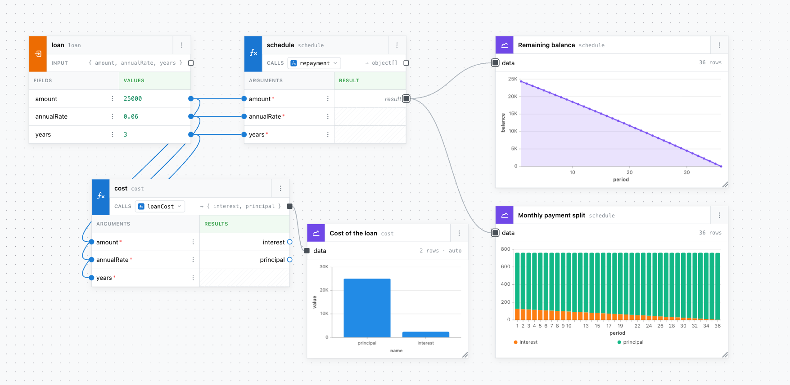
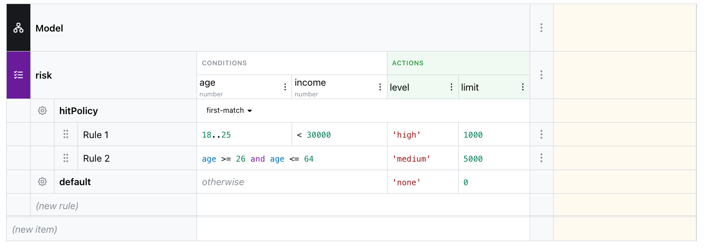

# EdgeRules Components

This repository defines reusable React components and hooks for building applications that integrate with the EdgeRules
decision engine. Rule evaluation itself is not implemented here — components delegate to the EdgeRules WASM decision
engine via [`@edgerules/web`](https://www.npmjs.com/package/@edgerules/web), published from the
[`edgerules`](../edgerules) repository. It includes:

- [x] EdgeRules Code Editor (syntax highlighting, engine diagnostics, Ctrl+Space completion, Ctrl+Click / F12
      go-to-definition, Shift-Alt-F formatting)
- [x] EdgeRules Code Editor Cell (the same language tooling in a compact cell control for the Boxed and Decision Table
      editors; commits on Enter/blur, cancels on Escape, analyzes the cell in the scope of its surrounding model via an
      embed context)
- [x] EdgeRules Boxed Editor ([spec and story](docs/boxed-editor-story.md); a single flat treegrid over every
      `BoxedRowKind` — fields, collections, `func`/`ruleset`/`optimise` — with inline editing, drag-and-drop,
      context-menu actions, and optional description/live-test-result overlay columns)
- [x] [EdgeRules Decision Table Editor](docs/decision-table-story.md) (DMN-style grid over a `ruleset`: decision tables,
      boolean-expression rules, and scorecards; statically highlighted display cells with a single CodeEditorCell on the
      active cell)
- [ ] EdgeRules Flow Editor (ReactFlow-based)
  - [x] FlowEditor canvas ([spec](docs/stories/completed/flow-editor-story.md#flow-editor-canvas)): node palette with
        drag or click to add, wires from the model, automatic layout, zoom, minimap. The host imports
        `@xyflow/react/dist/style.css`.
  - [x] InputNode / TermsNode ([spec](docs/stories/completed/flow-editor-story.md#flow-editor-inputnode))
  - [x] FunctionNode / RulesetNode ([spec and story](docs/stories/completed/flow-editor-story.md))
  - [x] OutputNode (shows the engine value of the wired result; no model writes)
  - [x] ChartNode ([spec](docs/stories/completed/flow-editor-story.md#flow-editor-chartnode)): a TanStack Charts line,
        area or bar chart of the wired list or record; configures itself from the data, Configure flips it to its config
        form, resizable from its bottom-right corner. Needs the `@tanstack/charts` peer.
- [x] [EdgeRules Tests Manager](docs/specs/tests-manager-spec.md) (Inputs/Assertions/Validations grid over a model or
      any fully typed `func`/`ruleset`/`optimise`/`loop`, backed by the engine-free `test-cases-service` package and the
      `TestRunner` execution service)
- [ ] EdgeRules Types Editor
- [EdgeRules Project Explorer](docs/stories/completed/project-explorer-story.md)
- [x] [EdgeRules Project Session](docs/project-session-story.md) (`edgerules-react/project-session`, no GUI): loads a
      project bundle — model DSL, documentation, tests and flow layout — into one `ProjectSession` that owns the engine
      and the slice stores, and saves it back as one revision. `LocalProjectRepository` keeps device-local projects in
      IndexedDB; `ProjectProvider` and `useProjectSlice` hand the session to a React subtree.
- [x] [EdgeRules Shell](docs/specs/shell-spec.md) (`edgerules-react/shell`): one part of the open project's model — the
      whole model, a context or a function — in the Code, Boxed or Flow view, with a breadcrumb of the root path and
      drill-down from the editors. Renders inside a `ProjectProvider`.

## Preview

**Flow Editor:** 

**Simple Decision Table:** 

## Opening a project in a story

Stories build their model through a project session, as a host application would. `openStoryProject` in
`stories/support/storyProject.ts` runs `ProjectFactory` → `LocalProjectRepository.create` → `ProjectSessionManager.open`
against the real `@edgerules/web` engine and returns the session. Every call creates a new project in the
`edgerules-storybook-projects` IndexedDB database, so a story always starts from its fixture:

```tsx
export const Default: Story = {
  loaders: [async () => ({session: await openStoryProject(MODEL_DSL)})],
  render: (_args, {loaded}) => <TestsManager service={loaded.session.engine} testCases={loaded.session.tests} />,
};
```

Pass a `ProjectBundleInput` instead of a DSL string to seed documentation, tests or a flow layout. Wrap the story in
`<ProjectProvider session={…}>` when it reads the session through `useProjectSession`, `useProjectSnapshot` or
`useProjectSlice`.

## Other Links

[EdgeRules Flow Editor GUI](/Users/rimvydasbingelis/Projects/EdgeRules/edgerules/doc/research/MODELER_GUI_RESEARCH.md)

## General Notes

- All components are built with React and TypeScript.
- All components can be rendered in isolation or integrated into a larger application.
- All components are tested with React Testing Library and Playwright.

## Technical Stack

- [`@edgerules/web`](https://www.npmjs.com/package/@edgerules/web) for browser-side rule parsing, execution and CRUD
  against the EdgeRules Portable Format; [`@edgerules/portable`](https://www.npmjs.com/package/@edgerules/portable) for
  the corresponding TypeScript types (`PortableNode`, `PortableError`, `PortableRootContext`).
- [Mantine](https://mantine.dev) (`@mantine/core`, `@mantine/hooks`) for dialogs, menus, tooltips, selects, alerts,
  buttons and the Project Explorer tree; [Tabler Icons](https://tabler.io/icons) (`@tabler/icons-react`) for icons. Grid
  rows and cells are plain elements styled with CSS Modules (see `docs/architecture-adr.md`).
- ReactFlow for flow-based visual programming.
- CodeMirror for code editing.
- TypeScript, React
- Vitest and React Testing Library for unit/component testing; Playwright for end-to-end and visual testing.
- tsdown for building the published npm package (dual ESM/CJS output with generated type declarations).
- Storybook for isolated component development and documentation.

## Project Structure

This repository is published to npm as a single package (`edgerules-react`). Each component is exposed as its own
subpath export (e.g. `edgerules-react/flow-editor`), so consumers only pull in the peer dependencies of the components
they actually import — a project that only uses the Code Editor never has to install `reactflow`.

```text
/
├── src/
│   ├── components/                # Reusable React components for EdgeRules
│   │   ├── boxed-editor/          # Boxed Expressions Editor
│   │   │   ├── index.ts           # Public exports for this component (its subpath entry point)
│   │   │   └── *.tsx              # Implementation, co-located unit tests (*.test.tsx)
│   │   ├── code-editor/           # Code Editor (CodeMirror) + shared EdgeRules language modules (language/)
│   │   ├── code-editor-cell/      # Compact cell editor sharing the code-editor language modules
│   │   ├── decision-table/        # Decision Table Editor
│   │   ├── documentation-service/ # Persistence for path-keyed free-text descriptions (no engine, no GUI) — see
│   │   │                          #   documentation-service-story.md; shared by boxed-editor, decision-table, etc.
│   │   ├── flow-editor/           # Flow Editor (ReactFlow-based)
│   │   ├── project-explorer/      # Project Explorer
│   │   ├── project-session/       # Project bundle, repositories, ProjectSession and its React provider (no GUI) —
│   │   │                          #   see project-session-story.md
│   │   ├── shell/                 # Shell: Code, Boxed and Flow views of one root path of the session model
│   │   ├── test-cases-service/    # Persistence for test cases/rows/results (no engine, no GUI) — see
│   │   │                          #   tests-manager-spec.md (docs/specs); used by tests-manager, designed for boxed-editor too
│   │   ├── tests-manager/         # Tests Manager grid + TestRunner (the execution service; see
│   │   │                          #   Clarification #13 in tests-manager-spec.md (docs/specs) for why the names differ)
│   │   └── types-editor/          # Types Editor
│   ├── hooks/                     # Custom React hooks for EdgeRules
│   ├── lib/                       # Core logic and utilities shared across components
│   └── index.ts                   # Root barrel re-exporting the full public API
├── stories/                        # Storybook stories, mirroring the src/components layout; support/ holds helpers
├── e2e/                            # Playwright end-to-end/visual tests
├── docs/                           # Design notes and feature specs (e.g. stories/completed/project-explorer-story.md)
├── dist/                           # Build output (ESM + CJS + .d.ts), git-ignored, published to npm
├── package.json
├── tsconfig.json
├── tsdown.config.ts                 # Library build config (multi-entry, one per component)
├── vitest.config.ts                # Unit test runner (+ React Testing Library)
├── playwright.config.ts
└── README.md                       # This file
```

Unit tests (React Testing Library) live next to the code they cover as `*.test.tsx`; Playwright specs live under `e2e/`
since they exercise built, running instances of the components rather than isolated units.

### Package & distribution conventions

- **Entry points**: `package.json` defines an `exports` map with one subpath per component
  (`edgerules-react/code-editor`, `edgerules-react/flow-editor`, ...) plus a root entry (`edgerules-react`) that
  re-exports everything for convenience.
- **Peer dependencies**: `react`, `react-dom`, `@mantine/core`, `@mantine/hooks` and other heavy, component-specific
  libraries (`reactflow`, `@tanstack/charts`, `@codemirror/state`/`@codemirror/view`/`@codemirror/lint`,
  `@tabler/icons-react`) are declared as `peerDependencies` (most marked optional via `peerDependenciesMeta`), never
  bundled, so consuming apps control their own versions and bundle size. Wrap the app in Mantine's `MantineProvider` and
  import `@mantine/core/styles.css` once; the library's own CSS Modules are injected at runtime, so no stylesheet of
  ours needs importing. Components take `className`/`style` (not `sx`) for host styling.
- **Build output**: `tsdown` builds dual ESM/CJS bundles with generated `.d.ts` files, one per component entry point,
  enabling tree-shaking. `sideEffects: false` is set in `package.json` (CSS files excluded) so bundlers can drop unused
  components entirely.
- **Published files**: only `dist/`, `README.md` and `LICENSE` are included via the `files` field — source, tests,
  stories and docs are not shipped to npm.
- **Engine dependency**: `@edgerules/web` (and its `@edgerules/portable` type dependency) is a regular `dependency`, not
  a peer — component behavior is tied to a specific engine API version, so it should not be left to the consuming app to
  resolve.
