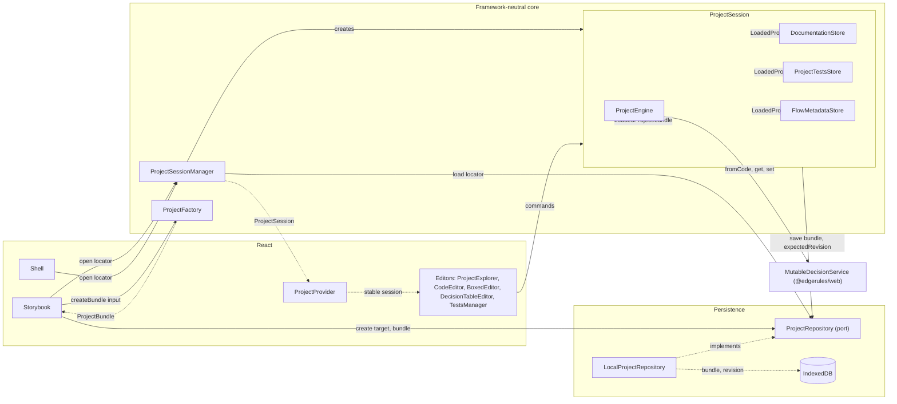
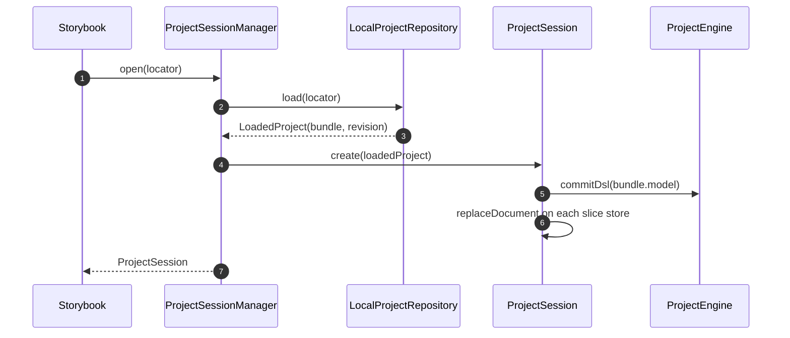
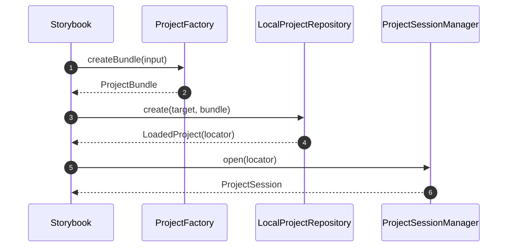
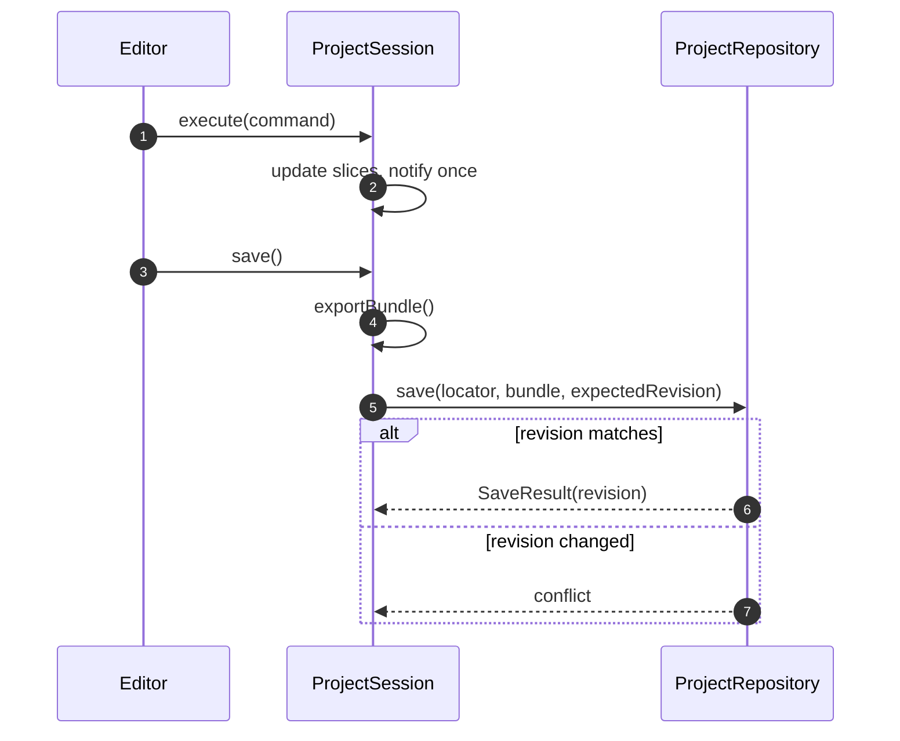

# EdgeRules Project Session

Today every component receives an engine `service` from the host, and the documentation and test services key their own
hidden IndexedDB stores by `modelName`. Nothing loads a project, holds the engine, or initialises the surrounding
services together. This story adds that layer, starting with a device-local IndexedDB project source.

It implements the first slices of `docs/architecture.md` ("Project state architecture") and
`docs/global-project-management.md` §5 and §15. It does not replace them; where this story is more specific, the
architecture documents are updated (see [Reconciliation](#reconciliation-with-the-architecture-docs)).

## Decisions

| #   | Decision                                                                                                          | Reason                                                                                            |
| --- | ----------------------------------------------------------------------------------------------------------------- | ------------------------------------------------------------------------------------------------- |
| 1   | `ProjectRepository` is bundle-level: `load`, `create`, `save(expectedRevision)`, plus `list` on the local one.    | Matches the architecture port; all authored slices save as one revision (architecture #6).        |
| 2   | Only `ProjectSession` talks to the repository. Documentation, tests and flow never read or write it directly.     | Prevents split-brain and keeps renames atomic across slices (architecture #7).                    |
| 3   | Slice stores are in-memory, session-owned, and expose `exportDocument` / `replaceDocument` / `subscribe`.         | A save moves every slice as one bundle; stores stay framework-neutral.                            |
| 4   | `ProjectSession` owns the `MutableDecisionService`, wrapped as `ProjectEngine`. Components get the facade only.   | One mutation and validation boundary; resolves Boxed/Flow facade cache coherence.                 |
| 5   | The core open API is `open(locator)`. Name lookup is `LocalProjectRepository.findByName(name)`.                   | `modelName` is not unique; project identity is the locator, the manifest `name` is display text.  |
| 6   | `ProjectFactory` turns DSL or Portable (plus optional slice data) into a `ProjectBundle`. It does not persist.    | Keeps conversion separate from storage; `repository.create` accepts only finished bundles.        |
| 7   | `LocalProjectRepository` is a device-local provider (`provider: 'indexeddb'`), canonical only for local projects. | Architecture #4 forbids IndexedDB as the canonical source for cloud projects, not for local ones. |
| 8   | One model per project (manifest `model.source`). `ProjectSession` exposes `activeModel` as a seam.                | Multi-model needs engine support and a format change; decide it separately.                       |
| 9   | The repository is injected into `ProjectSessionManager`. `LocalProjectRepository` is only the default.            | Keeps GitHub and S3 adapters pluggable without touching the session.                              |

## Component diagram

Data flow and ownership when a project is opened, edited and saved. Solid arrows are calls; dotted arrows carry data.



### Open sequence



### Create sequence



### Save sequence



## Contracts

```ts
interface ProjectLocator {
  provider: 'indexeddb' | 'github' | 's3'; // 'indexeddb' is added by this story
  resource: string; // indexeddb: database name
  projectPath: string; // indexeddb: project key
}

interface ProjectRepository {
  load(locator: ProjectLocator, revision?: string): Promise<LoadedProject>;
  create(target: ProjectLocator, bundle: ProjectBundle): Promise<LoadedProject>;
  save(locator: ProjectLocator, bundle: ProjectBundle, expectedRevision: string): Promise<SaveResult>;
}

interface LocalProjectRepository extends ProjectRepository {
  list(): Promise<ProjectDescriptor[]>;
  findByName(name: string): Promise<ProjectLocator | undefined>;
}

interface ProjectFactory {
  createBundle(input: {
    name: string;
    model: {dsl: string} | {portable: PortableRootContext};
    documentation?: DocumentationDocument;
    tests?: TestSuitesDocument;
    flow?: FlowMetadataDocument;
  }): ProjectBundle;
}

interface ProjectSessionManager {
  open(locator: ProjectLocator, revision?: string): Promise<ProjectSession>;
  get(projectId: string): ProjectSession | undefined;
  close(projectId: string): Promise<void>; // disposes the engine and subscriptions
}
```

`ProjectFactory.createBundle` is the part to design in detail during task 5: how a Portable-only input is turned into
the authored DSL comes from `MutableDecisionService.fromPortable(...)` followed by `getCode('*')`.

## Tasks

Work in this order; each task builds on the previous one and ships with tests against the real engine.

- [x] **1. Bundle schema and locator.** Define `ProjectBundle`, the manifest (`edgerules.project.json`, one
      `model.source`), `ProjectLocator` with `provider: 'indexeddb'`, and validators plus a `formatVersion` migration
      hook. Schema round-trip tests.
- [x] **2. `ProjectRepository` port and `LocalProjectRepository`.** Implement `load`, `create`, `save` with a revision
      counter and `expectedRevision` conflict detection, plus local-only `list()` and `findByName()`. Share a repository
      contract test suite so GitHub and S3 adapters can reuse it later.
- [x] **3. Session-backed slice stores.** Add `exportDocument` / `replaceDocument` / `renamePath` / `subscribe` to the
      documentation store, a `ProjectTestsStore` owning every subject and returning `TestCasesService` facades, and a
      `FlowMetadataStore`. The existing IndexedDB-backed factories stay for standalone use.
- [x] **4. `ProjectEngine` and `ProjectSession`.** Bump the `@edgerules/*` dependencies to `0.0.7-alpha.202610201841`.
      `ProjectEngine.exportDsl()` is `getCode('*')`. `ProjectSession` owns the `MutableDecisionService` wrapped as
      `ProjectEngine` (`commitDsl`, `get`/`set`/`remove`/`rename`, `toPortable`), the slice stores, typed commands,
      transactions with one notification, dirty state, `save()` and `dispose()`. Components receive the facade, never
      the raw service.
- [x] **5. `ProjectSessionManager`.** `open(locator)`, `get`, `close`. Repository injected; `LocalProjectRepository` is
      the default. Multi-project isolation tests.
- [x] **6. `ProjectFactory.createBundle`.** Accept EdgeRules DSL or Portable, plus optional documentation, test and flow
      slices. Persisting is the caller's job (`repository.create`). Design the optional-slice input in this task.
- [x] **7. `ProjectProvider` and `useProjectSlice`.** Stable session via context, slice subscriptions via
      `useSyncExternalStore`. Update `ProjectExplorer`, editors and `TestsManager` stories to build their session
      through `ProjectFactory` + `LocalProjectRepository` + `ProjectSessionManager`.
- [x] **8. Docs.** Update `architecture.md` per the reconciliation list; add the storybook helper to the README.

## Risks and open questions

- **DSL serialization:** resolved in engine `0.0.7-alpha.202610201841`. `getCode('*')` returns the whole model as DSL
  (verified: it reflects structured `set` / `rename` / `setCode` edits and round-trips through `fromCode`). The
  `@edgerules/*` dependencies are on `0.0.7-alpha.202610201841`.
- **Comments are not preserved:** `getCode('*')` emits a single-line canonical form, so source comments are dropped on
  save. Treat this as an engine limitation: report it in `docs/engine-bug-reports.md` and keep long-form documentation
  in the documentation sidecar.
- **Multiple models per project:** out of scope; `activeModel` is the only seam (decision 8).
- **Invalid DSL drafts:** the `ProjectDraftStore` for crash recovery (architecture phase 6) is not part of this story.
  Task 4 keeps the draft in memory only.

## Implementation notes

Decisions made while implementing, where the contracts above left room. Code: `src/components/project-session`,
published as `edgerules-react/project-session`.

- **Engine injection.** `ProjectSessionManager` and `ProjectFactory` take the engine class (`ProjectEngineClass`):
  `MutableDecisionService` from `@edgerules/web/mutable` after `await init()`, or from `@edgerules/node/mutable` in
  tests. There is no default, because the web build needs an async `init()` and the factory is synchronous.
- **`ProjectEngine`** has the `MutableDecisionService` surface the editors use, so every component takes it as its
  `service` without a cast. Every `set` / `setCode` / `remove` / `rename` through it marks the model slice dirty, even
  when the engine returns an error, since a failed write may still have changed the model. `commitDsl` swaps the
  instance behind the facade; solvers registered through the facade are carried over.
- **Draft and commit live on the session**, not the engine: `getDslDraft` / `setDslDraft` and the `commitDsl` command.
  An invalid commit keeps the draft and blocks `exportBundle` and `save`.
- **Commands** are a typed union (`commitDsl`, `renamePath`) plus `transaction(work)`. A transaction defers every store
  and session notification to its end and restores the engine and all slices when `work` throws. `renamePath` links the
  model afterwards and rolls back when that fails, because the engine migrates references only for callables
  (`docs/engine-bug-reports.md`, Clarified behaviour).
- **Dirty state counts real changes only.** A no-op write (the same description, the same layout, a `syncRows` that
  derives the rows already stored) does not mark a slice dirty. Test results are never exported; they stay in the
  subject facade until `TestRunCache` exists.
- **`createTestCasesCore`** holds the in-memory logic of one subject's tests. The IndexedDB `createTestCasesService` and
  the session's `ProjectTestsStore` both build on it.
- **`TestsManager`** takes either `modelName` (IndexedDB, as before) or `testCases` (a `TestCasesSource`, for example
  `session.tests`), never both.
- **`LocalProjectRepository`** keeps only the head revision, as a counter (`'1'`, `'2'`, …). The compare-and-swap of
  `save` runs in one IndexedDB transaction. The manifest `projectId` is unique per database and cannot change on save.
- **Opening a stored model that does not parse or link fails** with `invalid-model`. A recovery view is part of the
  `ProjectDraftStore` work.
- **Stories.** `stories/support/storyProject.ts` (`openStoryProject`) opens every converted story's project. The
  ProjectExplorer, CodeEditor (new `ProjectSessionDraft` story), DecisionTableEditor, BoxedEditor, FlowEditor and
  TestsManager stories use it. The single-node Flow stories (FunctionNode, InputNode, OutputNode, ChartNode) and the
  CodeEditorCell stories still build standalone services.

## Reconciliation with the architecture docs

- `architecture.md` decision #4 and the line stating IndexedDB alone suits only a device-local product: add that a
  `provider: 'indexeddb'` locator is the canonical source for explicitly local projects.
- `architecture.md` `ProjectLocator`: add `'indexeddb'` to `ProviderKind`.
- `architecture.md` `ProjectRepository`: no change; `list`/`findByName` are local-only extensions.
- `architecture.md` "Required service evolution": cite this story for the order of the slice-store work.
