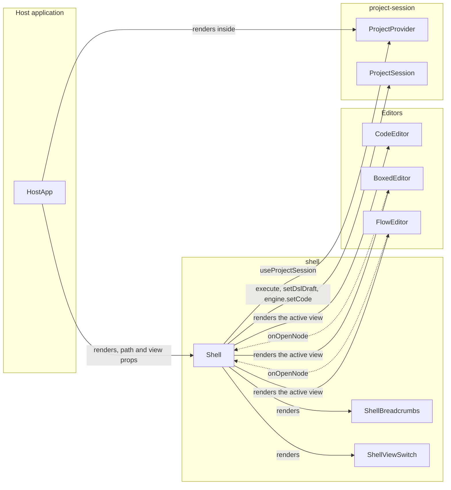
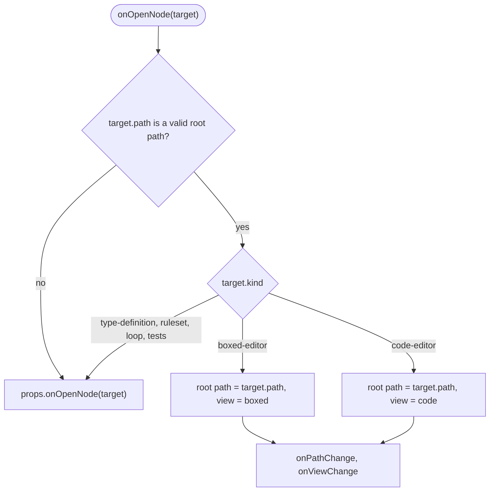

# Shell Specification

## Summary

`Shell` shows one part of the model of the open `ProjectSession`. The part starts at the root path: the whole model
(`'*'`), a qualified context path, or a qualified function path.

`Shell` wraps three editors and shows one of them at a time. Each editor renders a different part of the model, as
[model-decomposition.md](../model-decomposition.md) defines.

| View  | Editor        | Renders from the root path                                                                 |
| ----- | ------------- | ------------------------------------------------------------------------------------------ |
| Code  | `CodeEditor`  | The DSL code of the root path, `engine.getCode(path)`. All fields and all annotations.     |
| Boxed | `BoxedEditor` | The boxed expression rows of the root path. It hides `@ChartNode` and `@OutputNode` nodes. |
| Flow  | `FlowEditor`  | The Flow Component nodes that are direct fields of the root path context.                  |

`Shell` is a library component at `src/components/shell`, with the npm subpath export `edgerules-react/shell`.

## Structure

### Shell layout

The header is one row of the Boxed Editor ruled sheet: 40px tall, 1px border lines, the muted header fill. It has the
icon of the root path kind and the breadcrumb navigation on the left, and the view switch on the right. The active
editor fills the body.

```text
┌──────────────────────────────────────────────────────────────────────────┐
│ ƒx │ Model › applicant › calculateAge(...)    │  Code  │ Boxed  │  Flow  │
├──────────────────────────────────────────────────────────────────────────┤
│                                                                          │
│                         active editor (one at a time)                    │
│                                                                          │
├──────────────────────────────────────────────────────────────────────────┤
│ status line: commit error of the Code view (only when there is an error) │
└──────────────────────────────────────────────────────────────────────────┘
```

| Element            | Implementation                                   | Behavior                                                                     |
| ------------------ | ------------------------------------------------ | ---------------------------------------------------------------------------- |
| `ShellBreadcrumbs` | Kind icon square, then one `button` per item     | The first item is `Model` and opens `'*'`. The last item is text.            |
| `ShellViewSwitch`  | `radiogroup` of three 3-step header cells        | Changes the active view. The root path does not change.                      |
| Editor body        | One of `CodeEditor`, `BoxedEditor`, `FlowEditor` | Only the active editor is mounted.                                           |
| `ShellStatus`      | Mantine `Alert`                                  | Shows the last commit error of the Code view. It is hidden without an error. |

### Component dependencies

`Shell` reads the session from `ProjectProvider` and creates the editor services from the session facades.



`Shell` adds this row to the dependency-cruiser allowlist in [architecture.md](../architecture.md):

| Component | Allowed component dependencies                                                                                 |
| --------- | -------------------------------------------------------------------------------------------------------------- |
| `shell`   | `code-editor`, `boxed-editor`, `flow-editor`, `project-session`, `documentation-service`, `test-cases-service` |

### Files

```text
src/components/shell/
├── index.ts                  # npm public API: Shell, ShellProps, ShellView
├── Shell.tsx                 # layout, path and view state, onOpenNode routing
├── ShellBreadcrumbs.tsx
├── ShellViewSwitch.tsx
├── views/                    # CodeView, BoxedView, FlowView: one adapter per editor
├── shell-path.ts             # path segments, path validation, nearest existing path
├── shell.module.css
└── __tests__/                # RTL tests with the real @edgerules/node engine
stories/components/shell/     # Storybook story with the sample model
```

## Public API

```typescript
type ShellView = 'code' | 'boxed' | 'flow';

interface ShellProps {
  languageService: CodeEditorService; // diagnostics and completions; the engine class statics fit
  path?: string; // controlled root path: '*', a context path or a function path
  defaultPath?: string; // uncontrolled initial root path; defaults to '*'
  onPathChange?: (path: string) => void; // breadcrumb click, drill-down, or fallback to an existing path
  view?: ShellView; // controlled active view
  defaultView?: ShellView; // uncontrolled initial view; defaults to 'boxed'
  onViewChange?: (view: ShellView) => void; // view switch, or "View as code" of an editor
  readOnly?: boolean; // passed to every editor
  onOpenNode?: (target: BoxedEditorOpenTarget | FlowEditorOpenTarget) => void; // targets the Shell does not open
  className?: string;
  style?: CSSProperties;
}
```

- `Shell` MUST be rendered inside a `ProjectProvider`. It reads the session with `useProjectSession`.
- `Shell` creates `createBoxedEditorService(session.engine)` once per session.
- `Shell` creates `createFlowEditorService(session.engine, {root})` once per session and root path.
- `Shell` passes `session.documentation` to `BoxedEditor` and `FlowEditor`.
- `Shell` passes `session.tests.forSubject('*')` as the `testCasesService` of `BoxedEditor`.
- `Shell` passes `useProjectSlice('model').version` as the `revision` of `BoxedEditor`.
- `Shell` passes `session.flow.getLayout(root)` as `defaultLayout` of `FlowEditor`.
- `Shell` passes `(layout) => session.flow.setLayout(root, layout)` as `onLayoutChange` of `FlowEditor`.

## Behavior

### The root path addresses what the Project Explorer shows

A valid root path is `'*'`, a context path, or a function path. These are the entries that `ProjectExplorer` opens with
`onOpenVariables` and `onOpenFunction`.

| Path segment                  | Valid in a root path | Example                  |
| ----------------------------- | -------------------- | ------------------------ |
| Context field                 | Yes, at any position | `applicant`              |
| Function (`func`)             | Yes, last only       | `applicant.calculateAge` |
| Index                         | No                   | `loans[0]`               |
| Field inside a function body  | No                   | `calculateAge.result`    |
| Plain value, ruleset, or type | No                   | `limit`                  |

- `Shell` MUST NOT support indexed paths. A path that contains `[` is not a valid root path.
- A function is an atomic entity. A root path MUST NOT go below a function.
- `Shell` opens the nearest valid ancestor for an invalid root path, and then calls `onPathChange`.

### The breadcrumb shows the fully qualified root path

The breadcrumb has one item for the model and one item for each path segment.

| Root path                | Breadcrumb items                            |
| ------------------------ | ------------------------------------------- |
| `'*'`                    | `Model`                                     |
| `applicant`              | `Model` › `applicant`                       |
| `applicant.address`      | `Model` › `applicant` › `address`           |
| `applicant.calculateAge` | `Model` › `applicant` › `calculateAge(...)` |

- A context segment shows the field name.
- A function segment shows the function name and `(...)`. It is always the last item.
- A click on an item sets the root path to the path of that item.
- The kind icon shows the kind of the root path, in the colors of the Boxed Editor rows: the model (`IconSitemap` on
  dark), a function (`IconMathFunction` on blue), a context (muted `IconBraces`).
- A segment with a `@node-name` annotation shows the field name. The breadcrumb shows model paths, not node titles.

### Navigation changes the root path or the view

The editors report navigation intent through `onOpenNode`. `Shell` handles the targets it can show and forwards the
other targets to the host.



- In uncontrolled mode, `Shell` changes its state and then calls `onPathChange` and `onViewChange`.
- In controlled mode, `Shell` calls `onPathChange` and `onViewChange` only. The host sets the new props.
- `Shell` calls `onPathChange` or `onViewChange` only for a value that is different from the current value.

### The Code view commits the code of the root path

The Code view edits the DSL code of the root path. The commit target depends on the root path.

| Root path                | Value of `CodeEditor`            | Edit                  | Commit                                 |
| ------------------------ | -------------------------------- | --------------------- | -------------------------------------- |
| `'*'`                    | `session.getDslDraft()`          | `session.setDslDraft` | `session.execute({type: 'commitDsl'})` |
| Context or function path | `engine.getCode(path)`, or draft | Shell draft state     | `session.engine.setCode(path, code)`   |


- `engine.setCode(path, code)` accepts the unchanged output of `engine.getCode(path)` for every entity path and for
  `'*'`.
- `engine.setCode` refuses function code with a different function name. A rename uses the `renamePath` command.
- `Shell` keeps an invalid draft of a context or function path in memory, by path. The Code view shows that draft again
  on return.
- `ProjectSession` keeps an invalid draft of `'*'` (`hasDslDraft`).
- The Boxed view and the Flow view show the last committed model while a draft is invalid.

### The Flow view shows the direct nodes of the root path

The Flow view reads the direct fields of the root path context. It shows each direct field with a Flow Component
annotation as a node.

- `createFlowEditorService(engine, {root})` does not descend into a child context. A nested Flow Component appears only
  when its parent context is the root path.
- The root path of a function path is the function body context.
- Node ids stay fully qualified field paths, for example `applicant.score`.
- A new node, for example from the palette, is a direct field of the root path context.
- Each root path has its own `FlowLayout`: node positions, output nodes and chart nodes.
- `FlowMetadataDocument` holds one `FlowLayout` for each root path, keyed by the root path.
- The `renamePath` command moves the layout keys and the node position keys with the renamed path.

### The root path follows model changes

A rename or a remove can delete the root path from the model. After each model change, `Shell` checks the root path with
`engine.get(path)`.

- If the path does not exist, `Shell` opens the nearest ancestor path that exists, and then calls `onPathChange`.
- `'*'` always exists.

### The view switch keeps the root path

A view switch unmounts the active editor and mounts the new editor at the same root path. The new editor reads the
current model on mount, so it shows the changes of the other views.

## Data Model

| Model or type           | Purpose                                         | Defined in                                                                   |
| ----------------------- | ----------------------------------------------- | ---------------------------------------------------------------------------- |
| `ProjectSession`        | The model authority and its slice stores        | [session/types.ts](../../src/components/project-session/session/types.ts)    |
| `ProjectEngine`         | `getCode`, `setCode`, `get` of the root path    | [engine/types.ts](../../src/components/project-session/engine/types.ts)      |
| `FlowMetadataDocument`  | One `FlowLayout` for each root path             | [bundle/types.ts](../../src/components/project-session/bundle/types.ts)      |
| `FlowMetadataStore`     | `getLayout(root)` and `setLayout(root, layout)` | [stores/types.ts](../../src/components/project-session/stores/types.ts)      |
| `FlowLayout`            | Node positions, output nodes and chart nodes    | [flowLayout.ts](../../src/lib/flowLayout.ts)                                 |
| `BoxedEditorOpenTarget` | Drill-down target of the Boxed view             | [BoxedEditorProps.ts](../../src/components/boxed-editor/BoxedEditorProps.ts) |
| `FlowEditorOpenTarget`  | Drill-down target of the Flow view              | [core-node/types.ts](../../src/components/flow-editor/core-node/types.ts)    |

## Implementation Tasks

- [x] Add the `root` option to `createFlowEditorService`. `listNodes` reads the direct fields of the root only.
- [x] Make `createDraftNode`, `createInputNode` and `listInputCandidates` use the `root` option.
- [x] Key `FlowMetadataDocument` layouts by root path. Add the `root` argument to `getLayout` and `setLayout`.
- [x] Make `FlowMetadataStore.renamePath` move the layout keys and the node position keys.
- [x] Create `src/components/shell` with `Shell`, `ShellBreadcrumbs`, `ShellViewSwitch` and the three view adapters.
- [x] Implement root path validation: no index, nothing below a function, nearest valid ancestor.
- [x] Implement the Code view commit with the idle timer and the per-path draft.
- [x] Implement the `onOpenNode` routing and the fallback to the nearest existing path.
- [x] Add the `shell` subpath export to `package.json` and `tsdown.config.ts`.
- [x] Add the `shell` allowlist to `.dependency-cruiser.cjs` and to [architecture.md](../architecture.md).
- [x] Add RTL tests with the real `@edgerules/node` engine. Cover the breadcrumb, view switch, drill-down and Code view
      commit.
- [x] Add RTL tests for the invalid draft, the invalid root path, the path fallback and the per-root Flow layout.
- [x] Add a Storybook story with the sample model of [model-decomposition.md](../model-decomposition.md).

## Limitations

- `Shell` shows one session. Project selection, tabs and session lifetime belong to the host application.

## Clarifications

- [architecture.md](../architecture.md) names the host workspace `Shell`, which owns the active session ID and tabs.
  This `Shell` is the model view inside one `ProjectProvider`. The host workspace renders it.
- The host connects `ProjectExplorer` `onOpenVariables` and `onOpenFunction` to the `path` of `Shell`.
- Each function in EdgeRules is isolated. The Boxed view and the Flow view show a function body as a root context.
- The Code view shows annotations, because annotations are part of the DSL code.
- The engine tests `get-set-code-roundtrip.test.ts` and `set-code.test.ts` in `edgerules/tests/wasm/` verify the
  `getCode` to `setCode` round trip.
