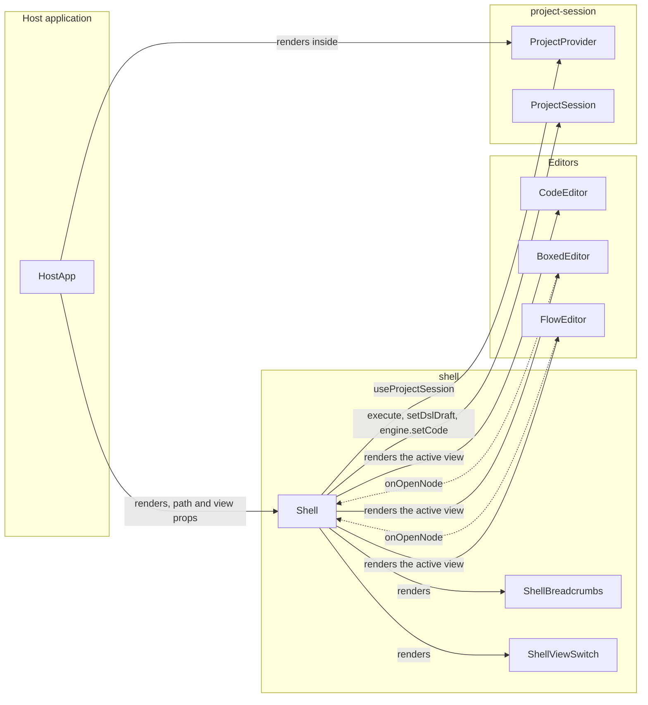
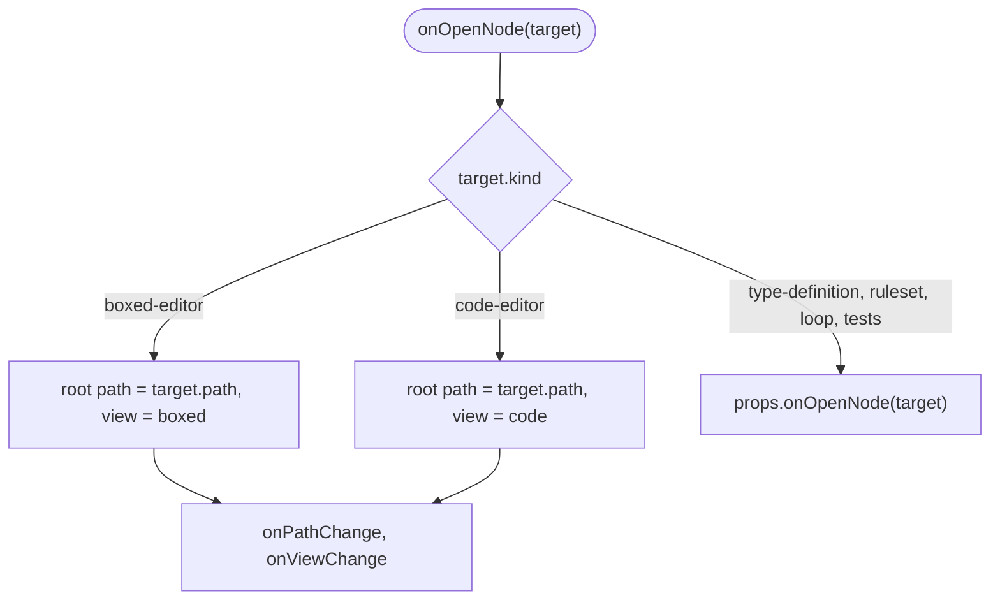
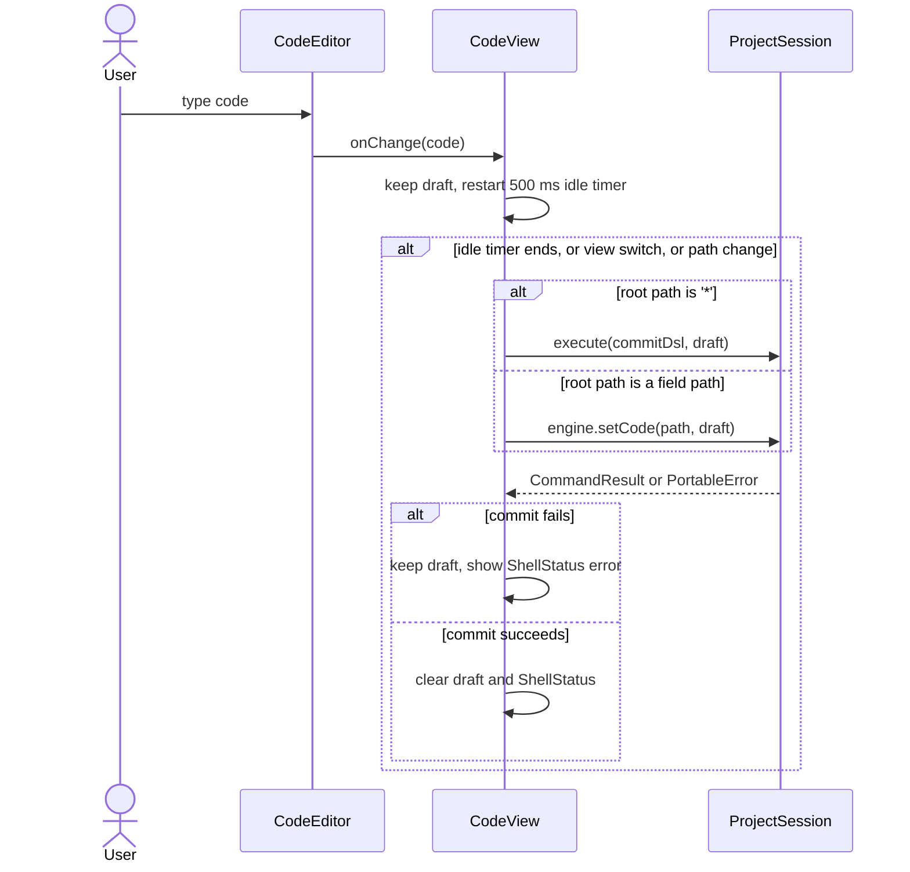

# Shell Specification

## Summary

`Shell` shows one part of the model of the open `ProjectSession`. The part starts at the root path: the whole model
(`'*'`) or a fully qualified context path, for example `applicant.address`.

`Shell` wraps three editors and shows one of them at a time. Each editor renders a different part of the model, as
[model-decomposition.md](../model-decomposition.md) defines.

| View  | Editor        | Renders from the root path                                                                 |
| ----- | ------------- | ------------------------------------------------------------------------------------------ |
| Code  | `CodeEditor`  | The DSL code of the root path, `engine.getCode(path)`. All fields and all annotations.     |
| Boxed | `BoxedEditor` | The boxed expression rows of the root path. It hides `@ChartNode` and `@OutputNode` nodes. |
| Flow  | `FlowEditor`  | The Flow Component nodes under the root path only.                                         |

`Shell` is a library component at `src/components/shell`, with the npm subpath export `edgerules-react/shell`.

## Structure

### Shell layout

The header has the breadcrumb navigation on the left and the view switch on the right. The active editor fills the body.

```text
┌──────────────────────────────────────────────────────────────────────────┐
│ credit-model › applicant › address                 [ Code | Boxed | Flow ] │
├──────────────────────────────────────────────────────────────────────────┤
│                                                                          │
│                         active editor (one at a time)                    │
│                                                                          │
├──────────────────────────────────────────────────────────────────────────┤
│ status line: commit error of the Code view (only when there is an error) │
└──────────────────────────────────────────────────────────────────────────┘
```

| Element            | Implementation                                          | Behavior                                                                     |
| ------------------ | ------------------------------------------------------- | ---------------------------------------------------------------------------- |
| `ShellBreadcrumbs` | Mantine `Breadcrumbs` with one `Anchor` per item        | The first item is the project name and opens `'*'`. The last item is text.   |
| `ShellViewSwitch`  | Mantine `SegmentedControl` with `Code`, `Boxed`, `Flow` | Changes the active view. The root path does not change.                      |
| Editor body        | One of `CodeEditor`, `BoxedEditor`, `FlowEditor`        | Only the active editor is mounted.                                           |
| `ShellStatus`      | Mantine `Alert`                                         | Shows the last commit error of the Code view. It is hidden without an error. |

### Component dependencies

`Shell` reads the session from `ProjectProvider` and creates the editor services from the session facades.



`Shell` adds this row to the dependency-cruiser allowlist in [architecture.md](../architecture.md):

| Component | Allowed component dependencies                                                                                 |
| --------- | -------------------------------------------------------------------------------------------------------------- |
| `shell`   | `code-editor`, `boxed-editor`, `flow-editor`, `project-session`, `documentation-service`, `test-cases-service` |

### Files

```text
src/components/shell/
├── index.ts                  # npm public API: Shell, ShellProps, ShellView
├── Shell.tsx                 # layout, path and view state, onOpenNode routing
├── ShellBreadcrumbs.tsx
├── ShellViewSwitch.tsx
├── views/                    # CodeView, BoxedView, FlowView: one adapter per editor
├── shell-path.ts             # path segments, parent path, nearest existing path
├── shell.module.css
└── __tests__/                # RTL tests with the real @edgerules/node engine
stories/components/shell/     # Storybook story with the sample model
```

## Public API

```typescript
type ShellView = 'code' | 'boxed' | 'flow';

interface ShellProps {
  languageService: CodeEditorService; // diagnostics and completions; the engine class statics fit
  path?: string; // controlled root path; '*' is the whole model
  defaultPath?: string; // uncontrolled initial root path; defaults to '*'
  onPathChange?: (path: string) => void; // breadcrumb click, drill-down, or fallback to an existing path
  view?: ShellView; // controlled active view
  defaultView?: ShellView; // uncontrolled initial view; defaults to 'boxed'
  onViewChange?: (view: ShellView) => void; // view switch, or "View as code" of an editor
  readOnly?: boolean; // passed to every editor
  onOpenNode?: (target: BoxedEditorOpenTarget | FlowEditorOpenTarget) => void; // targets the Shell does not open
  className?: string;
  style?: CSSProperties;
}
```

- `Shell` MUST be rendered inside a `ProjectProvider`. It reads the session with `useProjectSession`.
- `Shell` creates `createBoxedEditorService(session.engine)` and `createFlowEditorService(session.engine, {root})` once
  per session and root path.
- `Shell` passes `session.documentation` to `BoxedEditor` and `FlowEditor`.
- `Shell` passes `session.tests.forSubject('*')` as the `testCasesService` of `BoxedEditor`.
- `Shell` passes `useProjectSlice('model').version` as the `revision` of `BoxedEditor`.
- `Shell` passes `session.flow.getLayout()` as `defaultLayout` and `session.flow.setLayout` as `onLayoutChange` of
  `FlowEditor`.

## Behavior

### The breadcrumb shows the fully qualified root path

The breadcrumb has one item for the model and one item for each path segment.

| Root path           | Breadcrumb items                         |
| ------------------- | ---------------------------------------- |
| `'*'`               | `credit-model`                           |
| `applicant`         | `credit-model` › `applicant`             |
| `applicant.address` | `credit-model` › `applicant` › `address` |

- The model item shows `ProjectSessionSnapshot.name`.
- A click on an item sets the root path to the path of that item.
- A segment with a `@node-name` annotation shows the field name. The breadcrumb shows model paths, not node titles.

### Navigation changes the root path or the view

The editors report navigation intent through `onOpenNode`. `Shell` handles the targets it can show and forwards the
other targets to the host.



- In uncontrolled mode, `Shell` changes its state and then calls `onPathChange` and `onViewChange`.
- In controlled mode, `Shell` calls `onPathChange` and `onViewChange` only. The host sets the new props.
- `Shell` calls `onPathChange` or `onViewChange` only for a value that is different from the current value.

### The Code view commits the code of the root path

The Code view edits the DSL code of the root path. The commit target depends on the root path.

| Root path | Value of `CodeEditor`            | Edit                  | Commit                                 |
| --------- | -------------------------------- | --------------------- | -------------------------------------- |
| `'*'`     | `session.getDslDraft()`          | `session.setDslDraft` | `session.execute({type: 'commitDsl'})` |
| Other     | `engine.getCode(path)`, or draft | Shell draft state     | `session.engine.setCode(path, code)`   |



- `Shell` keeps an invalid draft of a field path in memory, by path. The Code view shows that draft again on return.
- `ProjectSession` keeps an invalid draft of `'*'` (`hasDslDraft`).
- The Boxed view and the Flow view show the last committed model while a draft is invalid.

### The Flow view shows the nodes under the root path only

- `createFlowEditorService(engine, {root})` starts the Flow node discovery at the root path. It walks the model in field
  order, as [model-decomposition.md](../model-decomposition.md) defines.
- Node ids stay fully qualified field paths, for example `applicant.score`.
- A new node, for example from the palette, is a field of the root path context.
- `listCallees` lists the callables of the whole model. Code under the root path can call an outer callable.
- One `FlowLayout` in `FlowMetadataStore` holds the positions of all nodes, because node ids are fully qualified.

### The root path follows model changes

A rename or a remove can delete the root path from the model. After each model change, `Shell` checks the root path with
`engine.get(path)`.

- If the path does not exist, `Shell` opens the nearest ancestor path that exists, and then calls `onPathChange`.
- `'*'` always exists.

### The view switch keeps the root path

A view switch unmounts the active editor and mounts the new editor at the same root path. The new editor reads the
current model on mount, so it shows the changes of the other views.

## Data Model

| Model or type           | Purpose                                      | Defined in                                                                   |
| ----------------------- | -------------------------------------------- | ---------------------------------------------------------------------------- |
| `ProjectSession`        | The model authority and its slice stores     | [session/types.ts](../../src/components/project-session/session/types.ts)    |
| `ProjectEngine`         | `getCode`, `setCode`, `get` of the root path | [engine/types.ts](../../src/components/project-session/engine/types.ts)      |
| `BoxedEditorOpenTarget` | Drill-down target of the Boxed view          | [BoxedEditorProps.ts](../../src/components/boxed-editor/BoxedEditorProps.ts) |
| `FlowEditorOpenTarget`  | Drill-down target of the Flow view           | [core-node/types.ts](../../src/components/flow-editor/core-node/types.ts)    |
| `FlowLayout`            | Node positions, output nodes and chart nodes | [flowLayout.ts](../../src/lib/flowLayout.ts)                                 |

## Implementation Tasks

- [ ] Add the `root` option to `createFlowEditorService`. `listNodes`, `createDraftNode`, `createInputNode` and
      `listInputCandidates` use it.
- [ ] Create `src/components/shell` with `Shell`, `ShellBreadcrumbs`, `ShellViewSwitch` and the three view adapters.
- [ ] Implement the Code view commit with the idle timer and the per-path draft.
- [ ] Implement the `onOpenNode` routing and the fallback to the nearest existing path.
- [ ] Add the `shell` subpath export to `package.json` and `tsdown.config.ts`.
- [ ] Add the `shell` allowlist to `.dependency-cruiser.cjs` and to [architecture.md](../architecture.md).
- [ ] Add RTL tests with the real `@edgerules/node` engine. Cover the breadcrumb, view switch, drill-down, Code view
      commit, invalid draft and path fallback.
- [ ] Add a Storybook story with the sample model of [model-decomposition.md](../model-decomposition.md).

## Limitations

- The root path addresses a context: `'*'`, a context field, or the body of a function that `BoxedEditor` opens.
- `Shell` shows one session. Project selection, tabs and session lifetime belong to the host application.

## Clarifications

- [architecture.md](../architecture.md) names the host workspace `Shell`, which owns the active session ID and tabs.
  This `Shell` is the model view inside one `ProjectProvider`. The host workspace renders it.
- The Code view shows annotations, because annotations are part of the DSL code.

## Open Questions

1. Does `engine.getCode(path)` return code that `engine.setCode(path, code)` accepts without change, for every context
   path? Verify with `../edgerules-v2/tests/wasm/` before the Code view implementation.
2. Does the breadcrumb need indexed paths such as `loans[0]`, or only dotted field paths?
3. Does each root path have its own output and chart nodes? `FlowLayout` holds one list of each for the whole model.
4. Does a function body root path show its parameters in the breadcrumb, for example `riskScore(income)`?
