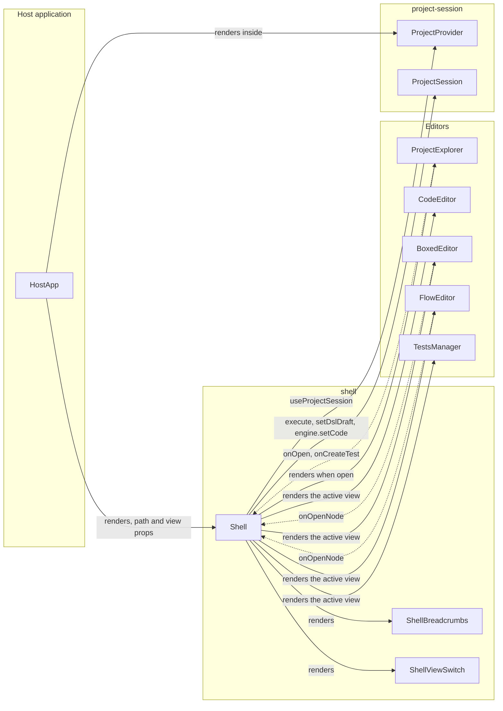
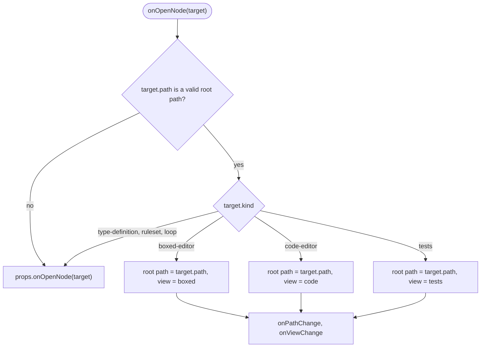

# Shell Specification

## Summary

`Shell` shows one part of the model of the open `ProjectSession`. The part starts at the root path: the whole model
(`'*'`) or the qualified path of an entity.

`Shell` wraps four editors and shows one of them at a time. Each editor renders a different part of the model, as
[model-decomposition.md](../model-decomposition.md) defines.

| View  | Editor         | Renders from the root path                                                                 |
| ----- | -------------- | ------------------------------------------------------------------------------------------ |
| Code  | `CodeEditor`   | The DSL code of the root path, `engine.getCode(path)`. All fields and all annotations.     |
| Boxed | `BoxedEditor`  | The boxed expression rows of the root path. It hides `@ChartNode` and `@OutputNode` nodes. |
| Flow  | `FlowEditor`   | The Flow Component nodes that are direct fields of the root path context.                  |
| Tests | `TestsManager` | The tests of the root path: `'*'`, a fully typed function or a ruleset.                    |

`ROOT_VIEWS` in [shell-path.ts](../../src/components/shell/shell-path.ts) gives the views of each root path kind.

`Shell` is a library component at `src/components/shell`, with the npm subpath export `edgerules-react/shell`.

## Structure

### Shell layout

The header is one row of the Boxed Editor ruled sheet: 40px tall, 1px border lines, the muted header fill. The kind icon
and the breadcrumb are on the left. The settings button, the view switch and the split screen toggle are on the right.

The active editor fills the body.

The `ProjectExplorer` side panel is optional. It is 256px wide, below the header row on the left of the active editor.

```text
┌──────────────────────────────────────────────────────────────────────────────┐
│ ƒx │ Loan desk › loanBook        │ ⚙ │ Code │ Boxed │ Flow │ Tests │ ◫        │
├──────────────────┬───────────────────────────────────────────────────────────┤
│ Project       [«]│                                                           │
│ ▸ TYPES       1  │               active editor (one at a time)               │
│ ▾ METHODS     2  │                                                           │
│   ƒx riskScore() │                                                           │
│ ▸ VARIABLES   1  ├───────────────────────────────────────────────────────────┤
│ ▸ WORKBOOKS   0  │ status line: commit error of the Code view (on error)     │
└──────────────────┴───────────────────────────────────────────────────────────┘
```

| Element            | Implementation                                                      | Behavior                                                                     |
| ------------------ | ------------------------------------------------------------------- | ---------------------------------------------------------------------------- |
| `ShellBreadcrumbs` | Kind icon square, then one `button` per item                        | The first item is the model name and opens `'*'`. The last item is text.     |
| Kind icon square   | Toggle `button` with `aria-pressed`                                 | Shows and hides the `ProjectExplorer` side panel.                            |
| `ProjectExplorer`  | Side panel below the header, left of the body                       | Mounted only while open. Its close button hides it.                          |
| `ShellSettings`    | Header cell `button` left of the view switch, and a Mantine `Modal` | Only for `'*'` and an annotated entity, and not when `readOnly`.             |
| `ShellViewSwitch`  | `radiogroup` of four 3-step header cells                            | Changes the active view. The root path does not change.                      |
| `ShellSplitToggle` | Toggle `button` with `aria-pressed`, one step right of Tests        | Off by default. Enabled only in the Flow view. Splits the Flow view.         |
| Editor body        | One of `CodeEditor`, `BoxedEditor`, `FlowEditor`, `TestsManager`    | Only the active editor is mounted.                                           |
| `ShellStatus`      | Mantine `Alert`                                                     | Shows the last commit error of the Code view. It is hidden without an error. |

### Flow view split screen

With the split screen on, the Flow view shows the selected node in a panel right of the canvas. The panel follows the
selection (`FlowEditor` `onSelectionChange`). A click on the empty canvas clears the selection and closes the panel. The
Flow view passes the model version as the `FlowEditor` `revision`: a change in the panel updates the nodes, the wires
and the output values on the canvas.

| Selected node                      | Panel content                                                                                                           |
| ---------------------------------- | ----------------------------------------------------------------------------------------------------------------------- |
| Function node                      | `BoxedEditor` at the callee path: the body of the called function or ruleset. A draft without a callee shows its field. |
| Object or list input               | `BoxedEditor` at the field path of the node. Another node mounts another Boxed Editor.                                  |
| Output or chart node (sink)        | `SinkSheet`: the full value of the wired path, on the Boxed Editor ruled sheet.                                         |
| None, several nodes, or toggle off | No panel. The canvas keeps its full width.                                                                              |

### Component dependencies

`Shell` reads the session from `ProjectProvider` and creates the editor services from the session facades.



`Shell` adds this row to the dependency-cruiser allowlist in [architecture.md](../architecture.md):

| Component | Allowed component dependencies                                                                                                                      |
| --------- | --------------------------------------------------------------------------------------------------------------------------------------------------- |
| `shell`   | `code-editor`, `boxed-editor`, `flow-editor`, `project-explorer`, `project-session`, `documentation-service`, `test-cases-service`, `tests-manager` |

### Files

```text
src/components/shell/
├── index.ts                  # npm public API: Shell, ShellProps, ShellView
├── Shell.tsx                 # layout, path and view state, onOpenNode routing
├── ShellBreadcrumbs.tsx
├── ShellViewSwitch.tsx
├── ShellSettings.tsx         # the settings button and dialog of the root path
├── views/                    # CodeView, BoxedView, FlowView, TestsView: one adapter per editor
├── shell-path.ts             # path segments, path validation, nearest existing path
├── shell.module.css
└── __tests__/                # RTL tests with the real @edgerules/node engine
stories/components/shell/     # Storybook story with the sample model
```

## Public API

```typescript
type ShellView = 'code' | 'boxed' | 'flow' | 'tests';

interface ShellProps {
  languageService: CodeEditorService; // diagnostics and completions; the engine class statics fit
  path?: string; // controlled root path: '*' or the path of an entity; the test subject in the 'tests' view
  defaultPath?: string; // uncontrolled initial root path; defaults to '*'
  onPathChange?: (path: string) => void; // breadcrumb click, drill-down, or fallback to an existing path
  view?: ShellView; // controlled active view
  defaultView?: ShellView; // uncontrolled initial view; defaults to 'boxed'
  onViewChange?: (view: ShellView) => void; // view switch, or "View as code" of an editor
  readOnly?: boolean; // passed to every editor
  explorerOpen?: boolean; // controlled visibility of the Project Explorer side panel
  defaultExplorerOpen?: boolean; // uncontrolled initial visibility of the Project Explorer; defaults to false
  onExplorerOpenChange?: (open: boolean) => void; // the kind icon of the header, or the close button of the panel
  onOpenNode?: (target: BoxedEditorOpenTarget | FlowEditorOpenTarget) => void; // targets the Shell does not open
  className?: string;
  style?: CSSProperties;
}
```

- `Shell` MUST be rendered inside a `ProjectProvider`. It reads the session with `useProjectSession`.
- `Shell` creates `createBoxedEditorService(session.engine)` once per session.
- `Shell` creates `createFlowEditorService(session.engine, {root})` once per session and root path.
- `Shell` passes `session.documentation` to `BoxedEditor` and `FlowEditor`.
- `Shell` passes `session.tests.forSubject(root)` as the `testCasesService` of `BoxedEditor` for a test subject only.
- `Shell` passes `useProjectSlice('model').version` as the `revision` of `BoxedEditor` and `ProjectExplorer`.
- `Shell` passes `session.engine` as the `service` of `ProjectExplorer` and `TestsManager`.
- `Shell` passes the subject IDs of `useProjectSlice('tests').subjects` as `testSubjects` of `ProjectExplorer`.
- `Shell` passes `session.tests` as the `testCases` of `TestsManager`.
- `Shell` passes `session.flow.getLayout(root)` as `defaultLayout` of `FlowEditor`.
- `Shell` passes `(layout) => session.flow.setLayout(root, layout)` as `onLayoutChange` of `FlowEditor`.

## Behavior

### The root path addresses each entry of the Project Explorer

A valid root path is `'*'` or the path of an entity. `ProjectExplorer` opens each of its entries with `onOpen`.

| Path segment                 | Valid in a root path | Views                    | Example                      |
| ---------------------------- | -------------------- | ------------------------ | ---------------------------- |
| Model                        | Yes, as `'*'`        | Code, Boxed, Flow, Tests | `'*'`                        |
| Context field                | Yes, at any position | Code, Boxed, Flow        | `applicant`                  |
| Workbook (`@Workbook`)       | Yes, at any position | Code, Boxed, Flow        | `loanBook`                   |
| Function (`func`)            | Yes, last only       | Code, Boxed, Tests       | `applicant.calculateAge`     |
| Ruleset                      | Yes, last only       | Code, Boxed, Tests       | `band`                       |
| Type definition              | Yes, last only       | Code, Boxed              | `Customer`                   |
| Plain value or invocation    | Yes, last only       | Code, Boxed              | `limit`, `loanBook.decision` |
| Index                        | No                   | None                     | `loans[0]`                   |
| Field inside a function body | No                   | None                     | `calculateAge.result`        |

- `Shell` MUST NOT support indexed paths. A path that contains `[` is not a valid root path.
- A root path MUST NOT go below a function, or below any other entity that is not a context.
- `Shell` opens the nearest valid ancestor for an invalid root path, and then calls `onPathChange`.
- A function has no Flow view. Its body is a function, not a canvas of Flow Component nodes.
- A function is a test subject only if every argument has a type. The engine types a generic function at each call site.
- `ShellViewSwitch` disables the cell of each view that the root path does not have.
- A root path in a view that it does not have shows the Boxed view. `Shell` calls `onViewChange`.
- In the Tests view, a root path that is not a test subject falls back to `'*'`.

### The Tests cell opens, creates, or explains the tests of the root path

| Root path                               | A click on the Tests cell                                                             |
| --------------------------------------- | ------------------------------------------------------------------------------------- |
| Test subject with tests                 | Opens the Tests view.                                                                 |
| Test subject without tests              | Opens a menu with `Create Tests`. The item adds a test case and opens the Tests view. |
| Generic function                        | Opens a menu with a disabled `Create Tests` and names the untyped arguments.          |
| Context, workbook, type, or plain value | None. The cell is disabled.                                                           |

- `readOnly` disables the Tests cell of a test subject without tests.
- The Boxed view shows the test column toggle only for a test subject.
- The `Add to Tests` menu of `ProjectExplorer` disables each generic function and shows its untyped arguments.
- The Boxed view of a plain value shows the own row of the field.

### The breadcrumb shows the fully qualified root path

The breadcrumb has one item for the model and one item for each path segment.

The first item is the model name (`@model-name` of the model root), or `Model` when the model has no name.

| Root path                | Breadcrumb items                            |
| ------------------------ | ------------------------------------------- |
| `'*'`                    | `Model`                                     |
| `applicant`              | `Model` › `applicant`                       |
| `applicant.address`      | `Model` › `applicant` › `address`           |
| `applicant.calculateAge` | `Model` › `applicant` › `calculateAge(...)` |

- A context segment shows the field name.
- A function or a ruleset segment shows its name and `(...)`. It is always the last item.
- A click on an item sets the root path to the path of that item.
- In the Tests view, a click on an item also sets the view to Boxed.
- The kind icon shows the root path kind in the colors of the Boxed Editor rows:

| Root path kind  | Icon               | Fill   |
| --------------- | ------------------ | ------ |
| Model (`'*'`)   | `IconSitemap`      | Dark   |
| Workbook        | `IconBook2`        | Dark   |
| Function        | `IconMathFunction` | Blue   |
| Ruleset         | `IconListCheck`    | Purple |
| Type definition | `IconTag`          | Orange |
| Context         | `IconBraces`       | Muted  |
| Plain value     | `IconVariable`     | Muted  |
| Tests view      | `IconFlask`        | Green  |

- The kind icon is the toggle of the Project Explorer. While the panel is open, the icon has the primary-color underline
  of the active view cell.

### The Project Explorer opens each entry in the active view

`ProjectExplorer` reports an opened entry as `{kind, path}` through `onOpen`. `explorerRoute` in
[shell-routing.ts](../../src/components/shell/shell-routing.ts) selects the root path and the view.

| Active view   | Opened entry                                      | Root path     | View                       |
| ------------- | ------------------------------------------------- | ------------- | -------------------------- |
| Any           | A test                                            | Subject ID    | Tests                      |
| Code or Boxed | Any other entry                                   | Entry path    | Unchanged                  |
| Flow          | A context or a workbook                           | Entry path    | Flow                       |
| Flow          | A node of a workbook, for example `function-node` | Workbook path | Flow, the node is centered |
| Flow          | A function, a ruleset, a type or a plain value    | Entry path    | Boxed                      |
| Tests         | A workbook                                        | Entry path    | Flow                       |
| Tests         | Any other entry                                   | Entry path    | Boxed                      |

- `FlowEditor` selects and centers the node of each new `focusNode` request.
- `onCreateTest(subjectId)` calls `session.tests.forSubject(subjectId).addTestCase()`.
- `readOnly` hides the add buttons of the explorer.
- A model change re-reads the model in the explorer. The expanded sections stay expanded.
- A segment with a `@node-name` annotation shows the field name. The breadcrumb shows model paths, not node titles.

### The settings dialog edits the name and the description of the root path

The settings button (`IconSettings`) is in the header left of the view switch. It shows for the model (`'*'`) and for an
annotated entity: a field with an `@node` annotation, such as `@Workbook`, `@InputNode`, `@FunctionNode` or `@Service`.
It does not show for another entity or when `readOnly` is set. A click opens the dialog immediately.

| Root path        | Dialog title      | Name field                                  | Version field     | Description field           |
| ---------------- | ----------------- | ------------------------------------------- | ----------------- | --------------------------- |
| `'*'`            | `Model settings`  | The model name (`setModelMetadata`)         | The model version | `documentation` at `'*'`    |
| Annotated entity | `<Node> settings` | The `name` of the annotation (`@node-name`) | None              | `documentation` at the path |

- Save writes all fields in one `session.transaction`. A failed write changes nothing and shows the error in the dialog.
- An empty annotation name removes the name: `@Workbook(name: "Loan book")` becomes `@Workbook`. The field name does not
  change. Use the rename of the Project Explorer or the Boxed Editor to rename the field.
- An annotation name write uses `setWithLinkCheck` on the authored entity with the new `@node-name`.
- The model name and version are not part of the DSL: the engine has no syntax for them and drops `@model-name`. The
  project manifest keeps them as `model.name` and `model.version`. The session engine adds them to the model root as
  `@model-name` and `@model-version` in `get('*')` and `toPortable()`, so the Boxed Editor header and the Tests Manager
  show the model name.
- The Boxed Editor has no settings dialog. The Shell settings replace it.

### The Flow view of the model offers the workbooks

The Flow view of `'*'` shows one panel for each workbook of the model when the model has workbooks. A click on a panel
opens the Flow view of the workbook.

| Panel part  | Content                                                                    |
| ----------- | -------------------------------------------------------------------------- |
| Title       | The `name` of the `@Workbook` annotation, or the field name without a name |
| Subtitle    | The field name, when the annotation has a name                             |
| Description | The description of the workbook, three lines at most, or `No description`  |
| Footer      | The number of `@InputNode` and `@FunctionNode` fields, and `Open flow`     |

### Navigation changes the root path or the view

The editors report navigation intent through `onOpenNode`. `Shell` handles the targets it can show and forwards the
other targets to the host.



- In uncontrolled mode, `Shell` changes its state and then calls `onPathChange` and `onViewChange`.
- In controlled mode, `Shell` calls `onPathChange` and `onViewChange` only. The host sets the new props.
- `Shell` calls `onPathChange` or `onViewChange` only for a value that is different from the current value.

### The Code view commits the code of the root path

The Code view edits the DSL code of the root path. The commit target depends on the root path.

| Root path                | Value of `CodeEditor`            | Edit                  | Commit                                 |
| ------------------------ | -------------------------------- | --------------------- | -------------------------------------- |
| `'*'`                    | `session.getDslDraft()`          | `session.setDslDraft` | `session.execute({type: 'commitDsl'})` |
| Context or function path | `engine.getCode(path)`, or draft | Shell draft state     | `session.engine.setCode(path, code)`   |


- `engine.setCode(path, code)` accepts the unchanged output of `engine.getCode(path)` for every entity path and for
  `'*'`.
- `engine.setCode` refuses function code with a different function name. A rename uses the `renamePath` command.
- `Shell` keeps an invalid draft of a context or function path in memory, by path. The Code view shows that draft again
  on return.
- `ProjectSession` keeps an invalid draft of `'*'` (`hasDslDraft`).
- The Boxed view and the Flow view show the last committed model while a draft is invalid.

### The Flow view shows the direct nodes of the root path

The Flow view reads the direct fields of the root path context. It shows each direct field with a Flow Component
annotation as a node.

- `createFlowEditorService(engine, {root})` does not descend into a child context. A nested Flow Component appears only
  when its parent context is the root path.
- Node ids stay fully qualified field paths, for example `applicant.score`.
- A new node, for example from the palette, is a direct field of the root path context.
- Each root path has its own `FlowLayout`: node positions, output nodes and chart nodes.
- `FlowMetadataDocument` holds one `FlowLayout` for each root path, keyed by the root path.
- The `renamePath` command moves the layout keys and the node position keys with the renamed path.

### The root path follows model changes

A rename or a remove can delete the root path from the model. After each model change, `Shell` checks the root path with
`engine.get(path)`.

- If the path does not exist, `Shell` opens the nearest ancestor path that exists, and then calls `onPathChange`.
- `'*'` always exists.

### The view switch keeps the root path

A view switch unmounts the active editor and mounts the new editor at the same root path. The new editor reads the
current model on mount, so it shows the changes of the other views.

## Data Model

| Model or type           | Purpose                                         | Defined in                                                                   |
| ----------------------- | ----------------------------------------------- | ---------------------------------------------------------------------------- |
| `ProjectSession`        | The model authority and its slice stores        | [session/types.ts](../../src/components/project-session/session/types.ts)    |
| `ProjectEngine`         | `getCode`, `setCode`, `get` of the root path    | [engine/types.ts](../../src/components/project-session/engine/types.ts)      |
| `FlowMetadataDocument`  | One `FlowLayout` for each root path             | [bundle/types.ts](../../src/components/project-session/bundle/types.ts)      |
| `FlowMetadataStore`     | `getLayout(root)` and `setLayout(root, layout)` | [stores/types.ts](../../src/components/project-session/stores/types.ts)      |
| `FlowLayout`            | Node positions, output nodes and chart nodes    | [flowLayout.ts](../../src/lib/flowLayout.ts)                                 |
| `BoxedEditorOpenTarget` | Drill-down target of the Boxed view             | [BoxedEditorProps.ts](../../src/components/boxed-editor/BoxedEditorProps.ts) |
| `FlowEditorOpenTarget`  | Drill-down target of the Flow view              | [core-node/types.ts](../../src/components/flow-editor/core-node/types.ts)    |

## Implementation Tasks

- [x] Add the `root` option to `createFlowEditorService`. `listNodes` reads the direct fields of the root only.
- [x] Make `createDraftNode`, `createInputNode` and `listInputCandidates` use the `root` option.
- [x] Key `FlowMetadataDocument` layouts by root path. Add the `root` argument to `getLayout` and `setLayout`.
- [x] Make `FlowMetadataStore.renamePath` move the layout keys and the node position keys.
- [x] Create `src/components/shell` with `Shell`, `ShellBreadcrumbs`, `ShellViewSwitch` and the three view adapters.
- [x] Implement root path validation: no index, nothing below a function, nearest valid ancestor.
- [x] Implement the Code view commit with the idle timer and the per-path draft.
- [x] Implement the `onOpenNode` routing and the fallback to the nearest existing path.
- [x] Add the `shell` subpath export to `package.json` and `tsdown.config.ts`.
- [x] Add the `shell` allowlist to `.dependency-cruiser.cjs` and to [architecture.md](../architecture.md).
- [x] Add RTL tests with the real `@edgerules/node` engine. Cover the breadcrumb, view switch, drill-down and Code view
      commit.
- [x] Add RTL tests for the invalid draft, the invalid root path, the path fallback and the per-root Flow layout.
- [x] Add a Storybook story with the sample model of [model-decomposition.md](../model-decomposition.md).
- [x] Accept the path of every entity as a root path. Disable the Flow view cell for a root path without Flow.
- [x] Add the Tests view with `TestsManager`, and route the `tests` target of the editors to it.
- [x] Open each Project Explorer entry in the default view of its section.
- [x] Add the settings button and dialog of the model and of annotated entities. Remove the Boxed Editor
      `Model settings`.
- [x] Keep the model name and version in the project manifest, with the `setModelMetadata` session command.
- [x] Show the name, the description and the node counts of each workbook in the Flow view of the model.

## Limitations

- `Shell` shows one session. Project selection, tabs and session lifetime belong to the host application.

## Clarifications

- [architecture.md](../architecture.md) names the host workspace `Shell`, which owns the active session ID and tabs.
  This `Shell` is the model view inside one `ProjectProvider`. The host workspace renders it.
- Each function in EdgeRules is isolated. The Boxed view and the Flow view show a function body as a root context.
- The Code view shows annotations, because annotations are part of the DSL code.
- The engine tests `get-set-code-roundtrip.test.ts` and `set-code.test.ts` in `edgerules/tests/wasm/` verify the
  `getCode` to `setCode` round trip.
