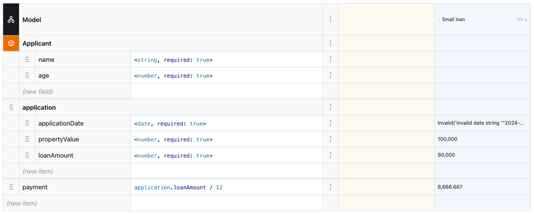

# Boxed Expression Update

> http://127.0.0.1:6006/?path=/story/components-boxed-editor--test-cases-and-test-runner

## Problem

It is very unclear where to put "show description" and "show test column" buttons. The current design is confusing and
not intuitive.

## Old View

## Solution

- [x] Existing top row where "Model" is displayed must be just one-step height. This row must be shown always on top of
      all Metaphors that are opened in Boxed Editor.
- [x] Existing 3 dor vertical icon must be changed to `plus` icon, because it basically opens a context menu where you
      can add other Metaphors. This is applicable only to the root view of the whole Model as a Boxed Expression.
  - [x] When I open a single expression or Metaphor as a Boxed Expression, then the `plus` icon must be hidden, because
        it is not applicable to add other Metaphors to a single expression. Simply leave the square empty.
- [x] Add two more toggle buttons to the left of the `plus` icon. One is for "show description" and another is for "show
      test column". These buttons must be shown only when a Metaphor is opened as a Boxed Expression.
- [x] Note that toggling description and test column must be applicable to all Metaphors that are opened as Boxed
      Expressions even to `http://127.0.0.1:6006/?path=/story/models-loan-repayment--decision-table`
- [x] Per default "show description" is always on and "show test column" must be toggled off.
- [x] When "show test column" is toggled on, then the test column must be shown and user should be able to school test
      cases as it can do today. However, make sure school left and school right buttons speak the same GUI language and
      are wrapped in a single cell of one step. The whole test column can be a little wider.
- [x] When "show test column" is toggled on, then default first test is executed immediately and results are shown. When
      user school tests, then these tests also trigger the execution.
- [x] Now the top row, where "Model" is displayed, must have a header that is adopted. For example, when root is opened,
      then it is fine to open `Model settings` and display name from model settings, but for other metaphors you must
      display Metaphor name, such as "Function", "Ruleset", etc. As of now, each Metaphor has an icon, so instead of
      displaying model icon, maybe display just an empty cell for now.
