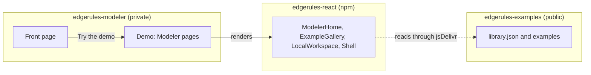
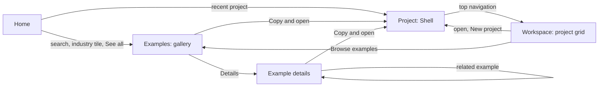
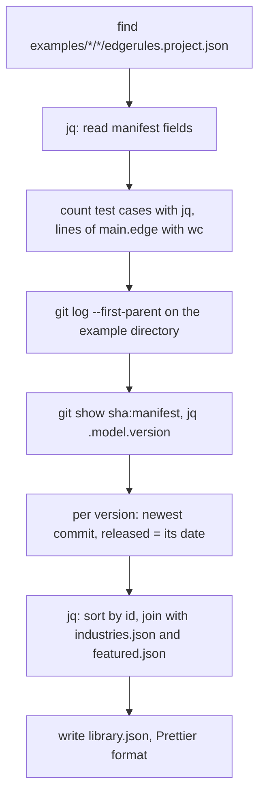
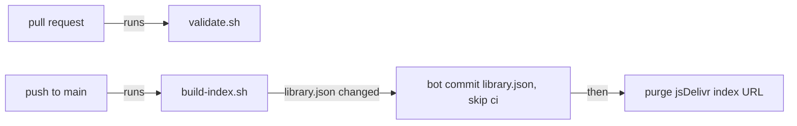
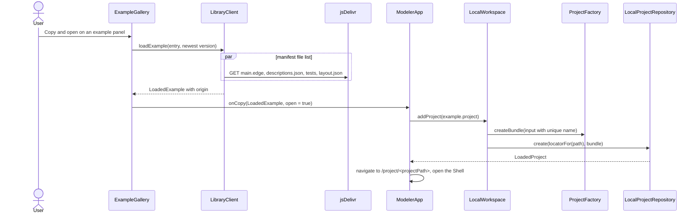
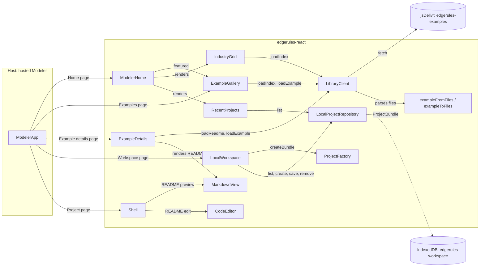

# Examples Library and Local Workspace

## Summary

A public GitHub repository `edgerules-examples` stores EdgeRules example projects as plain files. The hosted Modeler
loads one index file, `library.json`, from the repository root and shows it as a browsable Library.

The Library is read-only: only Git changes the examples. The user copies an example into the Local Workspace and edits
the copy there.

The Local Workspace keeps the projects of the user in IndexedDB of the browser. It is the only writable store of the
Modeler in this story.

The hosted Modeler has four pages: Home, Examples, Workspace and Project.

The Examples page is a gallery of example panels by industry, with search. "Copy and open" opens a copy in the Shell in
one step.

Goals:

- **Git diff:** every authored fact is in one small text file with a deterministic format. A change to a model shows as
  a DSL line diff, not as an escaped JSON string.
- **Scale:** the Library MUST stay usable with 5 000 examples. The Modeler loads only the index before the user selects
  an example.
- **No backend:** the Modeler reads the repository through a CDN. It does not use the GitHub REST API.
- **One format:** an example is a complete project in the authored project format. The library adds no model logic.
- **Maven-like repository:** `library.json` is the repository index. It resolves the coordinates `<id>@<version>` of an
  example to an immutable commit, and a local copy keeps its coordinates.
- **README for every project:** `README.md` is a standard slice of every project, not only of examples.

This story refines `global-project-management.md` §11. It replaces the CDN `.erproject` bundles of §11.2 with per-file
reads from the repository at a pinned commit.

## Technical Breakdown

### Repository boundaries

`edgerules-examples` is a separate repository with its own CI. It does not contain code of `edgerules-react`.

The local checkout of `edgerules-examples` is the sibling directory `../edgerules-examples`.

| Concern                                                      | `edgerules-react` (this repository) | `edgerules-examples`       |
| ------------------------------------------------------------ | ----------------------------------- | -------------------------- |
| Example files, `industries.json`, `featured.json`, `LICENSE` |                                     | Yes                        |
| `library.json` and `tooling/build-index.sh`                  |                                     | Yes                        |
| `tooling/validate.sh` and its Node script                    |                                     | Yes                        |
| JSON Schemas of the example files                            | Yes, published in the npm package   | Uses them from npm         |
| `exampleFromFiles`, `exampleToFiles`                         | Yes                                 | Uses them from npm         |
| Page components, `MarkdownView`, Shell                       | Yes                                 |                            |
| Pages, routes, top navigation                                | No: `edgerules-modeler` owns them   |                            |
| Engine for validation                                        |                                     | `@edgerules/node` from npm |

### Host application `edgerules-modeler`

The host Modeler is the private repository `edgerules-modeler`, checked out at `../edgerules-modeler`. It is not public
on GitHub.

This story does not design `edgerules-modeler`; a separate story does.

- **Front page:** presents EdgeRules to a new visitor and links to the Demo.
- **Demo:** the visitor selects an industry and tries a model of it, or a default model opens.
- **Modeler pages:** the Demo uses the pages of "Modeler pages" with the components of this story.



### First examples

The first 3 examples are the 3 projects of [`models/`](../../models/README.md), in the example directory format.

| Source in `models/` | Example directory                      | Industry  | Level        | Requires      |
| ------------------- | -------------------------------------- | --------- | ------------ | ------------- |
| `loan-repayment/`   | `examples/financial/loan-repayment/`   | Financial | beginner     | none          |
| `loan-origination/` | `examples/financial/loan-origination/` | Financial | intermediate | none          |
| `client-outreach/`  | `examples/financial/client-outreach/`  | Financial | advanced     | `milp-solver` |

- The script `scripts/export-examples.ts` of `edgerules-react` writes the 3 directories with `exampleToFiles`. It reads
  the `*_PROJECT` bundles of `models/` and writes to `../edgerules-examples/examples/`.
- `main.edge` of `client-outreach` contains the 100 generated clients of `clients.ts` as DSL text.
- Each example gets an authored `README.md` with the sections of "README of a project". The `'*'` description of
  `documentation.ts` is its overview paragraph.
- After the export, `edgerules-examples` is the source of its examples. `models/` stays the test and Storybook fixture
  set of `edgerules-react`.

### Modeler pages

The page structure combines two reference products:

- **GoRules templates:** an industry tab row over a gallery of panels, and a detail page per template. The detail page
  has actions, the decision model content, sample inputs and related templates of the same industry.
- **Dify Explore and Studio:** two separate pages. Explore is the template gallery with "Add to Workspace". Studio is
  the workspace grid: its first panel creates an app, and each app panel has a menu.

The host Modeler has a top navigation bar with Home, Examples and Workspace. The host owns the routes; each page is a
composition of components of this package.

| Page            | Route                                 | Content                                                                  | Components       |
| --------------- | ------------------------------------- | ------------------------------------------------------------------------ | ---------------- |
| Home            | `/`                                   | Search box, recent projects, industry tiles, featured examples           | `ModelerHome`    |
| Examples        | `/examples`, `/examples/<industry>`   | Industry tabs, search, facets, gallery of example panels                 | `ExampleGallery` |
| Example details | `/examples/<industry>/<id>@<version>` | Actions, metadata, version selector, README, related examples            | `ExampleDetails` |
| Workspace       | `/workspace`                          | Grid of project panels, "New project" panel, search, filters, panel menu | `LocalWorkspace` |
| Project         | `/project/<projectPath>`              | The Shell of one workspace project                                       | `Shell`          |

Navigation between the pages:



Home page:

```text
┌──────────────────────────────────────────────────────────────────────────────┐
│ EdgeRules        Home   Examples   Workspace                                 │
├──────────────────────────────────────────────────────────────────────────────┤
│        [ 🔍 Search 240 examples: loan, scorecard, optimise ...         ]     │
│                                                                              │
│ Continue                                              [+ New project]  All → │
│ ┌─────────────┐ ┌─────────────┐ ┌─────────────┐                              │
│ │Loan repaym. │ │Claims triage│ │My pricing   │                              │
│ │saved 2 h ago│ │saved 1 d ago│ │saved 3 d ago│                              │
│ └─────────────┘ └─────────────┘ └─────────────┘                              │
│ Industries                                                                   │
│ ┌──────────┐ ┌──────────┐ ┌──────────┐ ┌──────────┐ ┌──────────┐             │
│ │Financial │ │Insurance │ │Healthcare│ │Logistics │ │Retail    │  ...        │
│ │ 42       │ │ 31       │ │ 18       │ │ 22       │ │ 27       │             │
│ └──────────┘ └──────────┘ └──────────┘ └──────────┘ └──────────┘             │
│ Featured examples                                                   See all → │
│ (example panels, as on the Examples page)                                    │
└──────────────────────────────────────────────────────────────────────────────┘
```

Examples page with example panels:

```text
┌──────────────────────────────────────────────────────────────────────────────┐
│ [ 🔍 Search examples                    ]   Level ▾  Features ▾  Sort ▾      │
│ All  Financial  Insurance  Healthcare  Logistics  Retail  Telco  Public ...  │
│ 42 examples                                                                  │
│ ┌────────────────────────┐ ┌────────────────────────┐ ┌──────────────────── │
│ │ [thumbnail]            │ │ [thumbnail]            │ │ ...                  │
│ │ Financial · Beginner   │ │ Financial · Advanced   │ │                      │
│ │ Loan repayment         │ │ Loan origination       │ │                      │
│ │ Prices a loan request  │ │ Scorecard, policy rules│ │                      │
│ │ and returns ...        │ │ and affordability ...  │ │                      │
│ │ decision-table workbook│ │ scorecard service +3   │ │                      │
│ │ ✓ In workspace         │ │                        │ │                      │
│ │ [Copy and open] Details│ │ [Copy and open] Details│ │                      │
│ └────────────────────────┘ └────────────────────────┘ └──────────────────── │
└──────────────────────────────────────────────────────────────────────────────┘
```

Example details page:

```text
┌──────────────────────────────────────────────────────────────────────────────┐
│ Examples / Financial / Loan repayment                                        │
│ Loan repayment                                         version [1.2.0 ▾]     │
│ Prices a loan request and returns its monthly repayment schedule             │
│ [Copy and open]  [Copy to workspace]  [Share link]                           │
├───────────────────────────────────────────────────┬──────────────────────────┤
│ README.md (MarkdownView)                          │ Level: Beginner          │
│                                                   │ Features: decision-table,│
│                                                   │   function, workbook ... │
│                                                   │ 14 tests · 88 lines      │
│                                                   │ Engine: >=0.1.2-alpha    │
│                                                   │ Released: 2026-10-28     │
│                                                   │ View on GitHub →         │
├───────────────────────────────────────────────────┴──────────────────────────┤
│ Related examples (same industry, shared features): 3 example panels          │
└──────────────────────────────────────────────────────────────────────────────┘
```

Workspace page:

```text
┌──────────────────────────────────────────────────────────────────────────────┐
│ Workspace     [ 🔍 Search projects ]  Source: All ▾  Sort: Last saved ▾      │
│ ┌──────────────────┐ ┌──────────────────┐ ┌──────────────────┐              │
│ │  + New project   │ │ Loan repayment ⋮ │ │ My pricing     ⋮ │              │
│ │  Blank project   │ │ from loan-repay- │ │ Own project      │              │
│ │  From example →  │ │  ment@1.2.0      │ │                  │              │
│ │                  │ │ saved 2 h ago    │ │ saved 3 d ago    │              │
│ └──────────────────┘ └──────────────────┘ └──────────────────┘              │
│ Storage: 3.2 MB used of 1.1 GB · persistent                                  │
└──────────────────────────────────────────────────────────────────────────────┘
```

The panel menu `⋮` has Open, Rename, Duplicate and Delete.

### Repository layout

```text
edgerules-examples/
├── library.json                         # repository index; build-index.sh writes it, contributors never edit it
├── examples/
│   ├── financial/
│   │   ├── loan-repayment/              # one example = one project directory
│   │   └── loan-origination/
│   └── <industry>/<slug>/
├── industries.json                      # industry id -> title, description, icon, order
├── featured.json                        # ordered example ids for the Home page
├── tooling/
│   ├── build-index.sh                   # scans examples/ and writes library.json; CI and local
│   ├── validate.sh                      # schema, engine, tests, README checks; CI and local
│   └── validate.mjs                     # Node part of validate.sh
├── package.json                         # devDependencies: edgerules-react, @edgerules/node, prettier
├── .github/workflows/                   # validate on PR, build index on main
├── LICENSE                              # MIT, for every example
├── CONTRIBUTING.md
└── CODEOWNERS
```

- **Industry folder:** groups examples for humans and for the GitHub file browser. GitHub lists at most 1 000 entries of
  a folder, so a flat `examples/` folder does not scale.
- **Example id:** the `slug` folder name. It is unique in the whole repository (CI check). The id does not contain the
  industry, so a move to another industry keeps coordinates and deep links valid.
- **Industries:** the first `industries.json` has Financial, Aviation, Insurance, Healthcare, Logistics, Retail, Telco,
  Public Sector, Energy, Manufacturing and Cross-industry. Cross-industry holds examples of DSL features.
- **License:** all examples are MIT. The repository `LICENSE` file covers them, so an example has no license field.

### Example directory layout

```text
examples/financial/loan-repayment/
├── edgerules.project.json       # manifest: identity, version, catalog metadata, file list
├── README.md                    # project README; Library preview and Shell README view
├── model/
│   └── main.edge                # EdgeRules DSL, as written
├── docs/
│   └── descriptions.json        # DocumentationDocument: short description by model path
├── tests/
│   ├── loanRepayment.tests.json # one TestSuite per subject, self-contained
│   └── pricingTier.tests.json
├── flow/
│   └── layout.json              # FlowMetadataDocument: outputs, charts, positions
└── assets/
    ├── thumbnail.webp           # optional card image, 640 x 360
    └── *.png | *.svg            # optional README images
```

### Files and their diff properties

| File                         | Format                            | Maps to `ProjectBundleInput`             | Diff property                                    |
| ---------------------------- | --------------------------------- | ---------------------------------------- | ------------------------------------------------ |
| `edgerules.project.json`     | JSON, Prettier                    | `name`, `description`, `tags`, `model.*` | Small; changes only on a metadata edit           |
| `README.md`                  | Markdown, Prettier `proseWrap`    | `readme`                                 | Line diff of prose                               |
| `model/main.edge`            | DSL text, LF, final newline       | `model.dsl`                              | Line diff of the rules                           |
| `docs/descriptions.json`     | JSON, keys sorted, one key a line | `documentation`                          | One changed line for one changed description     |
| `tests/<subject>.tests.json` | JSON, Prettier                    | one entry of `tests.subjects`            | A new case adds one block; suites never conflict |
| `flow/layout.json`           | JSON, Prettier, positions rounded | `flow`                                   | Isolated: layout noise stays out of model diffs  |
| `assets/*`                   | Binary                            | none                                     | Size-limited, rarely changed                     |

Rules for a stable diff:

- The model DSL MUST be a file, never a string inside JSON or TypeScript.
- Every JSON file MUST pass `prettier --check`. The serializer writes object keys in a fixed order.
- `layout.json` MUST round positions to whole pixels. A drag of 0.3 px MUST NOT create a diff.
- Test case `id` values MUST be stable. A reorder changes `order` only.
- A test suite MUST be self-contained: its inputs are in the suite file.
- Derived data MUST NOT be in the repository: test results, Portable JSON, schemas, TAST.

### Manifest

The library manifest extends the `ProjectManifest` of
[`bundle/types.ts`](../../src/components/project-session/bundle/types.ts) without `projectId`. The `ProjectFactory`
gives each copy a new `projectId`.

```json
{
  "$schema": "../../../node_modules/edgerules-react/schemas/example.schema.json",
  "kind": "EdgeRulesProject",
  "formatVersion": 3,
  "name": "Loan repayment",
  "description": "Prices a loan request and returns its monthly repayment schedule",
  "tags": ["finance", "loan"],
  "model": {"format": "dsl", "source": "model/main.edge", "name": "Loan Repayment Planner", "version": "1.2.0"},
  "documentation": "docs/descriptions.json",
  "tests": ["tests/loanRepayment.tests.json", "tests/pricingTier.tests.json"],
  "flow": "flow/layout.json",
  "example": {
    "industry": "financial",
    "level": "beginner",
    "features": ["decision-table", "function", "service", "workbook", "chart"],
    "thumbnail": "assets/thumbnail.webp",
    "engine": ">=0.1.2-alpha",
    "authors": ["edgerules"],
    "requires": []
  }
}
```

| Field                            | Required | Use                                                         |
| -------------------------------- | -------- | ----------------------------------------------------------- |
| `name`                           | Yes      | Card title and the name of the copy                         |
| `description`                    | Yes      | Card text, at most 160 characters                           |
| `tags`                           | No       | Free search terms                                           |
| `model.version`                  | Yes      | Example version, semver; the `<version>` of the coordinates |
| `tests`, `flow`, `documentation` | No       | File list; the loader reads no directory listing            |
| `example.industry`               | Yes      | Id from `industries.json`; MUST match the parent folder     |
| `example.level`                  | Yes      | `beginner`, `intermediate` or `advanced`                    |
| `example.features`               | Yes      | Controlled vocabulary of DSL features; Library facet        |
| `example.engine`                 | Yes      | Semver range of `@edgerules/web` that links the model       |
| `example.thumbnail`              | No       | Card image                                                  |
| `example.authors`                | Yes      | Attribution                                                 |
| `example.requires`               | No       | Host capabilities: `milp-solver` for an `optimise` element  |

`README.md` has a fixed path in every project, so the manifest has no field for it. `example.features` comes from the
vocabulary in `example.schema.json`, and `validate.sh` checks each listed feature against the linked model.

### README of a project

`README.md` is a standard slice of every project: a library example and a Local Workspace project. It is the long
description; `docs/descriptions.json` keeps the short description of each model path.

| Project source                 | README content                                               |
| ------------------------------ | ------------------------------------------------------------ |
| Library example                | Authored `README.md` of the example                          |
| New project (`ProjectFactory`) | Generated: `# <name>` and the `description`                  |
| Project of format version 2    | The migration to format 3 generates it, as for a new project |

Each `README.md` of a library example SHOULD have these sections:

- **Title and one-paragraph overview:** the business problem.
- **Inputs and outputs:** a table of the service inputs and results.
- **Walkthrough:** the model parts in reading order, with model links (see "Markdown viewer").
- **Try it:** the workbooks and test suites to open first.
- **EdgeRules features:** the DSL features that the example shows, with links to the language reference.

A README MAY use GitHub Flavored Markdown: tables, task lists, fenced code, relative images from `assets/`. It MUST NOT
contain raw HTML: the viewer drops it.

### Coordinates and versions

An example has Maven-like coordinates `<id>@<version>`, for example `loan-repayment@1.2.0`. The `version` is the
`model.version` of the manifest.

- A released version is immutable. A change to the files of an example in Git MUST increase `model.version`.
- The index keeps every released version of an example with the commit that holds it. Old versions stay loadable.
- A copy stores its coordinates as `origin` in its manifest. A duplicate of a copy keeps the same `origin`.

The `ProjectManifest` gets the `origin` field:

```typescript
interface ProjectOrigin {
  library: string; // indexUrl of the LibrarySource that resolved the example
  id: string; // example id, the slug
  version: string; // released example version
}

interface ProjectManifest {
  // ...existing members
  origin?: ProjectOrigin; // coordinates of the library example that this project is a copy of
}
```

The Library compares the `origin` of the workspace projects with the index:

| Workspace state                   | Library shows                                    |
| --------------------------------- | ------------------------------------------------ |
| No project with this example `id` | Copy to workspace                                |
| A copy of the newest version      | "In workspace" badge; Open copy, Copy again      |
| Copies of older versions only     | "Update available" badge; Open copy, Copy newest |

### Index file `library.json`

`tooling/build-index.sh` writes `library.json` from all manifests and the git history. CI runs it on each push to
`main`; a contributor runs the same script locally.

```json
{
  "schemaVersion": 1,
  "generatedFrom": "3f9c2e1a7b0d...",
  "industries": [
    {"id": "financial", "title": "Financial", "description": "Credit, pricing, repayment", "icon": "bank"}
  ],
  "featured": ["loan-repayment", "claims-triage"],
  "examples": [
    {
      "id": "loan-repayment",
      "path": "examples/financial/loan-repayment",
      "name": "Loan repayment",
      "description": "Prices a loan request and returns its monthly repayment schedule",
      "industry": "financial",
      "level": "beginner",
      "features": ["decision-table", "function", "service", "workbook", "chart"],
      "tags": ["finance", "loan"],
      "engine": ">=0.1.2-alpha",
      "thumbnail": "assets/thumbnail.webp",
      "stats": {"tests": 14, "lines": 88},
      "versions": [
        {"version": "1.2.0", "ref": "3f9c2e1a7b0d...", "released": "2026-10-28"},
        {"version": "1.1.0", "ref": "9a41c07e55f2...", "released": "2026-09-14"}
      ]
    }
  ]
}
```

- **`generatedFrom`:** the `HEAD` commit that `build-index.sh` scanned. The index has no wall-clock time, so two runs on
  one commit give identical files.
- **`versions`:** newest first. `ref` is the commit SHA that holds the files of the version at the entry `path`. The
  metadata fields of the entry are those of the newest version.
- **Order:** `industries` in the order of `industries.json`; `featured` as in `featured.json`; `examples` sorted by
  `id`.
- **Size:** one entry is approximately 450 bytes plus 90 bytes a version. The index of 5 000 entries with 3 versions
  each is approximately 3.6 MB, or 450 KB with gzip.

### Index script `build-index.sh`

`build-index.sh` is a bash script with no Node dependency. It needs `bash` 3.2 or later (the macOS default), `git` and
`jq` 1.6 or later.

| Invocation                            | Behavior                                                              |
| ------------------------------------- | --------------------------------------------------------------------- |
| `tooling/build-index.sh`              | Writes `library.json` from the working tree and the history of `HEAD` |
| `tooling/build-index.sh --check`      | Writes nothing; exits 1 when `library.json` differs from the result   |
| `tooling/build-index.sh --out <file>` | Writes the index to `<file>`                                          |

The script builds the index in these steps:



- The `ref` of a version is the newest first-parent commit that changed the example directory with that `model.version`.
- The script fails with the manifest path on a manifest that `jq` cannot parse.
- The script needs the full history: CI checks out with `fetch-depth: 0`.
- An uncommitted change has no commit. The script reports it as a warning and gives it no `ref`.

### Repository CI

`tooling/validate.sh` runs the pull request checks. It calls `validate.mjs` with `edgerules-react` and `@edgerules/node`
from `package.json`.

| Check       | Failure condition                                                                                  |
| ----------- | -------------------------------------------------------------------------------------------------- |
| Schema      | A manifest, a test suite, descriptions or layout fails its JSON Schema                             |
| Format      | `prettier --check` fails, or `exampleToFiles(exampleFromFiles(files))` differs                     |
| Engine link | `main.edge` does not parse or link with `@edgerules/node`                                          |
| Tests       | A test case fails in the `TestRunner`                                                              |
| References  | A description, test subject, flow output or chart points to a missing model path                   |
| README      | `README.md` is missing, has a broken relative link, or a `model:` link to a missing path           |
| Metadata    | Unknown industry, folder and industry differ, duplicate slug, unknown feature, unknown featured id |
| Version     | Files of an example change, and `model.version` is not greater than on `main`                      |
| Size        | Example over 1 MB, an asset over 300 KB, `main.edge` over 5 000 lines                              |
| Secrets     | The secret scanner finds a credential                                                              |

The two workflows:



### File delivery

The Modeler reads files through jsDelivr. jsDelivr serves GitHub files with CORS and without an API rate limit. It
caches a commit-pinned URL permanently.

| Request      | URL                                                                                  | Cache                        |
| ------------ | ------------------------------------------------------------------------------------ | ---------------------------- |
| Index        | `https://cdn.jsdelivr.net/gh/rimvydasb/edgerules-examples@main/library.json`         | 12 h; CI purges it on update |
| Example file | `https://cdn.jsdelivr.net/gh/rimvydasb/edgerules-examples@<ref>/<path>/<file>`       | Immutable                    |
| Fallback     | `https://raw.githubusercontent.com/rimvydasb/edgerules-examples/<ref>/<path>/<file>` | 5 min                        |

The host configures both base URLs in a `LibrarySource`. A self-hosted copy of the repository uses the same layout.

### Example gallery and details

`ExampleGallery` is the Examples page and the featured row of the Home page. `ExampleDetails` is the Example details
page.

| Feature          | Behavior                                                                                                |
| ---------------- | ------------------------------------------------------------------------------------------------------- |
| Industry tabs    | "All" and one tab per industry of the index, with example counts; the tab is the `industry` prop        |
| Search           | Client-side, as the user types; matches `name`, `description`, `tags`, `features`, `id`, industry title |
| Facets           | Level, features (multi-select, AND), engine compatibility                                               |
| Sort             | Relevance, name, last release                                                                           |
| Example panel    | Thumbnail, industry, level, name, description, up to 3 features and "+N", workspace badge               |
| Panel actions    | "Copy and open" (primary) and "Details"                                                                 |
| Featured mode    | `featured` prop: the examples of `index.featured` in their order, no tabs, no facets                    |
| Details actions  | "Copy and open", "Copy to workspace", "Share link" (copies the page URL), "View on GitHub"              |
| Details content  | Version selector, rendered `README.md`, metadata side panel, related examples                           |
| Related examples | Up to 3 examples of the same industry, ordered by the number of shared features                         |
| Read-only        | No edit action; a copy is the only way to change an example                                             |
| Compatibility    | A version whose `engine` range excludes the loaded engine shows a warning; copy stays available         |
| Workspace badges | `workspaceOrigins` prop: see "Coordinates and versions"                                                 |
| Errors           | Index failure: retry panel. File failure: error on the details page with the file name                  |
| Keyboard         | Arrow keys move between panels, Enter opens the details, `/` focuses search                             |

- Search MUST respond within 50 ms for 5 000 entries. A lowercase token index built once after `loadIndex` meets this
  target, so the gallery needs no search library.
- The gallery renders the visible panels only (virtual grid), so 5 000 panels do not slow the page.

`IndustryGrid` shows one tile per industry of the index: icon, title, description and example count. A tile click calls
`onSelectIndustry(id)`.

### Modeler Home

`ModelerHome` is the Home page: the start point of the Modeler and the entry to the Library and the Workspace. The host
gives it callbacks for navigation and renders nothing else on the page.

| Section         | Content                                                                             | Source                   |
| --------------- | ----------------------------------------------------------------------------------- | ------------------------ |
| Hero            | Title, one-line tagline, search box with suggestions                                | Props, index, repository |
| Continue        | `RecentProjects`: up to 6 newest saved projects, "New project", "All projects"      | `LocalProjectRepository` |
| Get started     | Replaces "Continue" for an empty workspace: "Blank project" and 3 beginner examples | Index, `level: beginner` |
| Industries      | `IndustryGrid`: one tile per industry with icon, title and example count            | Index                    |
| Featured        | `ExampleGallery` in featured mode, "See all examples"                               | `index.featured`         |
| New and updated | Up to 6 examples with the newest `released` dates                                   | Index `versions`         |

Search box behavior:

- Typing shows up to 5 example suggestions and up to 3 workspace project suggestions in one dropdown, in two groups.
- Arrow keys and Enter on a suggestion open the example details page or the project. Enter without a selection calls
  `onSearch(query)`; the host shows the Examples page with that query.
- `/` focuses the search box from anywhere on the page.

Other behavior:

- Each section shows a skeleton while it loads. An index failure hides the library sections and shows one retry panel;
  "Continue" stays usable.
- The grid has 1 column on a phone, 2 on a tablet, and 3 or 4 on a desktop. Light and dark themes use Mantine tokens.

### Package placement of the page components

`ModelerHome`, `ExampleGallery`, `ExampleDetails` and `LocalWorkspace` are page-level components. They stay in
`src/components/`, as one component directory each:

| Component directory | Public API                                                                | Allowed component dependencies                          |
| ------------------- | ------------------------------------------------------------------------- | ------------------------------------------------------- |
| `markdown-view`     | `MarkdownView`                                                            | None; it MAY import `code-editor/language/` files       |
| `example-library`   | `ExampleGallery`, `ExampleDetails`, `IndustryGrid`, `createLibraryClient` | `project-session`, `markdown-view`                      |
| `local-workspace`   | `LocalWorkspace`, `RecentProjects`                                        | `project-session`, `example-library`                    |
| `modeler-home`      | `ModelerHome`                                                             | `project-session`, `example-library`, `local-workspace` |
| `shell` (change)    | existing                                                                  | existing, and `markdown-view`                           |

Rules for a page-level component:

- It takes its data sources as props (`LibraryClient`, `LocalProjectRepository`). It does not create them.
- It reports navigation through callbacks. It MUST NOT import a router, read `window.location`, or own a URL.
- It has no hard-coded library URL. The host creates the `LibraryClient` from its `LibrarySource`.

`edgerules-react` has no index page of its own: it is a library, and the host Modeler owns `/`. Storybook is the only
page that the repository runs.

- The `Modeler` Storybook group is first in `storySort`. Its first story, `Modeler/Home`, renders `ModelerHome` with the
  published `edgerules-examples` index and an in-memory workspace.
- The other `Modeler` stories compose the Examples, Example details, Workspace and Project pages as the host does.

### Local Workspace

`LocalWorkspace` is a React component over one `LocalProjectRepository`. It lists the projects of the user and manages
them; the Shell edits one open project.

- The workspace uses the IndexedDB database `edgerules-workspace`. It has no other storage and no export.
- On first use the workspace calls `navigator.storage.persist()`. It shows a warning when the browser can evict the
  data.

| Feature           | Behavior                                                                                 |
| ----------------- | ---------------------------------------------------------------------------------------- |
| Project grid      | One panel per project: name, description, origin coordinates or "Own project", last save |
| Sort and filter   | Sort by last save or name; source filter: all, from examples, own projects               |
| Search            | Client-side filter on name, description and tags                                         |
| Open              | Calls `onOpen(locator)`; the host opens the session in the Shell                         |
| New project panel | First panel of the grid: "Blank project" (name dialog, empty model) or "From example"    |
| Copy from Library | Adds the project of `LoadedExample`; a taken name gets a suffix: `Loan repayment (2)`    |
| Duplicate         | A new project from the head bundle; same `origin`, new `projectId`, suffixed name        |
| Panel menu        | Open, Rename, Duplicate, Delete                                                          |
| Rename            | Changes the manifest `name` and `description`; saves a new revision                      |
| Delete            | Mantine confirm modal, then `LocalProjectRepository.remove`; no browser `confirm()`      |
| Origin            | A copy shows `id@version`, and "Update available" when the index has a newer version     |
| Storage           | Used and available bytes from `navigator.storage.estimate()`                             |
| Empty state       | "Browse examples" and "New project" actions                                              |
| Recent projects   | `RecentProjects`: the newest saved projects as compact panels for the Home page          |

`LocalProjectRepository` stores `savedAt`, the time of each save, in the IndexedDB record of the head revision. The
last-save sort and "saved 2 h ago" read it.

"Copy and open" goes straight to the Shell:



### README view in the Shell

The Shell gets a fourth view, `readme`, at the project root. Every project in the Shell is a workspace project, so the
README is editable.

| Mode    | Component                                | Behavior                                        |
| ------- | ---------------------------------------- | ----------------------------------------------- |
| Preview | `MarkdownView`                           | Default mode; `model:` links navigate the Shell |
| Edit    | `CodeEditor` with `language: 'markdown'` | Markdown highlighting; no engine service        |

- An edit writes the `readme` slice store of the session. A save writes it with the other slices in one revision.
- `CodeEditor` gets the `language` prop: `'edgerules'` (the default) or `'markdown'`. With `'markdown'` the `service`
  prop is not used, and the editor has no diagnostics, completion or formatting.
- `@codemirror/lang-markdown` becomes an optional peer dependency.

### Shell navigation

The Shell bar links the open project to the Workspace, the Library and its source example. It has three parts:

- **Workspace crumb:** the breadcrumb starts with "Workspace /". A click calls `onShowWorkspace`.
- **Project menu:** the project name in the middle of the Shell bar, with `▾`. A click opens the menu below.
- **Origin chip:** a copy of an example shows `from <id>@<version>` in the menu header. With a newer version in the
  index, the chip shows "Update available".

```text
┌──────────────────────────────────────────────────────────────────────────────────────────┐
│ Workspace / Loan Repayment Planner / mortgageBook    Loan repayment ▾    ⚙  Boxed|Flow|… │
└──────────────────────────────────────────────────────────────────────────────────────────┘
                                       ┌──────────────────────────────────────┐
                                       │ Loan repayment                       │
                                       │ saved 2 min ago                      │
                                       │ [from loan-repayment@1.2.0 ↗]        │
                                       │──────────────────────────────────────│
                                       │ ← Back to workspace                  │
                                       │ Recent projects                      │
                                       │   Claims triage                      │
                                       │   My pricing                         │
                                       │ Browse examples                      │
                                       │ View original example                │
                                       │──────────────────────────────────────│
                                       │ Open README                          │
                                       │ Duplicate                            │
                                       └──────────────────────────────────────┘
```

| Menu item             | Shown                              | Action                                                     |
| --------------------- | ---------------------------------- | ---------------------------------------------------------- |
| Origin chip           | The manifest has an `origin`       | `onShowOrigin(origin)`: the host shows the example details |
| Back to workspace     | Always                             | `onShowWorkspace()`                                        |
| Recent projects       | Up to 5, the open project excluded | `onOpenProject(locator)`                                   |
| Browse examples       | Always                             | `onBrowseExamples()`                                       |
| View original example | The manifest has an `origin`       | `onShowOrigin(origin)`                                     |
| Open README           | Always                             | The Shell shows the `readme` view of the project root      |
| Duplicate             | `onDuplicate` is set               | `onDuplicate()`: the host adds a copy and opens it         |

- The Shell reads the project name, `origin` and the last save from its session. The host gives the recent projects and
  the origin status. The Shell reads neither the repository nor the library.
- An unsaved change does not block navigation in the Shell. The host decides to save, ask, or discard before it leaves
  the Project page.
- Without the `navigation` prop the Shell bar has no Workspace crumb and no project menu. Storybook stories and embedded
  hosts use this form.

### Markdown viewer

`MarkdownView` renders the README in the Library and in the Shell. It uses `react-markdown` with `remark-gfm`, as
optional peer dependencies.

| Concern        | Rule                                                                                                  |
| -------------- | ----------------------------------------------------------------------------------------------------- |
| Safety         | Raw HTML is dropped. URL schemes other than `https`, `mailto`, `model` and relative paths are removed |
| Relative URLs  | `resolveUrl(relative)` rewrites images and links to the commit-pinned file URL                        |
| Model links    | `[monthlyPayment](model:monthlyPayment)` calls `onModelLink(path)`; the Shell opens that path         |
| Code blocks    | `edgerules` fences use the static highlighter of `code-editor/language/highlight.ts`                  |
| External links | Open in a new tab with `rel="noopener noreferrer"`                                                    |
| Theme          | Mantine typography; light and dark                                                                    |

### Structural Diagram

The new components of this package and their dependencies:



### TypeScript API

`example-library` component, subpath export `edgerules-react/example-library`:

```typescript
interface LibrarySource {
  indexUrl: string; // URL of library.json; also the `library` of a ProjectOrigin
  fileBaseUrl: (ref: string) => string; // base URL of the repository files at a commit, with a final '/'
}

interface ExampleCoordinates {
  id: string; // example id, the slug
  version: string; // released version
}

interface LibraryClient {
  loadIndex(): Promise<LibraryIndex>; // fetches and validates library.json; caches it for the session
  resolve(coordinates: ExampleCoordinates): LibraryVersion | undefined; // the version and its ref, from the index
  loadReadme(entry: LibraryEntry, version: string): Promise<string>; // README Markdown at the ref of the version
  loadExample(entry: LibraryEntry, version: string): Promise<LoadedExample>; // all files of the manifest, in parallel
}

interface LoadedExample {
  entry: LibraryEntry; // the index entry
  ref: string; // commit SHA of the files
  project: ProjectBundleInput; // ready for ProjectFactory.createBundle; `origin` and `readme` are set
}

interface ExampleGalleryProps {
  client: LibraryClient; // from createLibraryClient(source)
  industry?: string; // controlled industry tab; undefined is "All"
  onIndustryChange?: (industry: string | undefined) => void; // the host updates the route
  query?: string; // controlled search text, from the Home search box or the route
  onQueryChange?: (query: string) => void; // search text change
  featured?: boolean; // featured mode for the Home page: index.featured only, no tabs or facets
  limit?: number; // maximum number of panels; featured mode shows "See all"
  engineVersion?: string; // version of the loaded engine, for the compatibility facet
  workspaceOrigins?: ProjectOrigin[]; // origins of the workspace projects, for the badges
  onCopy: (example: LoadedExample, open: boolean) => void; // the host adds the copy; `open` for "Copy and open"
  onShowDetails: (coordinates: ExampleCoordinates) => void; // the host navigates to the details page
}

interface ExampleDetailsProps {
  client: LibraryClient; // from createLibraryClient(source)
  example: ExampleCoordinates; // from the route; an unknown id or version shows "Example not found"
  onVersionChange?: (coordinates: ExampleCoordinates) => void; // the host updates the route
  engineVersion?: string; // version of the loaded engine, for the compatibility warning
  workspaceOrigins?: ProjectOrigin[]; // origins of the workspace projects, for the badge
  onCopy: (example: LoadedExample, open: boolean) => void; // "Copy and open" and "Copy to workspace"
  onShowDetails: (coordinates: ExampleCoordinates) => void; // a related example
  shareUrl?: (coordinates: ExampleCoordinates) => string; // the URL that "Share link" copies; no button without it
  repositoryUrl?: (entry: LibraryEntry, ref: string) => string; // the "View on GitHub" link; no link without it
}

interface IndustryGridProps {
  client: LibraryClient; // from createLibraryClient(source)
  onSelectIndustry: (industry: string) => void; // the host navigates to /examples/<industry>
}
```

`local-workspace` component, subpath export `edgerules-react/local-workspace`:

```typescript
interface LocalWorkspaceProps {
  repository: LocalProjectRepository; // the IndexedDB repository of the workspace
  factory: ProjectFactory; // creates the bundle of a new project or a copy
  library?: LibraryClient; // resolves "Update available"; without it the badge is not shown
  onOpen: (locator: ProjectLocator) => void; // the host opens the project in the Shell
  onBrowseExamples?: () => void; // "Browse examples" and the "From example" action of the New project panel
}

interface RecentProjectsProps {
  repository: LocalProjectRepository; // the IndexedDB repository of the workspace
  limit?: number; // number of panels, default 6
  onOpen: (locator: ProjectLocator) => void; // the host opens the project in the Shell
  onNewProject?: () => void; // shows the "New project" action
  onShowAll?: () => void; // shows the "All" link to the Workspace page
}
```

`modeler-home` component, subpath export `edgerules-react/modeler-home`:

```typescript
interface ModelerHomeProps {
  client: LibraryClient; // the example library
  repository: LocalProjectRepository; // the workspace, for "Continue" and project suggestions
  title?: string; // hero title, default "EdgeRules Modeler"
  tagline?: string; // hero tagline
  engineVersion?: string; // version of the loaded engine, for the compatibility warnings
  onSearch: (query: string) => void; // the host shows the Examples page with this query
  onSelectIndustry: (industry: string) => void; // the host shows /examples/<industry>
  onShowDetails: (coordinates: ExampleCoordinates) => void; // the host shows the example details page
  onCopy: (example: LoadedExample, open: boolean) => void; // "Copy and open" on a panel
  onOpenProject: (locator: ProjectLocator) => void; // a recent project or a project suggestion
  onNewProject: () => void; // "New project" and "Blank project"
  onShowAllProjects: () => void; // the host shows the Workspace page
  onShowAllExamples: () => void; // the host shows the Examples page
}
```

```typescript
interface LocalWorkspaceHandle {
  addProject(input: ProjectBundleInput): Promise<LoadedProject>; // unique name and path, then repository.create
}
```

`project-session` changes. `exampleFromFiles` and `exampleToFiles` use no engine, so Node and the browser both use them:

```typescript
interface ProjectBundle {
  // ...existing members
  readme: string; // Markdown of README.md
}

interface ProjectBundleInput {
  // ...existing members
  readme?: string; // defaults to a README generated from `name` and `description`
  origin?: ProjectOrigin; // copied into the manifest
}

interface LocalProjectRepository {
  // ...existing members
  remove(locator: ProjectLocator): Promise<void>; // deletes the project and its history; `not-found` when absent
}

interface ProjectDescriptor {
  // ...existing members
  origin?: ProjectOrigin; // from the manifest, for the workspace list and the Library badges
  savedAt: string; // ISO time of the last save; stored in the IndexedDB record
}

type ExampleFiles = Record<string, string>; // path relative to the example directory -> text content

function exampleFromFiles(files: ExampleFiles): ProjectBundleInput; // throws ProjectError 'invalid-bundle'
function exampleToFiles(project: ProjectBundleInput, example: ExampleMetadata): ExampleFiles; // canonical serializer
```

`markdown-view` component, subpath export `edgerules-react/markdown-view`:

```typescript
interface MarkdownViewProps {
  markdown: string; // GitHub Flavored Markdown
  resolveUrl?: (relative: string) => string; // rewrites relative image and link URLs
  onModelLink?: (path: string) => void; // called for model: links; without it they render as text
}
```

`shell` change:

```typescript
interface ShellNavigation {
  onShowWorkspace: () => void; // the Workspace crumb and "Back to workspace"
  onBrowseExamples: () => void; // "Browse examples"
  onOpenProject: (locator: ProjectLocator) => void; // a recent project
  recentProjects?: ProjectDescriptor[]; // newest first; the Shell shows up to 5 and omits the open project
  onShowOrigin?: (origin: ProjectOrigin) => void; // the origin chip and "View original example"
  originStatus?: 'latest' | 'update-available'; // from the library index; no status without it
  onDuplicate?: () => void; // shows "Duplicate"; the host copies the project and opens the copy
}

interface ShellProps {
  // ...existing members
  navigation?: ShellNavigation; // shows the Workspace crumb and the project menu
}
```

`code-editor` change:

```typescript
interface CodeEditorProps {
  // ...existing members
  language?: 'edgerules' | 'markdown'; // default 'edgerules'; 'markdown' does not use `service`
}
```

## Architecture Changes

- New component `example-library`: public API `ExampleGallery`, `ExampleDetails`, `IndustryGrid`, `createLibraryClient`,
  and their types.
- New component `local-workspace`: public API `LocalWorkspace`, `RecentProjects` and their types.
- New component `modeler-home`: public API `ModelerHome` and its types. It depends on `example-library` and
  `local-workspace`.
- The host Modeler owns the pages, the routes and the top navigation. The package has no router dependency.
- The dependency-cruiser allowlists get the rows of "Package placement of the page components".
- `docs/architecture.md` "Scope": the library contains page-level components, but no application, router or index page.
- New component `markdown-view`: public API `MarkdownView`. Optional peers `react-markdown` and `remark-gfm`.
- `code-editor`: `language` prop. Optional peer `@codemirror/lang-markdown`.
- `project-session`: `README.md` is a project slice (`ProjectBundle.readme`). `PROJECT_FORMAT_VERSION` becomes 3; the
  migration from 2 generates the README.
- `project-session`: `ProjectManifest.origin` keeps the library coordinates of a copy. This replaces the rule of
  `global-project-management.md` §5.3 that fork provenance is not in the manifest (ADR entry).
- `project-session`: `LocalProjectRepository.remove`, and `origin` and `savedAt` in `ProjectDescriptor`.
- `project-session` exports `exampleFromFiles`, `exampleToFiles`, `ExampleMetadata` and `ProjectOrigin`.
- The npm package publishes the JSON Schemas of the example files under `schemas/`.
- `shell`: `readme` view at the project root. It depends on `markdown-view` and `code-editor`.
- `shell`: optional `navigation` prop: Workspace crumb, project menu in the middle of the Shell bar, origin chip.
- No page-level component depends on `shell`, and `shell` depends on none of them.

## Out of Scope

- Any write from the Modeler to `edgerules-examples`. Only Git changes the Library.
- Export, import, or save of a workspace project to a file, Git or a cloud store.
- Automatic update of a copy to a newer example version.
- Mermaid diagrams inside a README.

## Limitations

- The workspace data lives in one browser profile. A browser that evicts storage deletes the projects.
- Model DSL has no import. A large input data set in the model is part of `main.edge`.
- The index purge relies on the jsDelivr purge API. Without a purge, a new example appears within 12 h.
- Search is substring and token based, without typo tolerance.

## Future Improvements

- Export and import of a workspace project as an `.erproject` file.
- "Export as example": `exampleToFiles` produces a ZIP of the directory for a pull request to `edgerules-examples`.
- Three-way merge of a newer example version into a copy, with `origin` as the merge base.
- Shard `library.json` by industry above 5 000 examples: the root index keeps industries and counts only.
- Ctrl+K command palette in the Shell: one search over projects, examples and commands, from the `ModelerHome` search.
- A closable banner on the first open of a copy: "Your copy of …", "View original", "More examples".
- Per-entity Markdown documents (`docs/nodes/*.md`) after stable entity ids exist (`global-project-management.md` §6).

## Verification

| Check     | Command                |
| --------- | ---------------------- |
| Build     | `npm run build`        |
| Typecheck | `npm run typecheck`    |
| Lint      | `npm run lint`         |
| Test      | `npm test`             |
| Rules     | `npm run depcruise`    |
| Format    | `npm run format:check` |
| E2E       | `npm run e2e`          |
| Start     | `npm run storybook`    |

`edgerules-examples` checks: `tooling/validate.sh` and `tooling/build-index.sh --check`.

## Tasks

**Phase 1: README slice, origin and repository changes in `project-session`**

- [ ] Ensure project compiles and existing tests are passing
- [ ] Add `ProjectBundle.readme`, `ProjectManifest.origin` and `ProjectOrigin`
- [ ] Generate the README in `ProjectFactory.createBundle` when the input has none
- [ ] Add the format 2 to 3 migration to `parseProjectBundle`
- [ ] Add the `readme` slice store to `ProjectSession`, and store the README in `LocalProjectRepository`
- [ ] Add `LocalProjectRepository.remove`, and `origin` and `savedAt` to `ProjectDescriptor`
- [ ] Add tests for the code of this phase

Acceptance criteria:

- [ ] `npm test` passes, including a migration test: a format 2 bundle opens with a generated README
- [ ] `npm test` passes, including a session test: a README edit and a model edit save as one revision
- [ ] `npm test` passes, including a repository test: `remove` deletes a project, and `list` omits it

**Phase 2: example file format**

- [ ] Add `ExampleMetadata` and the library manifest type to `project-session/bundle`
- [ ] Implement `exampleFromFiles` and `exampleToFiles` with fixed key order and rounded flow positions
- [ ] Write JSON Schemas for the manifest, `descriptions.json`, a test suite and `layout.json`; publish them in the
      package
- [ ] Add a small example directory as a test fixture in `project-session/__tests__/fixtures/`
- [ ] Write `scripts/export-examples.ts`: it exports the 3 examples of "First examples" to `../edgerules-examples`
- [ ] Add a `prepare` script that builds `dist/`, so that a Git dependency on `edgerules-react` installs a build
- [ ] Add tests for the code of this phase

Acceptance criteria:

- [ ] `npm test` passes, including `exampleFiles.test.ts`: the round trip of the fixture gives identical files
- [ ] The fixture opens with `ProjectFactory.createBundle`, and its test suites pass with `@edgerules/node`
- [ ] `npx tsx scripts/export-examples.ts` writes the 3 example directories, and a second run changes no file

**Phase 3: `edgerules-examples` repository on GitHub**

This phase runs in `../edgerules-examples`. The library phases after it read the published repository, not a fixture.

- [ ] Initialize `../edgerules-examples` with the layout of this story and the MIT `LICENSE`
- [ ] Export the 3 examples of "First examples" with `scripts/export-examples.ts` of `edgerules-react`
- [ ] Add `edgerules-react` as a Git devDependency (`github:rimvydasb/edgerules-react#<tag>`) until its first npm
      release
- [ ] Write the `README.md` of each of the 3 examples
- [ ] Register highs-js in `validate.mjs` for an example that requires `milp-solver`
- [ ] Write `tooling/build-index.sh` with `--check` and `--out`
- [ ] Write `tooling/validate.sh` and `tooling/validate.mjs`
- [ ] Add the pull request and `main` workflows
- [ ] Add `CONTRIBUTING.md` with the README sections, the feature vocabulary, the version rule and the local commands
- [ ] Add tests for the scripts: a fixture repository with two versions of one example
- [ ] Push the repository to the public GitHub repository `rimvydasb/edgerules-examples`

Acceptance criteria:

- [ ] `tooling/validate.sh` passes for the 3 first examples, the test suites of `client-outreach` included
- [ ] `tooling/build-index.sh` on macOS and on the CI runner gives identical `library.json` files
- [ ] `tooling/build-index.sh` on the fixture repository lists both versions with their commits
- [ ] A pull request with a failing test case fails `validate.sh`
- [ ] A pull request that changes an example without a new `model.version` fails `validate.sh`
- [ ] A push to `main` with a new `model.version` commits `library.json` with the new version
- [ ] `curl https://cdn.jsdelivr.net/gh/rimvydasb/edgerules-examples@main/library.json` returns the 3 examples

**Phase 4: Markdown viewer and Shell README view**

- [ ] Add `markdown-view` with `react-markdown` and `remark-gfm` as optional peers
- [ ] Implement URL rewrite, scheme filter, `model:` links and `edgerules` code highlighting
- [ ] Add the `language` prop to `CodeEditor` with `@codemirror/lang-markdown`
- [ ] Add the `readme` view to the Shell: preview with `MarkdownView`, edit with `CodeEditor`
- [ ] Add Storybook stories for `MarkdownView` and the Shell README view
- [ ] Add tests for the code of this phase

Acceptance criteria:

- [ ] `npm test` passes, including `MarkdownView.test.tsx`: raw HTML and `javascript:` links do not render
- [ ] `npm test` passes, including a Shell test: a README edit marks the project dirty, and save keeps it
- [ ] `npm test` passes, including a Shell test: a `model:` link in the README opens that model path
- [ ] `npm run depcruise` passes with the new component

**Phase 5: Local Workspace**

- [ ] Implement `LocalWorkspace`: list, search, sort, open, new, duplicate, rename, delete, storage, empty state
- [ ] Implement `addProject` with unique names and paths
- [ ] Implement `RecentProjects`
- [ ] Request persistent storage on first use and show the eviction warning
- [ ] Add Storybook stories: empty workspace, workspace with copies, delete confirm
- [ ] Add tests for the code of this phase

Acceptance criteria:

- [ ] `npm test` passes, including `LocalWorkspace.test.tsx`: new, duplicate, rename and delete against IndexedDB
- [ ] `npm test` passes, including a test: two copies of one example get the names `X` and `X (2)`

**Phase 6: Shell navigation**

- [ ] Add `ShellNavigation` and the `navigation` prop to the Shell
- [ ] Add the Workspace crumb to `ShellBreadcrumbs`
- [ ] Add the project menu in the middle of the Shell bar, with the origin chip in its header
- [ ] Add a Storybook story of the Shell with navigation, for a copy with "Update available" and for an own project
- [ ] Add tests for the code of this phase

Acceptance criteria:

- [ ] `npm test` passes, including a Shell test: the Workspace crumb calls `onShowWorkspace`
- [ ] `npm test` passes, including a Shell test: the menu of a copy shows the origin chip and "View original example"
- [ ] `npm test` passes, including a Shell test: the menu of an own project has no origin chip
- [ ] `npm test` passes, including a Shell test: without `navigation` the Shell bar is unchanged

**Phase 7: Library client and components**

- [ ] Implement `createLibraryClient` with index validation, `resolve` and parallel file reads
- [ ] Implement `ExampleGallery`: industry tabs, search, facets, sort, example panels, featured mode, virtual grid
- [ ] Implement `ExampleDetails`: actions, version selector, README, metadata panel, related examples
- [ ] Implement `IndustryGrid`
- [ ] Add `EXAMPLES_SOURCE` to `stories/support/`: the `LibrarySource` of `rimvydasb/edgerules-examples` on jsDelivr
- [ ] Add Storybook stories against `EXAMPLES_SOURCE`, with a `LocalWorkspace` next to the gallery
- [ ] Add a test fixture: a snapshot of the published `library.json` and its files. Unit tests read it offline
- [ ] Add a second version of one example to the fixture, for the version and badge tests
- [ ] Add tests for the code of this phase

Acceptance criteria:

- [ ] `npm test` passes, including `ExampleGallery.test.tsx` and `ExampleDetails.test.tsx`: search, facets, panels,
      versions, copy
- [ ] `npm test` passes, including a badge test: a workspace origin of an older version shows "Update available"
- [ ] A test with 5 000 generated entries finds a match in less than 50 ms

**Phase 8: Modeler Home and page composition**

- [ ] Add a `Modeler` Storybook group, first in `storySort`, with the Home, Examples, Example details, Workspace and
      Project pages
- [ ] Implement `ModelerHome`: hero search with suggestions, Continue or Get started, industries, featured, new and
      updated
- [ ] Compose the pages as the host does, with `EXAMPLES_SOURCE` and an in-memory route state
- [ ] Add tests for the code of this phase

Acceptance criteria:

- [ ] `npm test` passes, including `ModelerHome.test.tsx`: suggestions, empty workspace, index failure
- [ ] In Storybook, "Copy and open" on an example panel shows the copy in the Shell
- [ ] In Storybook, the Workspace page lists the copy with its origin and its last save time
- [ ] In Storybook, the project menu of the copy opens its example details, and the Workspace crumb opens the Workspace

**Phase E2E:**

- [ ] Add E2E tests for the user flows of this story

Acceptance criteria:

- [ ] `npm run e2e` passes, including `example-library.spec.ts`: search, preview, copy, open in the Shell, against the
      published repository
- [ ] `npm run e2e` passes, including `local-workspace.spec.ts`: README edit, save, reload, README kept

**Phase X:**

- [ ] Update `docs/architecture.md` with the changes from `## Architecture Changes`
- [ ] Add an ADR entry to `docs/architecture-adr.md`: the manifest keeps the library `origin`
- [ ] Update `global-project-management.md` §5.3 and §11 to reference this story
- [ ] Update `README.md` with the new components and the Shell README view
- [ ] Review the implementation against this story and the project conventions

Acceptance criteria:

- [ ] Every command in `## Verification` passes
- [ ] Storybook starts with `npm run storybook` and shows the Library, Workspace and README stories
