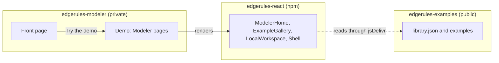
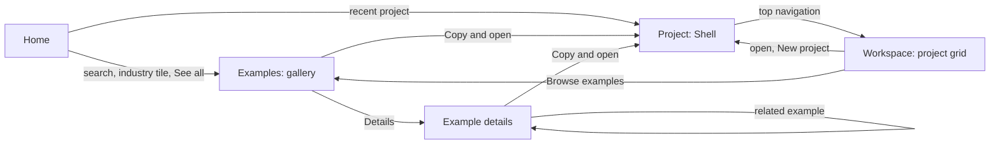
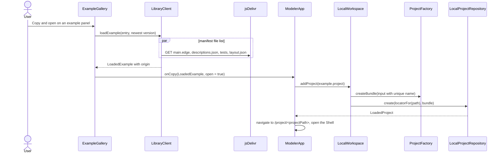
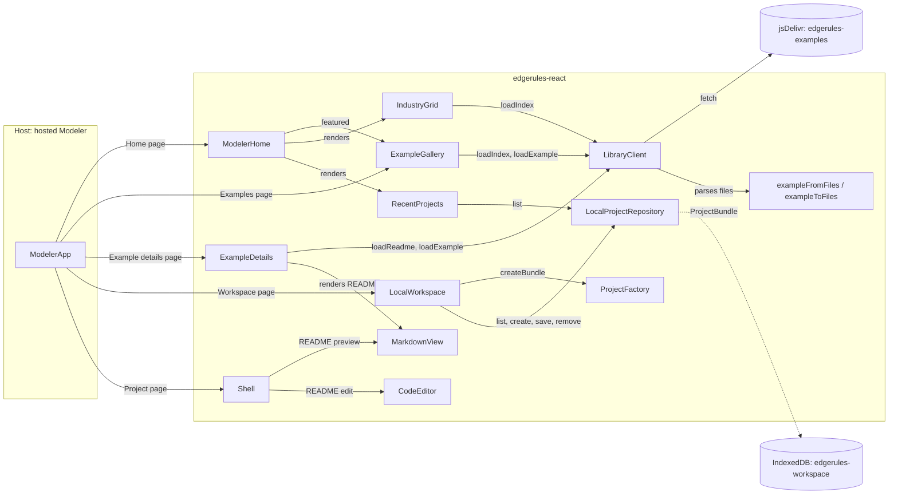

# Examples Library and Local Workspace

## Summary

The hosted Modeler loads `library.json` of the examples repository and shows it as a browsable Library. The story
[examples-repository-story.md](examples-repository-story.md) defines the repository and its index.

The Library is read-only: only Git changes the examples. The user copies an example into the Local Workspace and edits
the copy there.

The Local Workspace keeps the projects of the user in IndexedDB of the browser. It is the only writable store of the
Modeler in this story.

The hosted Modeler has four pages: Home, Examples, Workspace and Project.

The Examples page is a gallery of example panels by industry, with search. "Copy and open" opens a copy in the Shell in
one step.

Goals:

- **Scale:** the Library MUST stay usable with 5 000 examples. The Modeler loads only the index before the user selects
  an example.
- **Read-only Library:** a copy in the Local Workspace is the only way to change an example.
- **Provenance:** a workspace copy keeps the coordinates `<id>@<version>` of its example.
- **No router:** the components report navigation through callbacks; the host owns the routes.

Prerequisites:

- [model-readme-story.md](model-readme-story.md): `MarkdownView` and the README slice.
- [examples-repository-story.md](examples-repository-story.md): the published `rimvydasb/edgerules-examples` repository.
  The components of this story read it from the start, not a fixture.

## Technical Breakdown

### Host application `edgerules-modeler`

The host Modeler is the private repository `edgerules-modeler`, checked out at `../edgerules-modeler`. It is not public
on GitHub.

This story does not design `edgerules-modeler`; a separate story does.

- **Front page:** presents EdgeRules to a new visitor and links to the Demo.
- **Demo:** the visitor selects an industry and tries a model of it, or a default model opens.
- **Modeler pages:** the Demo uses the pages of "Modeler pages" with the components of this story.



### Modeler pages

The page structure combines two reference products:

- **GoRules templates:** an industry tab row over a gallery of panels, and a detail page per template. The detail page
  has actions, the decision model content, sample inputs and related templates of the same industry.
- **Dify Explore and Studio:** two separate pages. Explore is the template gallery with "Add to Workspace". Studio is
  the workspace grid: its first panel creates an app, and each app panel has a menu.

The host Modeler has a top navigation bar with Home, Examples and Workspace. The host owns the routes; each page is a
composition of components of this package.

| Page            | Route                                 | Content                                                                  | Components       |
| --------------- | ------------------------------------- | ------------------------------------------------------------------------ | ---------------- |
| Home            | `/`                                   | Search box, recent projects, industry tiles, featured examples           | `ModelerHome`    |
| Examples        | `/examples`, `/examples/<industry>`   | Industry tabs, search, facets, gallery of example panels                 | `ExampleGallery` |
| Example details | `/examples/<industry>/<id>@<version>` | Actions, metadata, version selector, README, related examples            | `ExampleDetails` |
| Workspace       | `/workspace`                          | Grid of project panels, "New project" panel, search, filters, panel menu | `LocalWorkspace` |
| Project         | `/project/<projectPath>`              | The Shell of one workspace project                                       | `Shell`          |

Navigation between the pages:



Home page:

```text
┌──────────────────────────────────────────────────────────────────────────────┐
│ EdgeRules        Home   Examples   Workspace                                 │
├──────────────────────────────────────────────────────────────────────────────┤
│        [ 🔍 Search 240 examples: loan, scorecard, optimise ...         ]     │
│                                                                              │
│ Continue                                              [+ New project]  All → │
│ ┌─────────────┐ ┌─────────────┐ ┌─────────────┐                              │
│ │Loan repaym. │ │Claims triage│ │My pricing   │                              │
│ │saved 2 h ago│ │saved 1 d ago│ │saved 3 d ago│                              │
│ └─────────────┘ └─────────────┘ └─────────────┘                              │
│ Industries                                                                   │
│ ┌──────────┐ ┌──────────┐ ┌──────────┐ ┌──────────┐ ┌──────────┐             │
│ │Financial │ │Insurance │ │Healthcare│ │Logistics │ │Retail    │  ...        │
│ │ 42       │ │ 31       │ │ 18       │ │ 22       │ │ 27       │             │
│ └──────────┘ └──────────┘ └──────────┘ └──────────┘ └──────────┘             │
│ Featured examples                                                   See all → │
│ (example panels, as on the Examples page)                                    │
└──────────────────────────────────────────────────────────────────────────────┘
```

Examples page with example panels:

```text
┌──────────────────────────────────────────────────────────────────────────────┐
│ [ 🔍 Search examples                    ]   Level ▾  Features ▾  Sort ▾      │
│ All  Financial  Insurance  Healthcare  Logistics  Retail  Telco  Public ...  │
│ 42 examples                                                                  │
│ ┌────────────────────────┐ ┌────────────────────────┐ ┌──────────────────── │
│ │ [thumbnail]            │ │ [thumbnail]            │ │ ...                  │
│ │ Financial · Beginner   │ │ Financial · Advanced   │ │                      │
│ │ Loan repayment         │ │ Loan origination       │ │                      │
│ │ Prices a loan request  │ │ Scorecard, policy rules│ │                      │
│ │ and returns ...        │ │ and affordability ...  │ │                      │
│ │ decision-table workbook│ │ scorecard service +3   │ │                      │
│ │ ✓ In workspace         │ │                        │ │                      │
│ │ [Copy and open] Details│ │ [Copy and open] Details│ │                      │
│ └────────────────────────┘ └────────────────────────┘ └──────────────────── │
└──────────────────────────────────────────────────────────────────────────────┘
```

Example details page:

```text
┌──────────────────────────────────────────────────────────────────────────────┐
│ Examples / Financial / Loan repayment                                        │
│ Loan repayment                                         version [1.2.0 ▾]     │
│ Prices a loan request and returns its monthly repayment schedule             │
│ [Copy and open]  [Copy to workspace]  [Share link]                           │
├───────────────────────────────────────────────────┬──────────────────────────┤
│ README.md (MarkdownView)                          │ Level: Beginner          │
│                                                   │ Features: decision-table,│
│                                                   │   function, workbook ... │
│                                                   │ 14 tests · 88 lines      │
│                                                   │ Engine: >=0.1.2-alpha    │
│                                                   │ Released: 2026-10-28     │
│                                                   │ View on GitHub →         │
├───────────────────────────────────────────────────┴──────────────────────────┤
│ Related examples (same industry, shared features): 3 example panels          │
└──────────────────────────────────────────────────────────────────────────────┘
```

Workspace page:

```text
┌──────────────────────────────────────────────────────────────────────────────┐
│ Workspace     [ 🔍 Search projects ]  Source: All ▾  Sort: Last saved ▾      │
│ ┌──────────────────┐ ┌──────────────────┐ ┌──────────────────┐              │
│ │  + New project   │ │ Loan repayment ⋮ │ │ My pricing     ⋮ │              │
│ │  Blank project   │ │ from loan-repay- │ │ Own project      │              │
│ │  From example →  │ │  ment@1.2.0      │ │                  │              │
│ │                  │ │ saved 2 h ago    │ │ saved 3 d ago    │              │
│ └──────────────────┘ └──────────────────┘ └──────────────────┘              │
│ Storage: 3.2 MB used of 1.1 GB · persistent                                  │
└──────────────────────────────────────────────────────────────────────────────┘
```

The panel menu `⋮` has Open, Rename, Duplicate and Delete.

### Origin of a workspace copy

An example has the coordinates `<id>@<version>` of [examples-repository-story.md](examples-repository-story.md). A
workspace copy keeps them.

- A copy stores its coordinates as `origin` in its manifest. A duplicate of a copy keeps the same `origin`.

The `ProjectManifest` gets the `origin` field:

```typescript
interface ProjectOrigin {
  library: string; // indexUrl of the LibrarySource that resolved the example
  id: string; // example id, the slug
  version: string; // released example version
}

interface ProjectManifest {
  // ...existing members
  origin?: ProjectOrigin; // coordinates of the library example that this project is a copy of
}
```

The Library compares the `origin` of the workspace projects with the index:

| Workspace state                   | Library shows                                    |
| --------------------------------- | ------------------------------------------------ |
| No project with this example `id` | Copy to workspace                                |
| A copy of the newest version      | "In workspace" badge; Open copy, Copy again      |
| Copies of older versions only     | "Update available" badge; Open copy, Copy newest |

### Example gallery and details

`ExampleGallery` is the Examples page and the featured row of the Home page. `ExampleDetails` is the Example details
page.

| Feature          | Behavior                                                                                                |
| ---------------- | ------------------------------------------------------------------------------------------------------- |
| Industry tabs    | "All" and one tab per industry of the index, with example counts; the tab is the `industry` prop        |
| Search           | Client-side, as the user types; matches `name`, `description`, `tags`, `features`, `id`, industry title |
| Facets           | Level, features (multi-select, AND), engine compatibility                                               |
| Sort             | Relevance, name, last release                                                                           |
| Example panel    | Thumbnail, industry, level, name, description, up to 3 features and "+N", workspace badge               |
| Panel actions    | "Copy and open" (primary) and "Details"                                                                 |
| Featured mode    | `featured` prop: the examples of `index.featured` in their order, no tabs, no facets                    |
| Details actions  | "Copy and open", "Copy to workspace", "Share link" (copies the page URL), "View on GitHub"              |
| Details content  | Version selector, rendered `README.md`, metadata side panel, related examples                           |
| Related examples | Up to 3 examples of the same industry, ordered by the number of shared features                         |
| Read-only        | No edit action; a copy is the only way to change an example                                             |
| Compatibility    | A version whose `engine` range excludes the loaded engine shows a warning; copy stays available         |
| Workspace badges | `workspaceOrigins` prop: see "Origin of a workspace copy"                                               |
| Errors           | Index failure: retry panel. File failure: error on the details page with the file name                  |
| Keyboard         | Arrow keys move between panels, Enter opens the details, `/` focuses search                             |

- Search MUST respond within 50 ms for 5 000 entries. A lowercase token index built once after `loadIndex` meets this
  target, so the gallery needs no search library.
- The gallery renders the visible panels only (virtual grid), so 5 000 panels do not slow the page.

`IndustryGrid` shows one tile per industry of the index: icon, title, description and example count. A tile click calls
`onSelectIndustry(id)`.

### Modeler Home

`ModelerHome` is the Home page: the start point of the Modeler and the entry to the Library and the Workspace. The host
gives it callbacks for navigation and renders nothing else on the page.

| Section         | Content                                                                             | Source                   |
| --------------- | ----------------------------------------------------------------------------------- | ------------------------ |
| Hero            | Title, one-line tagline, search box with suggestions                                | Props, index, repository |
| Continue        | `RecentProjects`: up to 6 newest saved projects, "New project", "All projects"      | `LocalProjectRepository` |
| Get started     | Replaces "Continue" for an empty workspace: "Blank project" and 3 beginner examples | Index, `level: beginner` |
| Industries      | `IndustryGrid`: one tile per industry with icon, title and example count            | Index                    |
| Featured        | `ExampleGallery` in featured mode, "See all examples"                               | `index.featured`         |
| New and updated | Up to 6 examples with the newest `released` dates                                   | Index `versions`         |

Search box behavior:

- Typing shows up to 5 example suggestions and up to 3 workspace project suggestions in one dropdown, in two groups.
- Arrow keys and Enter on a suggestion open the example details page or the project. Enter without a selection calls
  `onSearch(query)`; the host shows the Examples page with that query.
- `/` focuses the search box from anywhere on the page.

Other behavior:

- Each section shows a skeleton while it loads. An index failure hides the library sections and shows one retry panel;
  "Continue" stays usable.
- The grid has 1 column on a phone, 2 on a tablet, and 3 or 4 on a desktop. Light and dark themes use Mantine tokens.

### Package placement of the page components

`ModelerHome`, `ExampleGallery`, `ExampleDetails` and `LocalWorkspace` are page-level components. They stay in
`src/components/`, as one component directory each:

| Component directory | Public API                                                                | Allowed component dependencies                          |
| ------------------- | ------------------------------------------------------------------------- | ------------------------------------------------------- |
| `example-library`   | `ExampleGallery`, `ExampleDetails`, `IndustryGrid`, `createLibraryClient` | `project-session`, `markdown-view`                      |
| `local-workspace`   | `LocalWorkspace`, `RecentProjects`                                        | `project-session`, `example-library`                    |
| `modeler-home`      | `ModelerHome`                                                             | `project-session`, `example-library`, `local-workspace` |

Rules for a page-level component:

- It takes its data sources as props (`LibraryClient`, `LocalProjectRepository`). It does not create them.
- It reports navigation through callbacks. It MUST NOT import a router, read `window.location`, or own a URL.
- It has no hard-coded library URL. The host creates the `LibraryClient` from its `LibrarySource`.

`edgerules-react` has no index page of its own: it is a library, and the host Modeler (`edgerules-modeler`) owns `/`.
Storybook is the only page that the repository runs.

- The `Modeler` Storybook group is first in `storySort`. Its first story, `Modeler/Home`, renders `ModelerHome` with the
  published `edgerules-examples` index and an in-memory workspace.
- The other `Modeler` stories compose the Examples, Example details, Workspace and Project pages as the host does.

### Local Workspace

`LocalWorkspace` is a React component over one `LocalProjectRepository`. It lists the projects of the user and manages
them; the Shell edits one open project.

- The workspace uses the IndexedDB database `edgerules-workspace`. It has no other storage and no export.
- On first use the workspace calls `navigator.storage.persist()`. It shows a warning when the browser can evict the
  data.

| Feature           | Behavior                                                                                 |
| ----------------- | ---------------------------------------------------------------------------------------- |
| Project grid      | One panel per project: name, description, origin coordinates or "Own project", last save |
| Sort and filter   | Sort by last save or name; source filter: all, from examples, own projects               |
| Search            | Client-side filter on name, description and tags                                         |
| Open              | Calls `onOpen(locator)`; the host opens the session in the Shell                         |
| New project panel | First panel of the grid: "Blank project" (name dialog, empty model) or "From example"    |
| Copy from Library | Adds the project of `LoadedExample`; a taken name gets a suffix: `Loan repayment (2)`    |
| Duplicate         | A new project from the head bundle; same `origin`, new `projectId`, suffixed name        |
| Panel menu        | Open, Rename, Duplicate, Delete                                                          |
| Rename            | Changes the manifest `name` and `description`; saves a new revision                      |
| Delete            | Mantine confirm modal, then `LocalProjectRepository.remove`; no browser `confirm()`      |
| Origin            | A copy shows `id@version`, and "Update available" when the index has a newer version     |
| Storage           | Used and available bytes from `navigator.storage.estimate()`                             |
| Empty state       | "Browse examples" and "New project" actions                                              |
| Recent projects   | `RecentProjects`: the newest saved projects as compact panels for the Home page          |

`LocalProjectRepository` stores `savedAt`, the time of each save, in the IndexedDB record of the head revision. The
last-save sort and "saved 2 h ago" read it.

"Copy and open" goes straight to the Shell:



### Shell navigation

The Shell bar links the open project to the Workspace, the Library and its source example. It has three parts:

- **Workspace crumb:** the breadcrumb starts with "Workspace /". A click calls `onShowWorkspace`.
- **Project menu:** the project name in the middle of the Shell bar, with `▾`. A click opens the menu below.
- **Origin chip:** a copy of an example shows `from <id>@<version>` in the menu header. With a newer version in the
  index, the chip shows "Update available".

```text
┌──────────────────────────────────────────────────────────────────────────────────────────┐
│ Workspace / Loan Repayment Planner / mortgageBook    Loan repayment ▾    ⚙  Boxed|Flow|… │
└──────────────────────────────────────────────────────────────────────────────────────────┘
                                       ┌──────────────────────────────────────┐
                                       │ Loan repayment                       │
                                       │ saved 2 min ago                      │
                                       │ [from loan-repayment@1.2.0 ↗]        │
                                       │──────────────────────────────────────│
                                       │ ← Back to workspace                  │
                                       │ Recent projects                      │
                                       │   Claims triage                      │
                                       │   My pricing                         │
                                       │ Browse examples                      │
                                       │ View original example                │
                                       │──────────────────────────────────────│
                                       │ Open README                          │
                                       │ Duplicate                            │
                                       └──────────────────────────────────────┘
```

| Menu item             | Shown                              | Action                                                     |
| --------------------- | ---------------------------------- | ---------------------------------------------------------- |
| Origin chip           | The manifest has an `origin`       | `onShowOrigin(origin)`: the host shows the example details |
| Back to workspace     | Always                             | `onShowWorkspace()`                                        |
| Recent projects       | Up to 5, the open project excluded | `onOpenProject(locator)`                                   |
| Browse examples       | Always                             | `onBrowseExamples()`                                       |
| View original example | The manifest has an `origin`       | `onShowOrigin(origin)`                                     |
| Open README           | Always                             | The Shell shows the `readme` view of the project root      |
| Duplicate             | `onDuplicate` is set               | `onDuplicate()`: the host adds a copy and opens it         |

- The Shell reads the project name, `origin` and the last save from its session. The host gives the recent projects and
  the origin status. The Shell reads neither the repository nor the library.
- An unsaved change does not block navigation in the Shell. The host decides to save, ask, or discard before it leaves
  the Project page.
- Without the `navigation` prop the Shell bar has no Workspace crumb and no project menu. Storybook stories and embedded
  hosts use this form.

### Structural Diagram

The new components of this package and their dependencies:



### TypeScript API

`example-library` component, subpath export `edgerules-react/example-library`:

```typescript
interface LibrarySource {
  indexUrl: string; // URL of library.json; also the `library` of a ProjectOrigin
  fileBaseUrl: (ref: string) => string; // base URL of the repository files at a commit, with a final '/'
}

interface ExampleCoordinates {
  id: string; // example id, the slug
  version: string; // released version
}

interface LibraryClient {
  loadIndex(): Promise<LibraryIndex>; // fetches and validates library.json; caches it for the session
  resolve(coordinates: ExampleCoordinates): LibraryVersion | undefined; // the version and its ref, from the index
  loadReadme(entry: LibraryEntry, version: string): Promise<string>; // README Markdown at the ref of the version
  loadExample(entry: LibraryEntry, version: string): Promise<LoadedExample>; // all files of the manifest, in parallel
}

interface LoadedExample {
  entry: LibraryEntry; // the index entry
  ref: string; // commit SHA of the files
  project: ProjectBundleInput; // ready for ProjectFactory.createBundle; `origin` and `readme` are set
}

interface ExampleGalleryProps {
  client: LibraryClient; // from createLibraryClient(source)
  industry?: string; // controlled industry tab; undefined is "All"
  onIndustryChange?: (industry: string | undefined) => void; // the host updates the route
  query?: string; // controlled search text, from the Home search box or the route
  onQueryChange?: (query: string) => void; // search text change
  featured?: boolean; // featured mode for the Home page: index.featured only, no tabs or facets
  limit?: number; // maximum number of panels; featured mode shows "See all"
  engineVersion?: string; // version of the loaded engine, for the compatibility facet
  workspaceOrigins?: ProjectOrigin[]; // origins of the workspace projects, for the badges
  onCopy: (example: LoadedExample, open: boolean) => void; // the host adds the copy; `open` for "Copy and open"
  onShowDetails: (coordinates: ExampleCoordinates) => void; // the host navigates to the details page
}

interface ExampleDetailsProps {
  client: LibraryClient; // from createLibraryClient(source)
  example: ExampleCoordinates; // from the route; an unknown id or version shows "Example not found"
  onVersionChange?: (coordinates: ExampleCoordinates) => void; // the host updates the route
  engineVersion?: string; // version of the loaded engine, for the compatibility warning
  workspaceOrigins?: ProjectOrigin[]; // origins of the workspace projects, for the badge
  onCopy: (example: LoadedExample, open: boolean) => void; // "Copy and open" and "Copy to workspace"
  onShowDetails: (coordinates: ExampleCoordinates) => void; // a related example
  shareUrl?: (coordinates: ExampleCoordinates) => string; // the URL that "Share link" copies; no button without it
  repositoryUrl?: (entry: LibraryEntry, ref: string) => string; // the "View on GitHub" link; no link without it
}

interface IndustryGridProps {
  client: LibraryClient; // from createLibraryClient(source)
  onSelectIndustry: (industry: string) => void; // the host navigates to /examples/<industry>
}
```

`local-workspace` component, subpath export `edgerules-react/local-workspace`:

```typescript
interface LocalWorkspaceProps {
  repository: LocalProjectRepository; // the IndexedDB repository of the workspace
  factory: ProjectFactory; // creates the bundle of a new project or a copy
  library?: LibraryClient; // resolves "Update available"; without it the badge is not shown
  onOpen: (locator: ProjectLocator) => void; // the host opens the project in the Shell
  onBrowseExamples?: () => void; // "Browse examples" and the "From example" action of the New project panel
}

interface RecentProjectsProps {
  repository: LocalProjectRepository; // the IndexedDB repository of the workspace
  limit?: number; // number of panels, default 6
  onOpen: (locator: ProjectLocator) => void; // the host opens the project in the Shell
  onNewProject?: () => void; // shows the "New project" action
  onShowAll?: () => void; // shows the "All" link to the Workspace page
}
```

`modeler-home` component, subpath export `edgerules-react/modeler-home`:

```typescript
interface ModelerHomeProps {
  client: LibraryClient; // the example library
  repository: LocalProjectRepository; // the workspace, for "Continue" and project suggestions
  title?: string; // hero title, default "EdgeRules Modeler"
  tagline?: string; // hero tagline
  engineVersion?: string; // version of the loaded engine, for the compatibility warnings
  onSearch: (query: string) => void; // the host shows the Examples page with this query
  onSelectIndustry: (industry: string) => void; // the host shows /examples/<industry>
  onShowDetails: (coordinates: ExampleCoordinates) => void; // the host shows the example details page
  onCopy: (example: LoadedExample, open: boolean) => void; // "Copy and open" on a panel
  onOpenProject: (locator: ProjectLocator) => void; // a recent project or a project suggestion
  onNewProject: () => void; // "New project" and "Blank project"
  onShowAllProjects: () => void; // the host shows the Workspace page
  onShowAllExamples: () => void; // the host shows the Examples page
}
```

```typescript
interface LocalWorkspaceHandle {
  addProject(input: ProjectBundleInput): Promise<LoadedProject>; // unique name and path, then repository.create
}
```

`project-session` changes:

```typescript
interface ProjectBundleInput {
  // ...existing members
  origin?: ProjectOrigin; // copied into the manifest
}

interface LocalProjectRepository {
  // ...existing members
  remove(locator: ProjectLocator): Promise<void>; // deletes the project and its history; `not-found` when absent
}

interface ProjectDescriptor {
  // ...existing members
  origin?: ProjectOrigin; // from the manifest, for the workspace list and the Library badges
  savedAt: string; // ISO time of the last save; stored in the IndexedDB record
}
```

`shell` change:

```typescript
interface ShellNavigation {
  onShowWorkspace: () => void; // the Workspace crumb and "Back to workspace"
  onBrowseExamples: () => void; // "Browse examples"
  onOpenProject: (locator: ProjectLocator) => void; // a recent project
  recentProjects?: ProjectDescriptor[]; // newest first; the Shell shows up to 5 and omits the open project
  onShowOrigin?: (origin: ProjectOrigin) => void; // the origin chip and "View original example"
  originStatus?: 'latest' | 'update-available'; // from the library index; no status without it
  onDuplicate?: () => void; // shows "Duplicate"; the host copies the project and opens the copy
}

interface ShellProps {
  // ...existing members
  navigation?: ShellNavigation; // shows the Workspace crumb and the project menu
}
```

## Architecture Changes

- New component `example-library`: public API `ExampleGallery`, `ExampleDetails`, `IndustryGrid`, `createLibraryClient`,
  and their types.
- New component `local-workspace`: public API `LocalWorkspace`, `RecentProjects` and their types.
- New component `modeler-home`: public API `ModelerHome` and its types. It depends on `example-library` and
  `local-workspace`.
- The host Modeler owns the pages, the routes and the top navigation. The package has no router dependency.
- The dependency-cruiser allowlists get the rows of "Package placement of the page components".
- `docs/architecture.md` "Scope": the library contains page-level components, but no application, router or index page.
- `project-session`: `ProjectManifest.origin` keeps the library coordinates of a copy. This replaces the rule of
  `global-project-management.md` §5.3 that fork provenance is not in the manifest (ADR entry).
- `project-session`: `LocalProjectRepository.remove`, and `origin` and `savedAt` in `ProjectDescriptor`.
- `project-session` exports `ProjectOrigin`.
- `shell`: optional `navigation` prop: Workspace crumb, project menu in the middle of the Shell bar, origin chip.
- No page-level component depends on `shell`, and `shell` depends on none of them.

## Out of Scope

- Any write from the Modeler to `edgerules-examples`. Only Git changes the Library.
- Export, import, or save of a workspace project to a file, Git or a cloud store.
- Automatic update of a copy to a newer example version.
- The design of `edgerules-modeler`: its front page and its Demo.

## Limitations

- The workspace data lives in one browser profile. A browser that evicts storage deletes the projects.
- Search is substring and token based, without typo tolerance.

## Future Improvements

- Export and import of a workspace project as an `.erproject` file.
- Three-way merge of a newer example version into a copy, with `origin` as the merge base.
- Ctrl+K command palette in the Shell: one search over projects, examples and commands, from the `ModelerHome` search.
- A closable banner on the first open of a copy: "Your copy of …", "View original", "More examples".

## Verification

| Check     | Command                |
| --------- | ---------------------- |
| Build     | `npm run build`        |
| Typecheck | `npm run typecheck`    |
| Lint      | `npm run lint`         |
| Test      | `npm test`             |
| Rules     | `npm run depcruise`    |
| Format    | `npm run format:check` |
| E2E       | `npm run e2e`          |
| Start     | `npm run storybook`    |

## Tasks

**Phase 1: origin and repository changes in `project-session`**

- [ ] Ensure project compiles and existing tests are passing
- [ ] Add `ProjectManifest.origin`, `ProjectBundleInput.origin` and `ProjectOrigin`
- [ ] Add `LocalProjectRepository.remove`, and `origin` and `savedAt` to `ProjectDescriptor`
- [ ] Store `savedAt` in the IndexedDB record on each save
- [ ] Add tests for the code of this phase

Acceptance criteria:

- [ ] `npm test` passes, including a repository test: `remove` deletes a project, and `list` omits it
- [ ] `npm test` passes, including a factory test: `origin` of the input is in the manifest of the new bundle
- [ ] `npm test` passes, including a repository test: `savedAt` changes on each save

**Phase 2: Local Workspace**

- [ ] Implement `LocalWorkspace`: list, search, sort, open, new, duplicate, rename, delete, storage, empty state
- [ ] Implement `addProject` with unique names and paths
- [ ] Implement `RecentProjects`
- [ ] Request persistent storage on first use and show the eviction warning
- [ ] Add Storybook stories: empty workspace, workspace with copies, delete confirm
- [ ] Add tests for the code of this phase

Acceptance criteria:

- [ ] `npm test` passes, including `LocalWorkspace.test.tsx`: new, duplicate, rename and delete against IndexedDB
- [ ] `npm test` passes, including a test: two copies of one example get the names `X` and `X (2)`

**Phase 3: Shell navigation**

- [ ] Add `ShellNavigation` and the `navigation` prop to the Shell
- [ ] Add the Workspace crumb to `ShellBreadcrumbs`
- [ ] Add the project menu in the middle of the Shell bar, with the origin chip in its header
- [ ] Add a Storybook story of the Shell with navigation, for a copy with "Update available" and for an own project
- [ ] Add tests for the code of this phase

Acceptance criteria:

- [ ] `npm test` passes, including a Shell test: the Workspace crumb calls `onShowWorkspace`
- [ ] `npm test` passes, including a Shell test: the menu of a copy shows the origin chip and "View original example"
- [ ] `npm test` passes, including a Shell test: the menu of an own project has no origin chip
- [ ] `npm test` passes, including a Shell test: without `navigation` the Shell bar is unchanged

**Phase 4: Library client and components**

- [ ] Implement `createLibraryClient` with index validation, `resolve` and parallel file reads
- [ ] Implement `ExampleGallery`: industry tabs, search, facets, sort, example panels, featured mode, virtual grid
- [ ] Implement `ExampleDetails`: actions, version selector, README, metadata panel, related examples
- [ ] Implement `IndustryGrid`
- [ ] Add `EXAMPLES_SOURCE` to `stories/support/`: the `LibrarySource` of `rimvydasb/edgerules-examples` on jsDelivr
- [ ] Add Storybook stories against `EXAMPLES_SOURCE`, with a `LocalWorkspace` next to the gallery
- [ ] Add a test fixture: a snapshot of the published `library.json` and its files. Unit tests read it offline
- [ ] Add a second version of one example to the fixture, for the version and badge tests
- [ ] Add tests for the code of this phase

Acceptance criteria:

- [ ] `npm test` passes, including `ExampleGallery.test.tsx` and `ExampleDetails.test.tsx`: search, facets, panels,
      versions, copy
- [ ] `npm test` passes, including a badge test: a workspace origin of an older version shows "Update available"
- [ ] A test with 5 000 generated entries finds a match in less than 50 ms

**Phase 5: Modeler Home and page composition**

- [ ] Add a `Modeler` Storybook group, first in `storySort`, with the Home, Examples, Example details, Workspace and
      Project pages
- [ ] Implement `ModelerHome`: hero search with suggestions, Continue or Get started, industries, featured, new and
      updated
- [ ] Compose the pages as the host does, with `EXAMPLES_SOURCE` and an in-memory route state
- [ ] Add tests for the code of this phase

Acceptance criteria:

- [ ] `npm test` passes, including `ModelerHome.test.tsx`: suggestions, empty workspace, index failure
- [ ] In Storybook, "Copy and open" on an example panel shows the copy in the Shell
- [ ] In Storybook, the Workspace page lists the copy with its origin and its last save time
- [ ] In Storybook, the project menu of the copy opens its example details, and the Workspace crumb opens the Workspace

**Phase E2E:**

- [ ] Add E2E tests for the user flows of this story

Acceptance criteria:

- [ ] `npm run e2e` passes, including `example-library.spec.ts`: search, preview, copy, open in the Shell, against the
      published repository
- [ ] `npm run e2e` passes, including `local-workspace.spec.ts`: copy, rename, duplicate, delete, reload

**Phase X:**

- [ ] Update `docs/architecture.md` with the changes from `## Architecture Changes`
- [ ] Add an ADR entry to `docs/architecture-adr.md`: the manifest keeps the library `origin`
- [ ] Update `global-project-management.md` §5.3 and §11 to reference this story
- [ ] Update `README.md` with the new components
- [ ] Review the implementation against this story and the project conventions

Acceptance criteria:

- [ ] Every command in `## Verification` passes
- [ ] Storybook starts with `npm run storybook` and shows the `Modeler` group first
