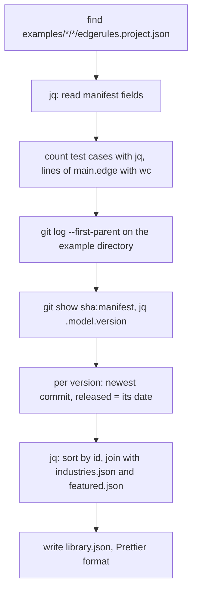
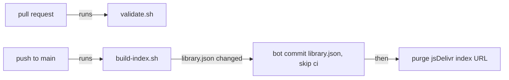

# Examples Repository

## Summary

The public GitHub repository `rimvydasb/edgerules-examples` stores EdgeRules example projects as plain files. A
generated index, `library.json`, at the repository root lists every example and every released version.

Only Git changes the examples. The Examples Library of the Modeler reads them through jsDelivr
([examples-library-story.md](examples-library-story.md)).

Goals:

- **Git diff:** every authored fact is in one small text file with a deterministic format. A change to a model shows as
  a DSL line diff, not as an escaped JSON string.
- **One format:** an example is a complete project in the authored project format. The repository adds no model logic.
- **Maven-like repository:** `library.json` is the repository index. It resolves the coordinates `<id>@<version>` of an
  example to an immutable commit.
- **No backend:** a reader gets the index and the files through a CDN. It does not use the GitHub REST API.
- **Local tooling:** every CI check is a script that also runs on a developer machine.

Prerequisite: Phase 1 of [model-readme-story.md](model-readme-story.md), because each example has a `README.md`.

This story refines `global-project-management.md` §11. It replaces the CDN `.erproject` bundles of §11.2 with per-file
reads from the repository at a pinned commit.

## Technical Breakdown

### Repository boundaries

`edgerules-examples` is a separate repository with its own CI. It does not contain code of `edgerules-react`.

The local checkout of `edgerules-examples` is the sibling directory `../edgerules-examples`.

| Concern                                                      | `edgerules-react`                 | `edgerules-examples`       |
| ------------------------------------------------------------ | --------------------------------- | -------------------------- |
| Example files, `industries.json`, `featured.json`, `LICENSE` |                                   | Yes                        |
| `library.json` and `tooling/build-index.sh`                  |                                   | Yes                        |
| `tooling/validate.sh` and its Node script                    |                                   | Yes                        |
| JSON Schemas of the example files                            | Yes, published in the npm package | Uses them as a dependency  |
| `exampleFromFiles`, `exampleToFiles`                         | Yes                               | Uses them as a dependency  |
| Engine for validation                                        |                                   | `@edgerules/node` from npm |

### First examples

The first 3 examples are the 3 projects of [`models/`](../../models/README.md), in the example directory format.

| Source in `models/` | Example directory                      | Industry  | Level        | Requires      |
| ------------------- | -------------------------------------- | --------- | ------------ | ------------- |
| `loan-repayment/`   | `examples/financial/loan-repayment/`   | Financial | beginner     | none          |
| `loan-origination/` | `examples/financial/loan-origination/` | Financial | intermediate | none          |
| `client-outreach/`  | `examples/financial/client-outreach/`  | Financial | advanced     | `milp-solver` |

- The script `scripts/export-examples.ts` of `edgerules-react` writes the 3 directories with `exampleToFiles`. It reads
  the `*_PROJECT` bundles of `models/` and writes to `../edgerules-examples/examples/`.
- `main.edge` of `client-outreach` contains the 100 generated clients of `clients.ts` as DSL text.
- Each example gets an authored `README.md` with the sections of "README of an example". The `'*'` description of
  `documentation.ts` is its overview paragraph.
- After the export, `edgerules-examples` is the source of its examples. `models/` stays the test and Storybook fixture
  set of `edgerules-react`.

### Repository layout

```text
edgerules-examples/
├── library.json                         # repository index; build-index.sh writes it, contributors never edit it
├── examples/
│   ├── financial/
│   │   ├── loan-repayment/              # one example = one project directory
│   │   └── loan-origination/
│   └── <industry>/<slug>/
├── industries.json                      # industry id -> title, description, icon, order
├── featured.json                        # ordered example ids for the Home page
├── tooling/
│   ├── build-index.sh                   # scans examples/ and writes library.json; CI and local
│   ├── validate.sh                      # schema, engine, tests, README checks; CI and local
│   └── validate.mjs                     # Node part of validate.sh
├── package.json                         # devDependencies: edgerules-react, @edgerules/node, prettier
├── .github/workflows/                   # validate on PR, build index on main
├── LICENSE                              # MIT, for every example
├── CONTRIBUTING.md
└── CODEOWNERS
```

- **Industry folder:** groups examples for humans and for the GitHub file browser. GitHub lists at most 1 000 entries of
  a folder, so a flat `examples/` folder does not scale.
- **Example id:** the `slug` folder name. It is unique in the whole repository (CI check). The id does not contain the
  industry, so a move to another industry keeps coordinates and deep links valid.
- **Industries:** the first `industries.json` has Financial, Aviation, Insurance, Healthcare, Logistics, Retail, Telco,
  Public Sector, Energy, Manufacturing and Cross-industry. Cross-industry holds examples of DSL features.
- **License:** all examples are MIT. The repository `LICENSE` file covers them, so an example has no license field.

### Example directory layout

```text
examples/financial/loan-repayment/
├── edgerules.project.json       # manifest: identity, version, catalog metadata, file list
├── README.md                    # project README; Library preview and Shell README view
├── model/
│   └── main.edge                # EdgeRules DSL, as written
├── docs/
│   └── descriptions.json        # DocumentationDocument: short description by model path
├── tests/
│   ├── loanRepayment.tests.json # one TestSuite per subject, self-contained
│   └── pricingTier.tests.json
├── flow/
│   └── layout.json              # FlowMetadataDocument: outputs, charts, positions
└── assets/
    ├── thumbnail.webp           # optional card image, 640 x 360
    └── *.png | *.svg            # optional README images
```

### Files and their diff properties

| File                         | Format                            | Maps to `ProjectBundleInput`             | Diff property                                    |
| ---------------------------- | --------------------------------- | ---------------------------------------- | ------------------------------------------------ |
| `edgerules.project.json`     | JSON, Prettier                    | `name`, `description`, `tags`, `model.*` | Small; changes only on a metadata edit           |
| `README.md`                  | Markdown, Prettier `proseWrap`    | `readme`                                 | Line diff of prose                               |
| `model/main.edge`            | DSL text, LF, final newline       | `model.dsl`                              | Line diff of the rules                           |
| `docs/descriptions.json`     | JSON, keys sorted, one key a line | `documentation`                          | One changed line for one changed description     |
| `tests/<subject>.tests.json` | JSON, Prettier                    | one entry of `tests.subjects`            | A new case adds one block; suites never conflict |
| `flow/layout.json`           | JSON, Prettier, positions rounded | `flow`                                   | Isolated: layout noise stays out of model diffs  |
| `assets/*`                   | Binary                            | none                                     | Size-limited, rarely changed                     |

Rules for a stable diff:

- The model DSL MUST be a file, never a string inside JSON or TypeScript.
- Every JSON file MUST pass `prettier --check`. The serializer writes object keys in a fixed order.
- `layout.json` MUST round positions to whole pixels. A drag of 0.3 px MUST NOT create a diff.
- Test case `id` values MUST be stable. A reorder changes `order` only.
- A test suite MUST be self-contained: its inputs are in the suite file.
- Derived data MUST NOT be in the repository: test results, Portable JSON, schemas, TAST.

### Manifest

The library manifest extends the `ProjectManifest` of
[`bundle/types.ts`](../../src/components/project-session/bundle/types.ts) without `projectId`. The `ProjectFactory`
gives each copy a new `projectId`.

```json
{
  "$schema": "../../../node_modules/edgerules-react/schemas/example.schema.json",
  "kind": "EdgeRulesProject",
  "formatVersion": 3,
  "name": "Loan repayment",
  "description": "Prices a loan request and returns its monthly repayment schedule",
  "tags": ["finance", "loan"],
  "model": {"format": "dsl", "source": "model/main.edge", "name": "Loan Repayment Planner", "version": "1.2.0"},
  "documentation": "docs/descriptions.json",
  "tests": ["tests/loanRepayment.tests.json", "tests/pricingTier.tests.json"],
  "flow": "flow/layout.json",
  "example": {
    "industry": "financial",
    "level": "beginner",
    "features": ["decision-table", "function", "service", "workbook", "chart"],
    "thumbnail": "assets/thumbnail.webp",
    "engine": ">=0.1.2-alpha",
    "authors": ["edgerules"],
    "requires": []
  }
}
```

| Field                            | Required | Use                                                         |
| -------------------------------- | -------- | ----------------------------------------------------------- |
| `name`                           | Yes      | Card title and the name of the copy                         |
| `description`                    | Yes      | Card text, at most 160 characters                           |
| `tags`                           | No       | Free search terms                                           |
| `model.version`                  | Yes      | Example version, semver; the `<version>` of the coordinates |
| `tests`, `flow`, `documentation` | No       | File list; the loader reads no directory listing            |
| `example.industry`               | Yes      | Id from `industries.json`; MUST match the parent folder     |
| `example.level`                  | Yes      | `beginner`, `intermediate` or `advanced`                    |
| `example.features`               | Yes      | Controlled vocabulary of DSL features; Library facet        |
| `example.engine`                 | Yes      | Semver range of `@edgerules/web` that links the model       |
| `example.thumbnail`              | No       | Card image                                                  |
| `example.authors`                | Yes      | Attribution                                                 |
| `example.requires`               | No       | Host capabilities: `milp-solver` for an `optimise` element  |

`README.md` has a fixed path in every project, so the manifest has no field for it. `example.features` comes from the
vocabulary in `example.schema.json`, and `validate.sh` checks each listed feature against the linked model.

### README of an example

The README slice is defined in [model-readme-story.md](model-readme-story.md).

Each `README.md` of a library example SHOULD have these sections:

- **Title and one-paragraph overview:** the business problem.
- **Inputs and outputs:** a table of the service inputs and results.
- **Walkthrough:** the model parts in reading order, with `model:` links of `MarkdownView`.
- **Try it:** the workbooks and test suites to open first.
- **EdgeRules features:** the DSL features that the example shows, with links to the language reference.

A README MAY use GitHub Flavored Markdown: tables, task lists, fenced code, relative images from `assets/`. It MUST NOT
contain raw HTML: the viewer drops it.

### Coordinates and versions

An example has Maven-like coordinates `<id>@<version>`, for example `loan-repayment@1.2.0`. The `version` is the
`model.version` of the manifest.

- A released version is immutable. A change to the files of an example in Git MUST increase `model.version`.
- The index keeps every released version of an example with the commit that holds it. Old versions stay loadable.

### Index file `library.json`

`tooling/build-index.sh` writes `library.json` from all manifests and the git history. CI runs it on each push to
`main`; a contributor runs the same script locally.

```json
{
  "schemaVersion": 1,
  "generatedFrom": "3f9c2e1a7b0d...",
  "industries": [
    {"id": "financial", "title": "Financial", "description": "Credit, pricing, repayment", "icon": "bank"}
  ],
  "featured": ["loan-repayment", "claims-triage"],
  "examples": [
    {
      "id": "loan-repayment",
      "path": "examples/financial/loan-repayment",
      "name": "Loan repayment",
      "description": "Prices a loan request and returns its monthly repayment schedule",
      "industry": "financial",
      "level": "beginner",
      "features": ["decision-table", "function", "service", "workbook", "chart"],
      "tags": ["finance", "loan"],
      "engine": ">=0.1.2-alpha",
      "thumbnail": "assets/thumbnail.webp",
      "stats": {"tests": 14, "lines": 88},
      "versions": [
        {"version": "1.2.0", "ref": "3f9c2e1a7b0d...", "released": "2026-10-28"},
        {"version": "1.1.0", "ref": "9a41c07e55f2...", "released": "2026-09-14"}
      ]
    }
  ]
}
```

- **`generatedFrom`:** the `HEAD` commit that `build-index.sh` scanned. The index has no wall-clock time, so two runs on
  one commit give identical files.
- **`versions`:** newest first. `ref` is the commit SHA that holds the files of the version at the entry `path`. The
  metadata fields of the entry are those of the newest version.
- **Order:** `industries` in the order of `industries.json`; `featured` as in `featured.json`; `examples` sorted by
  `id`.
- **Size:** one entry is approximately 450 bytes plus 90 bytes a version. The index of 5 000 entries with 3 versions
  each is approximately 3.6 MB, or 450 KB with gzip.

### Index script `build-index.sh`

`build-index.sh` is a bash script with no Node dependency. It needs `bash` 3.2 or later (the macOS default), `git` and
`jq` 1.6 or later.

| Invocation                            | Behavior                                                              |
| ------------------------------------- | --------------------------------------------------------------------- |
| `tooling/build-index.sh`              | Writes `library.json` from the working tree and the history of `HEAD` |
| `tooling/build-index.sh --check`      | Writes nothing; exits 1 when `library.json` differs from the result   |
| `tooling/build-index.sh --out <file>` | Writes the index to `<file>`                                          |

The script builds the index in these steps:



- The `ref` of a version is the newest first-parent commit that changed the example directory with that `model.version`.
- The script fails with the manifest path on a manifest that `jq` cannot parse.
- The script needs the full history: CI checks out with `fetch-depth: 0`.
- An uncommitted change has no commit. The script reports it as a warning and gives it no `ref`.

### Repository CI

`tooling/validate.sh` runs the pull request checks. It calls `validate.mjs` with `edgerules-react` and `@edgerules/node`
from `package.json`.

| Check       | Failure condition                                                                                  |
| ----------- | -------------------------------------------------------------------------------------------------- |
| Schema      | A manifest, a test suite, descriptions or layout fails its JSON Schema                             |
| Format      | `prettier --check` fails, or `exampleToFiles(exampleFromFiles(files))` differs                     |
| Engine link | `main.edge` does not parse or link with `@edgerules/node`                                          |
| Tests       | A test case fails in the `TestRunner`                                                              |
| References  | A description, test subject, flow output or chart points to a missing model path                   |
| README      | `README.md` is missing, has a broken relative link, or a `model:` link to a missing path           |
| Metadata    | Unknown industry, folder and industry differ, duplicate slug, unknown feature, unknown featured id |
| Version     | Files of an example change, and `model.version` is not greater than on `main`                      |
| Size        | Example over 1 MB, an asset over 300 KB, `main.edge` over 5 000 lines                              |
| Secrets     | The secret scanner finds a credential                                                              |

The two workflows:



### File delivery

The Modeler reads files through jsDelivr. jsDelivr serves GitHub files with CORS and without an API rate limit. It
caches a commit-pinned URL permanently.

| Request      | URL                                                                                  | Cache                        |
| ------------ | ------------------------------------------------------------------------------------ | ---------------------------- |
| Index        | `https://cdn.jsdelivr.net/gh/rimvydasb/edgerules-examples@main/library.json`         | 12 h; CI purges it on update |
| Example file | `https://cdn.jsdelivr.net/gh/rimvydasb/edgerules-examples@<ref>/<path>/<file>`       | Immutable                    |
| Fallback     | `https://raw.githubusercontent.com/rimvydasb/edgerules-examples/<ref>/<path>/<file>` | 5 min                        |

The host configures both base URLs in a `LibrarySource`. A self-hosted copy of the repository uses the same layout.

### TypeScript API

`project-session` exports the example file conversion. It uses no engine, so Node and the browser both use it:

```typescript
type ExampleFiles = Record<string, string>; // path relative to the example directory -> text content

function exampleFromFiles(files: ExampleFiles): ProjectBundleInput; // throws ProjectError 'invalid-bundle'
function exampleToFiles(project: ProjectBundleInput, example: ExampleMetadata): ExampleFiles; // canonical serializer
```

## Architecture Changes

- `project-session` exports `exampleFromFiles`, `exampleToFiles` and `ExampleMetadata`.
- The npm package publishes the JSON Schemas of the example files under `schemas/`.
- `package.json` gets a `prepare` script that builds `dist/`, so that a Git dependency installs a build.
- `scripts/export-examples.ts` exports the projects of `models/` to `../edgerules-examples`. It is a development script
  and is not published.

## Out of Scope

- Any write from the Modeler to `edgerules-examples`. Only Git changes the examples.
- The Library user interface: [examples-library-story.md](examples-library-story.md).

## Limitations

- Model DSL has no import. A large input data set in the model is part of `main.edge`.
- The index purge relies on the jsDelivr purge API. Without a purge, a new example appears within 12 h.

## Future Improvements

- Shard `library.json` by industry above 5 000 examples: the root index keeps industries and counts only.
- "Export as example": `exampleToFiles` produces a ZIP of the directory for a pull request to `edgerules-examples`.

## Verification

| Check     | Command                |
| --------- | ---------------------- |
| Build     | `npm run build`        |
| Typecheck | `npm run typecheck`    |
| Lint      | `npm run lint`         |
| Test      | `npm test`             |
| Rules     | `npm run depcruise`    |
| Format    | `npm run format:check` |
| E2E       | `npm run e2e`          |
| Start     | `npm run storybook`    |

`edgerules-examples` checks: `tooling/validate.sh` and `tooling/build-index.sh --check`.

## Tasks

**Phase 1: example file format in `edgerules-react`**

- [ ] Add `ExampleMetadata` and the library manifest type to `project-session/bundle`
- [ ] Implement `exampleFromFiles` and `exampleToFiles` with fixed key order and rounded flow positions
- [ ] Write JSON Schemas for the manifest, `descriptions.json`, a test suite and `layout.json`; publish them in the
      package
- [ ] Add a small example directory as a test fixture in `project-session/__tests__/fixtures/`
- [ ] Write `scripts/export-examples.ts`: it exports the 3 examples of "First examples" to `../edgerules-examples`
- [ ] Add a `prepare` script that builds `dist/`, so that a Git dependency on `edgerules-react` installs a build
- [ ] Add tests for the code of this phase

Acceptance criteria:

- [ ] `npm test` passes, including `exampleFiles.test.ts`: the round trip of the fixture gives identical files
- [ ] The fixture opens with `ProjectFactory.createBundle`, and its test suites pass with `@edgerules/node`
- [ ] `npx tsx scripts/export-examples.ts` writes the 3 example directories, and a second run changes no file

**Phase 2: `edgerules-examples` repository on GitHub**

This phase runs in `../edgerules-examples`. The Examples Library story reads the published repository, not a fixture.

- [ ] Initialize `../edgerules-examples` with the layout of this story and the MIT `LICENSE`
- [ ] Export the 3 examples of "First examples" with `scripts/export-examples.ts` of `edgerules-react`
- [ ] Add `edgerules-react` as a Git devDependency (`github:rimvydasb/edgerules-react#<tag>`) until its first npm
      release
- [ ] Write the `README.md` of each of the 3 examples
- [ ] Register highs-js in `validate.mjs` for an example that requires `milp-solver`
- [ ] Write `tooling/build-index.sh` with `--check` and `--out`
- [ ] Write `tooling/validate.sh` and `tooling/validate.mjs`
- [ ] Add the pull request and `main` workflows
- [ ] Add `CONTRIBUTING.md` with the README sections, the feature vocabulary, the version rule and the local commands
- [ ] Add tests for the scripts: a fixture repository with two versions of one example
- [ ] Push the repository to the public GitHub repository `rimvydasb/edgerules-examples`

Acceptance criteria:

- [ ] `tooling/validate.sh` passes for the 3 first examples, the test suites of `client-outreach` included
- [ ] `tooling/build-index.sh` on macOS and on the CI runner gives identical `library.json` files
- [ ] `tooling/build-index.sh` on the fixture repository lists both versions with their commits
- [ ] A pull request with a failing test case fails `validate.sh`
- [ ] A pull request that changes an example without a new `model.version` fails `validate.sh`
- [ ] A push to `main` with a new `model.version` commits `library.json` with the new version
- [ ] `curl https://cdn.jsdelivr.net/gh/rimvydasb/edgerules-examples@main/library.json` returns the 3 examples

**Phase X:**

- [ ] Update `docs/architecture.md` with the changes from `## Architecture Changes`
- [ ] Update `global-project-management.md` §11 to reference this story
- [ ] Review the implementation against this story and the project conventions

Acceptance criteria:

- [ ] Every command in `## Verification` passes
- [ ] `tooling/validate.sh` and `tooling/build-index.sh --check` pass in `../edgerules-examples`
