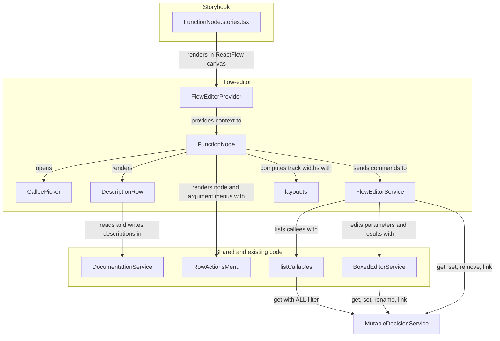
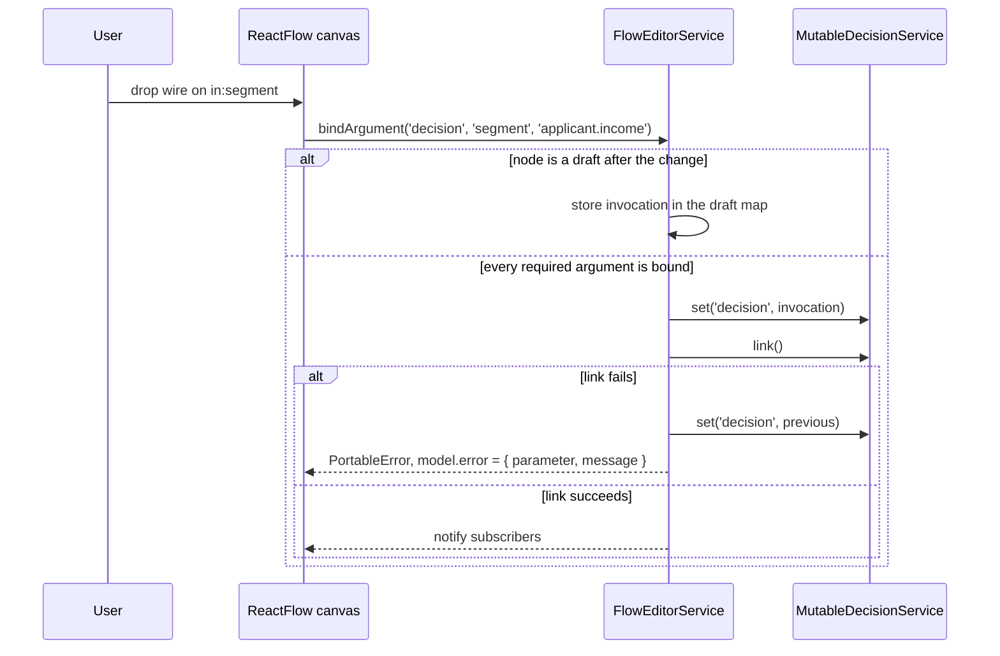

# Flow Editor: FunctionNode

## Summary

`FunctionNode` is the first node of the EdgeRules Flow Editor. It renders one model field annotated `@FunctionNode`
whose value is a Portable `invocation` of a user-defined `func` or `ruleset`.

The node shows structure only: the callee, one input pin per argument, one output pin per result field. Wires show
where argument values come from.

Output nodes show result values. The node renders alone in Storybook inside a `@xyflow/react` canvas.

The visual design is the approved proposal: [FunctionNode Design Proposal](<stories/FunctionNode Design Proposal.html>).
Open it in a browser.

The proposal is the reference for layout, colors, pins, menus and states. This story is the reference for behavior and
tasks.

## Technical Breakdown

### Files

| File                                                          | Responsibility                                                              |
|---------------------------------------------------------------|-----------------------------------------------------------------------------|
| `src/lib/callables.ts`                                        | `listCallables()`: every user callable in the model, moved from tests-manager |
| `src/lib/linkCheck.ts`                                        | `setWithLinkCheck()`: write, link, revert on failure; moved from boxed-editor |
| `src/ui/RowActionsMenu.tsx`                                   | Shared Mantine menu, moved from `boxed-editor/menu/RowActionsMenu.tsx`      |
| `src/components/flow-editor/index.ts`                         | Public exports of the `edgerules-react/flow-editor` subpath                 |
| `src/components/flow-editor/FlowEditorProvider.tsx`           | React context for the service, documentation service and host callbacks    |
| `src/components/flow-editor/flow-editor-types.ts`             | Public and internal types (see Component API)                              |
| `src/components/flow-editor/service/createFlowEditorService.ts` | Engine-backed reads, writes, drafts and link checks for flow nodes        |
| `src/components/flow-editor/function-node/FunctionNode.tsx`   | The `@xyflow/react` custom node component                                  |
| `src/components/flow-editor/function-node/layout.ts`          | Pure track-width computation in 40px steps                                 |
| `src/components/flow-editor/function-node/CalleePicker.tsx`   | Searchable callee list (Mantine `Combobox`)                                |
| `src/components/flow-editor/function-node/DescriptionRow.tsx` | Description display and inline edit                                        |
| `src/components/flow-editor/function-node/functionNode.module.css` | Node styles                                                           |
| `src/components/flow-editor/__tests__/`                       | Vitest + RTL tests against the real `@edgerules/node` engine               |
| `stories/components/flow-editor/FunctionNode.stories.tsx`     | Storybook stories against the real `@edgerules/web` engine                 |
| `e2e/flow-editor/function-node.spec.ts`                       | Playwright tests against the built Storybook                               |

### Structural Diagram

The `flow-editor` package and the existing code it depends on:



### Component API

The public API is the `edgerules-react/flow-editor` subpath. Keep it to these exports.

```typescript
// FlowEditorProvider props
interface FlowEditorProviderProps {
    service: FlowEditorService; // engine-backed node service from createFlowEditorService()
    documentation?: DocumentationService; // stores node descriptions; omit to hide description UI
    readOnly?: boolean; // disables every mutation; menus show only non-mutating items
    onOpenNode?: (target: FlowEditorOpenTarget) => void; // routes "Open in…", "Open tests", "View as code" to the host
    children: ReactNode; // the ReactFlow canvas
}

// Host routing target; reuses the Boxed Editor kinds and adds 'tests'
interface FlowEditorOpenTarget {
    path: string; // callee path ('risk') or node field path ('decision')
    kind: BoxedEditorTargetKind | 'tests'; // 'ruleset', 'boxed-editor', 'code-editor' or 'tests'
}

// ReactFlow node data; the node id is the field path
interface FunctionNodeData {
    field: string; // model field path of the invocation, for example 'decision'
}

// Factory
declare function createFlowEditorService(mutable: MutableDecisionService): FlowEditorService;

interface FlowEditorService {
    listCallees(): CalleeRef[]; // user func and ruleset entries with only typed parameters
    getFunctionNode(field: string): FunctionNodeModel; // committed invocation plus any draft overlay
    createDraftNode(): string; // new field name from uniqueName('node', …); no callee, nothing written
    setCallee(field: string, method: string): PortableError | void; // keeps bindings with same name and type
    bindArgument(field: string, parameter: string, sourcePath: string): PortableError | void; // link-checked
    unbindArgument(field: string, parameter: string): void; // turns the node into a draft
    setNodeName(field: string, name: string): PortableError | void; // '@node-name' only
    renameField(field: string, newName: string): PortableError | void; // rewrites wires, moves description
    duplicate(field: string): string | PortableError; // returns the new field name
    removeFromFlow(field: string): PortableError | void; // remove(`${field}.@FunctionNode`)
    deleteField(field: string): PortableError | void; // remove(field), link-checked
    addArgument(field: string, after?: string): PortableError | void; // after = undefined appends
    moveArgument(field: string, parameter: string, direction: 'up' | 'down'): PortableError | void;
    removeArgument(field: string, parameter: string): PortableError | void; // refused when the body uses it
    renameResult(field: string, from: string, to: string): PortableError | void; // link-checked, reverted on failure
    subscribe(listener: () => void): Unsubscribe; // fires after every committed change
}

interface CalleeRef {
    path: string; // dotted callee path, for example 'risk' or 'group.nested'
    kind: 'function' | 'ruleset';
    parameters: SignatureParameter[]; // from get(path, 'FIELDS')
    returnLabel: string; // 'number' or '{ level, limit }'
}

interface FunctionNodeModel {
    field: string; // model field path
    label?: string; // '@node-name'
    callee?: CalleeRef; // undefined while no callee is picked
    arguments: NodeArgument[]; // one per callee parameter, in signature order
    results: NodeResult[]; // record fields, or one unnamed 'result'
    draft: boolean; // true while a required argument is unbound; the draft is not in the model
    callers: number; // invocations of the callee in the whole model
    error?: { parameter: string; message: string }; // last rejected bindArgument
}

interface NodeArgument {
    name: string;
    type: string; // 'number', 'string', 'Applicant', 'number[]'
    binding?: { kind: 'path' | 'value'; text: string }; // 'path' draws a wire; 'value' is a literal or expression
    used: boolean; // the callee body references it; Delete argument is disabled
}

interface NodeResult {
    name: string; // field name, or 'result' for an unnamed return
    type: string;
    renamable: boolean; // false for the unnamed return of a func
}
```

### Node anatomy

The proposal shows every part. The table maps each part to its data and behavior.

| Part              | Source                                    | Behavior                                                              |
|-------------------|-------------------------------------------|-----------------------------------------------------------------------|
| Kind tile         | `callee.kind`                             | Boxed Editor color and icon: `func` `#1976d2`, `ruleset` `#6a1b9a`    |
| Header line 1     | `label`, `field`, `draft`                 | Bold label, mono field name, "draft" badge, node menu ⋮               |
| Header line 2     | `callee.path`, `callee.returnLabel`       | Callee chip opens `CalleePicker`; whole-result pin `out:*` at the right edge |
| Description row   | `DocumentationService` at `field`         | Full width, yellow tint, two-line clamp, click to edit                |
| Argument band     | `arguments.length`                        | Reads ARGUMENT or ARGUMENTS; hidden with zero parameters              |
| Result band       | `results.length`                          | Reads RESULT or RESULTS                                               |
| Argument row      | `NodeArgument`                            | Name and required mark only; ⋮ on hover or focus; pin `in:<name>`     |
| Result row        | `NodeResult`                              | Right-aligned name; click to rename; pin `out:<name>`                 |

The node MUST NOT show argument bindings or result values. The pin tooltip shows the binding text.

### Pins

| Pin            | Condition                                         | Style                               |
|----------------|---------------------------------------------------|-------------------------------------|
| Filled circle  | Scalar, `binding.kind === 'path'`                 | Fill and ring in the type color     |
| Dotted ring    | `binding.kind === 'value'`                        | No wire                             |
| Square         | Record type, and the `out:*` pin                  | Radius 2px                          |
| Double ring    | List type (`number[]`)                            | Ring in the element type color      |
| Red ring       | No binding, or `error.parameter` matches          | `--mantine-color-error`             |

Type colors: number blue, string green, boolean orange, date and time teal, record grey. Define them as CSS custom
properties in `functionNode.module.css` with light and dark values from the Mantine palette.

- **Handle ids:** `in:<parameter>`, `out:<result>` and `out:*`.
- **Node id:** the field path.
- **Source path:** `<nodeId>.<result>`, or `<nodeId>` for `out:*`.

### Sizing

`layout.ts` exports a pure function. Text measurement is injected, so tests run without a canvas.

```typescript
interface FunctionNodeLayoutInput {
    titleWidth: number; // measured width of label plus field name plus badge
    calleeLineWidth: number; // measured width of the CALLS label, chip and return type
    argumentNameWidths: number[]; // measured widths of argument names
    resultNameWidths: number[]; // measured widths of result names
}

interface FunctionNodeLayout {
    argumentTrack: number; // px, 0 when there are no arguments
    resultTrack: number; // px
    width: number; // px, argumentTrack + resultTrack
}

declare function computeFunctionNodeLayout(input: FunctionNodeLayoutInput): FunctionNodeLayout;
```

- Each track is its widest name plus padding, rounded up to whole 40px steps, from 2 to 4 steps.
- The header width wins over the body. The extra steps go half to each track, the larger half to the result track.
- The description row never changes the width.
- Names longer than the track are cut with an ellipsis. The full name is in a tooltip.

### Menus

The node menu and the argument menu use `RowActionsMenu`. Disabled items show the reason in a tooltip.

| Menu     | Group          | Item                          | Service call                                        |
|----------|----------------|-------------------------------|-----------------------------------------------------|
| Node     | This node      | Rename node                   | `setNodeName`                                       |
| Node     | This node      | Rename field                  | `renameField`                                       |
| Node     | This node      | Change callee…                | opens `CalleePicker`, then `setCallee`              |
| Node     | This node      | Duplicate                     | `duplicate`                                         |
| Node     | This node      | Add description               | shows the description row in edit mode; no description exists |
| Node     | This node      | Remove description            | `documentation.setDescription(field, '')`; a description exists |
| Node     | Callee · N callers | Add argument              | `addArgument(field)`                                |
| Node     | Callee · N callers | Open in decision table editor | `onOpenNode({ path, kind: 'ruleset' })`; reads "Open in boxed editor" with `kind: 'boxed-editor'` for a `func` |
| Node     | Callee · N callers | Open tests                | `onOpenNode({ path, kind: 'tests' })`               |
| Node     | Callee · N callers | View as code              | `onOpenNode({ path: field, kind: 'code-editor' })`  |
| Node     | Remove         | Remove from flow              | `removeFromFlow`                                    |
| Node     | Remove         | Delete (red)                  | `deleteField`                                       |
| Argument | -              | Move up                       | `moveArgument(field, name, 'up')`; disabled on the first row |
| Argument | -              | Move down                     | `moveArgument(field, name, 'down')`; disabled on the last row |
| Argument | -              | Add argument below            | `addArgument(field, name)`                          |
| Argument | -              | Delete argument (red)         | `removeArgument`; disabled when `used`              |

The argument menu footer reads "Changes `<callee>` for N callers". Results have no menu.

### Inline edits

| Edit               | Trigger          | Commit                        | Cancel  | Rule                                                  |
|--------------------|------------------|-------------------------------|---------|-------------------------------------------------------|
| Rename result      | Click result name | Enter or click away          | Escape  | Identifier pattern, unique among results; not for an unnamed return |
| Edit description   | Click description | Enter or click away          | Escape  | Single-line input; an empty text deletes the description |
| New argument name  | Add argument     | Enter or click away           | Escape  | Same rules as the Boxed Editor argument header        |

### Behavioral Diagram



### Draft nodes

- A node with an unbound required argument is a draft. The service keeps its invocation in memory only.
- `getFunctionNode` returns the draft overlay over the committed field. A new node is a draft with no callee.
- The service writes the invocation when the last required argument is bound. `@node: 'FunctionNode'` is part of
  that write.

### Reuse

| Need                                       | Existing code                                                                 |
|--------------------------------------------|-------------------------------------------------------------------------------|
| List user callables                        | `listTestSubjects` walk in `tests-manager/model/subjects.ts`                  |
| Add, move, remove a parameter with call-site migration | `addArgument`, `moveArgument`, `removeArgument` in `boxed-editor/commands/rowFactories.ts` + `BoxedEditorService.setBoxedRowData` |
| Ruleset parameter (condition column)       | `addConditionColumn`, `moveConditionColumn`, `removeConditionColumn`          |
| Rename a ruleset result (action column)    | `renameActionColumn`                                                          |
| Rename a `func` result field               | `BoxedEditorService.rename(`${callee}.${from}`, to)`                          |
| Write with link check and revert           | `setWithLinkCheck` in `boxed-editor/service/createBoxedEditorService.ts`      |
| Menu                                       | `RowActionsMenu` in `boxed-editor/menu/RowActionsMenu.tsx`                    |
| Unique names                               | `uniqueName` in `boxed-editor/commands/rowFactories.ts`                       |
| Descriptions                               | `DocumentationService`, `useDescription`                                      |

## Architecture Changes

- `FlowEditor` changes from "Not present" to a package with `FunctionNode` in `docs/ARCHITECTURE.md`.
- New ADR in `docs/architecture-adr.md`: a `FunctionNode` with an unbound required argument stays an editor draft.
  Context: the engine rejects the whole model with `E113` for one missing argument.

## Clarifications

- Engine facts verified on `@edgerules/node` `0.0.6-alpha.202607291629`:
    - `get(path)` on a mutable service returns the full definition. Pass `'FIELDS'` to get a `function-schema` or
      `ruleset-schema`.
    - `get(field, 'FIELDS')` on a record-returning invocation returns `"@type": "object"`. Result fields come from the
      callee schema `@return`.
    - `set` accepts a mistyped or incomplete invocation without an error. Only linking detects it.
    - One unbound required argument raises `E113` at link time, and no field of the model evaluates.
    - A mistyped argument raises `type mismatch in node NodeId(n): expected string, found number`. The message has no
      argument name, so the service assigns it to the parameter of the current `bindArgument` call.
    - `rename()` on a plain field does not migrate references. Dangling references raise `E103` at link time.
    - `remove('decision.@FunctionNode')` removes the annotation and keeps the field.
    - `DocumentationService.setDescription(path, '')` deletes the entry.
- Built-in functions are not callees. The callee list has user `func` and `ruleset` entries only.
- The unnamed return of a `func` (`func monthly(amount: number): amount / 12`) shows one result named `result`. It is
  not renamable, because naming it changes the return type for every caller.
- A new parameter is `number` for a `func` and `string` for a `ruleset`. `listCallables` drops callables with untyped
  parameters, so a new parameter always has a type.
- The Delete key on a selected node calls `removeFromFlow`, not `deleteField`.
- `callers` counts every `invocation` with the same `@method` in `toPortable()`.
- Tests use `@edgerules/node`. Stories use `@edgerules/web` with `await init()` in `loaders`. Neither mocks the engine.

## Out of Scope

- The Flow Editor canvas component, node positions and their persistence (`FlowMetadataStore`).
- OutputNode and the other node kinds. Stories use story-local stub nodes for output values.
- `optimise` and `loop` callees.
- Editing argument values without a wire. View as code covers it.

## Open Questions

1. Which version of `@xyflow/react` to pin? The latest 12.x is the default unless the architect states otherwise.

## Verification

| Check      | Command                    |
|------------|----------------------------|
| Build      | `npm run build`            |
| Typecheck  | `npm run typecheck`        |
| Format     | `npm run format:check`     |
| Test       | `npm test`                 |
| E2E        | `npm run e2e`              |
| Start      | `npm run storybook`        |

## Tasks

**Phase 1: Package setup and shared code**

- [x] Ensure the project compiles and existing tests pass
- [x] Add `@xyflow/react` as an optional peer dependency and a dev dependency
- [x] Add the `flow-editor` subpath to `package.json` `exports` and to the `tsdown.config.ts` `entry`
- [x] Move `RowActionsMenu` to `src/ui/RowActionsMenu.tsx`; update Boxed Editor imports
- [x] Move the callable walk to `src/lib/callables.ts` as `listCallables()`; `listTestSubjects` calls it
- [x] Move `setWithLinkCheck` to `src/lib/linkCheck.ts`; Boxed Editor imports it
- [x] Add tests for the code of this phase

Acceptance criteria:

- [x] `npm test` passes, including `callables.test.ts` and the existing tests-manager and boxed-editor suites
- [x] `npm run build` emits `dist/components/flow-editor/index.js`

**Phase 2: Service and layout**

- [x] Write `flow-editor-types.ts` with the Component API types
- [x] Write `createFlowEditorService`: `listCallees`, `getFunctionNode`, `createDraftNode`, `setCallee`, `bindArgument`,
  `unbindArgument`, draft map, `subscribe`
- [x] Write `computeFunctionNodeLayout` in `layout.ts`
- [x] Add tests for the code of this phase, against `MutableDecisionService.fromCode` from `@edgerules/node/mutable`,
  with the sample model from the proposal

Acceptance criteria:

- [x] `createFlowEditorService.test.ts` passes with these cases:
    - [x] The service does not write a draft.
    - [x] The last required binding writes the invocation with `@node`.
    - [x] A mistyped binding is reverted and sets `error.parameter`.
    - [x] `setCallee` keeps bindings with the same name and type.
- [x] `layout.test.ts` passes: step rounding, 2 to 4 step limits, header-wins distribution, no argument track for zero
  parameters

**Phase 3: FunctionNode rendering**

- [x] Write `FlowEditorProvider` and `FunctionNode` with header, bands, rows, pins and handles from the proposal
- [x] Write `functionNode.module.css` with Mantine variables, type color tokens, light and dark values
- [x] Write `CalleePicker` with search and Functions / Rulesets groups
- [x] Add the Storybook stories:
    - [x] Default (`risk`), Unnamed return (`monthly`), Record argument (`applicantDecision`)
    - [x] Draft, No callee
    - [x] Wired: story-local stub source and output nodes. The output value comes from `execute`.
- [x] Add tests for the code of this phase (RTL inside `ReactFlowProvider`)

Acceptance criteria:

- [x] `FunctionNode.test.tsx` passes with these cases:
    - [x] Band labels are singular or plural.
    - [x] No binding text and no value text renders.
    - [x] The draft badge shows for an unbound argument.
    - [x] The picker lists only user callables.
- [ ] Manual: `npm run storybook`, each FunctionNode story matches the proposal in light and dark themes

**Phase 4: Menus and inline edits**

- [x] Write the node menu and the argument menu from the Menus table
- [x] Write `addArgument`, `moveArgument`, `removeArgument`, `renameResult`, `setNodeName`, `renameField`,
  `duplicate`, `removeFromFlow`, `deleteField` in the service, with the Reuse table helpers
- [x] Write inline result rename and `DescriptionRow` with Add description and Remove description
- [x] Add stories with `play` functions: Node menu, Argument menu, Rename result, Edit description
- [x] Add tests for the code of this phase

Acceptance criteria:

- [x] `FunctionNodeMenus.test.tsx` passes with these cases:
    - [x] Delete argument is disabled for a used parameter.
    - [x] Move up is disabled on the first row.
    - [x] Add argument below inserts after the row.
    - [x] The unnamed `result` has no rename input.
- [x] `createFlowEditorService.test.ts` passes with these cases:
    - [x] `renameResult` rewrites the wires of every caller.
    - [x] `renameResult` reverts on a failed link.
    - [x] `removeFromFlow` keeps the field.
    - [x] Parameter edits migrate every call site.
- [x] `DescriptionRow.test.tsx` passes: an empty commit deletes the description; Escape restores the old text

**Phase E2E**

- [x] Add E2E tests for the user flows of this story in `e2e/flow-editor/function-node.spec.ts`

Acceptance criteria:

- [x] `npm run e2e` passes, including pick a callee, wire an argument, rename a result, add and remove a description

**Phase X**

- [x] Update `docs/ARCHITECTURE.md` and `docs/architecture-adr.md` with `## Architecture Changes`
- [x] Update `README.md`: check the FunctionNode box and link this story
- [ ] Review the implementation against this story, the proposal and the project conventions

Acceptance criteria:

- [ ] Every command in `## Verification` passes
- [ ] Storybook starts with `npm run storybook` and shows the FunctionNode stories

# Flow Editor: InputNode

## Summary

`InputNode` is the source node of the Flow Editor. It renders one model field annotated `@InputNode` whose value is a
record (`@kind: 'context'`). The node shows structure only: the field name and one output pin per field of the record.
Wires from these pins feed the argument pins of a `FunctionNode`. Output nodes, not the InputNode, show values.

The proposal does not draw the InputNode. It is built from the FunctionNode parts: same 40px sheet, same header, band,
pins, menu and inline edits. The tile uses the input color `#ed6c02`.

## Technical Breakdown

| File                                                                | Responsibility                                          |
|---------------------------------------------------------------------|---------------------------------------------------------|
| `src/components/flow-editor/input-node/InputNode.tsx`               | The `@xyflow/react` custom node component               |
| `src/components/flow-editor/function-node/nodeMenus.tsx`            | `inputNodeMenuItems`, next to the FunctionNode menus    |
| `src/components/flow-editor/service/createFlowEditorService.ts`     | InputNode reads and writes                              |
| `src/components/flow-editor/__tests__/InputNode.test.tsx`           | RTL tests against the real `@edgerules/node` engine     |
| `stories/components/flow-editor/InputNode.stories.tsx`              | Storybook stories against the real `@edgerules/web` engine |

### Component API

```typescript
interface InputNodeData {
    field: string; // model field path of the input record, for example 'applicant'
}

interface InputField {
    name: string;
    type: string; // 'number', 'string[]', 'object' for a nested record
    used: boolean; // an expression elsewhere in the model reads `<field>.<name>`; Delete field is disabled
}

interface InputNodeModel {
    field: string;
    label?: string; // '@node-name'
    fields: InputField[]; // one output pin per field of the record
}

// Added to FlowEditorService
getInputNode(field: string): InputNodeModel; // no fields when the record is not an InputNode
listInputCandidates(): string[]; // record fields that are not yet an InputNode
addInputNode(field: string): PortableError | void; // writes '@node: InputNode', link-checked
addInputField(field: string, after?: string): PortableError | void; // appends a number field; after = undefined appends
moveInputField(field: string, name: string, direction: 'up' | 'down'): PortableError | void;
removeInputField(field: string, name: string): PortableError | void; // link-checked, reverted when something reads it
renameInputField(field: string, from: string, to: string): PortableError | void; // rewrites `<field>.<from>` only, link-checked
```

`setNodeName`, `renameField`, `duplicate`, `removeFromFlow` and `deleteField` act on an InputNode when `field` is one.

### Node anatomy

| Part            | Source              | Behavior                                                                   |
|-----------------|---------------------|----------------------------------------------------------------------------|
| Kind tile       | -                   | Orange, input icon                                                         |
| Header line 1   | `label`, `field`    | Bold label, mono field name, node menu ⋮                                   |
| Header line 2   | `fields`            | INPUT label, `{ age, income }` summary, whole-record pin `out:*`           |
| Description row | `DocumentationService` | Same as the FunctionNode                                                |
| Field band      | `fields.length`     | Reads FIELD or FIELDS                                                      |
| Field row       | `InputField`        | Right-aligned name; click to rename; field menu ⋮ on the left; pin `out:<name>`; no values |

- **Handle ids:** `out:<field>` and `out:*`. There are no input handles.
- **Source path:** `<nodeId>.<field>`, or `<nodeId>` for `out:*`.
- **Pins:** same type colors and shapes as the FunctionNode output pins.

### Menu

| Group  | Item                                      | Service call                                    |
|--------|-------------------------------------------|-------------------------------------------------|
| This node | Rename node                            | `setNodeName`                                   |
| This node | Rename field                           | `renameField`                                   |
| This node | Duplicate                              | `duplicate`                                     |
| This node | Add description, Remove description    | `documentation.setDescription`                  |
| Record | Add field                                 | `addInputField(field)`, then the name opens for editing |
| Record | Open in boxed editor                      | `onOpenNode({ path: field, kind: 'boxed-editor' })` |
| Record | View as code                              | `onOpenNode({ path: field, kind: 'code-editor' })` |
| Remove | Remove from flow                          | `removeFromFlow`                                |
| Remove | Delete (red)                              | `deleteField`                                   |

### Clarifications

- Engine facts verified on `@edgerules/node` `0.0.6-alpha.202607291629`:
    - `set` on a record that already has annotations keeps them when the new node has none. `removeFromFlow` therefore
      calls `remove('<field>.@InputNode')`, which removes `@node` and `@node-name`.
    - A plain value such as `amount: 5` takes no annotation, and `set` rejects `@kind: 'value'`. An InputNode is a
      record only.
    - `get(field, 'FIELDS')` on a record returns the typed fields with `readOnly: true`.
- The field menu is the FunctionNode argument menu for a record field: Move up, Move down, Add field below,
  Delete field (disabled with the reason when `used`). The footer reads "Changes `<field>`". The dots are always
  visible, on the left of the row, with no box.
- A new field is a `number` with value `0`. Each edit rewrites the whole record in one link-checked write that keeps
  `@node` and `@node-name`; the engine keeps the key order, so Move up and Move down reorder the rows.
- `renameInputField` rewrites `<field>.<from>` in every expression and renames the key. It does **not** use the Boxed
  Editor `rename`: that rewrites every identifier named `from` in the whole model, so renaming `applicant.age` also
  renamed the `age` parameter of `risk` and every call-site argument. The write goes through the changed top-level
  entries and `link()`, not `set('*')`, which drops the root metadata. A bare sibling reference such as `b: a + 1`
  inside the record is not rewritten; linking fails and the rename is reverted with the engine message.
- Pin positions: xyflow measures the handles of a node only on mount and resize. Reordering, adding or renaming
  rows keeps the node size, so the wires stayed at the old pin positions (age appeared wired to income). Both node
  components call `useSyncPins(id, key)` (`updateNodeInternals`) when the ordered handle ids or the width change.
- Dragging a wire from an InputNode is out of this story. Wires are written by the target FunctionNode (`bindArgument`).

## Tasks

- [x] Add `InputNodeData`, `InputField`, `InputNodeModel` and the four service methods
- [x] Write `InputNode` and `inputNodeMenuItems`; export `InputNode` from `edgerules-react/flow-editor`
- [x] Add tests: `InputNode.test.tsx` and the `InputNode service` block in `createFlowEditorService.test.ts`
- [x] Add the Storybook stories: Default, SingleField, Wired, NodeMenu, RenameField
- [x] Update `README.md` and `docs/ARCHITECTURE.md`
- [ ] Manual: `npm run storybook`, the InputNode stories in light and dark themes
- [x] Field menu: Move up, Move down, Add field below, Delete field; Add field in the node menu
- [x] Fix: wires follow their pins after Move up, Move down, add, delete and rename (`useSyncPins`, both nodes)
- [x] Fix: field rename is path-based
- [x] E2E tests for the InputNode in `e2e/flow-editor/input-node.spec.ts`
