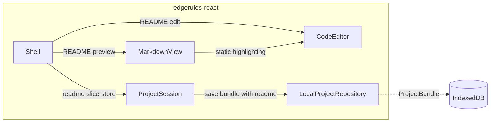

# Model README

## Summary

`README.md` is a standard slice of every EdgeRules project. It is the long description of the project, in GitHub
Flavored Markdown.

The Shell shows the README in a `readme` view at the project root. The view has a preview with the new `MarkdownView`
component, and an edit mode with `CodeEditor`.

Related stories:

- [examples-repository-story.md](examples-repository-story.md) stores a `README.md` in each example. It needs Phase 1 of
  this story.
- [examples-library-story.md](examples-library-story.md) shows the README of an example with `MarkdownView`.

## Technical Breakdown

### README is a project slice

`README.md` is at the project root, next to `edgerules.project.json`, and the manifest has no field for it.
`docs/descriptions.json` keeps the short description of each model path; the README is the long description.

| Project source                  | README content                                               |
| ------------------------------- | ------------------------------------------------------------ |
| Example of `edgerules-examples` | Authored `README.md` of the example                          |
| New project (`ProjectFactory`)  | Generated: `# <name>` and the `description`                  |
| Project of format version 2     | The migration to format 3 generates it, as for a new project |

- `PROJECT_FORMAT_VERSION` becomes 3. The migration from format 2 is pure, as the other migrations of
  `parseProjectBundle`.
- `ProjectSession` has a `readme` slice store. A save writes the README with the other slices in one revision.
- `LocalProjectRepository` stores the README in the bundle record. `exportBundle` returns it.
- A README MAY use GitHub Flavored Markdown: tables, task lists, fenced code, relative images. It MUST NOT contain raw
  HTML: `MarkdownView` drops it.

### README view in the Shell

The Shell gets a fourth view, `readme`, at the project root. The README of a project that is not read-only is editable.

| Mode    | Component                                | Behavior                                        |
| ------- | ---------------------------------------- | ----------------------------------------------- |
| Preview | `MarkdownView`                           | Default mode; `model:` links navigate the Shell |
| Edit    | `CodeEditor` with `language: 'markdown'` | Markdown highlighting; no engine service        |

- An edit writes the `readme` slice store of the session. A save writes it with the other slices in one revision.
- `CodeEditor` gets the `language` prop: `'edgerules'` (the default) or `'markdown'`. With `'markdown'` the `service`
  prop is not used, and the editor has no diagnostics, completion or formatting.
- `@codemirror/lang-markdown` becomes an optional peer dependency.

### Markdown viewer

`MarkdownView` renders a README in the Shell, and in other components such as the Examples Library. It uses
`react-markdown` with `remark-gfm`, as optional peer dependencies.

| Concern        | Rule                                                                                                  |
| -------------- | ----------------------------------------------------------------------------------------------------- |
| Safety         | Raw HTML is dropped. URL schemes other than `https`, `mailto`, `model` and relative paths are removed |
| Relative URLs  | `resolveUrl(relative)` rewrites relative images and links, for example to a commit-pinned file URL    |
| Model links    | `[monthlyPayment](model:monthlyPayment)` calls `onModelLink(path)`; the Shell opens that path         |
| Code blocks    | `edgerules` fences use the static highlighter of `code-editor/language/highlight.ts`                  |
| External links | Open in a new tab with `rel="noopener noreferrer"`                                                    |
| Theme          | Mantine typography; light and dark                                                                    |

### Structural Diagram

The README components and their dependencies:



### TypeScript API

`project-session` changes:

```typescript
interface ProjectBundle {
  // ...existing members
  readme: string; // Markdown of README.md
}

interface ProjectBundleInput {
  // ...existing members
  readme?: string; // defaults to a README generated from `name` and `description`
}
```

`markdown-view` component, subpath export `edgerules-react/markdown-view`:

```typescript
interface MarkdownViewProps {
  markdown: string; // GitHub Flavored Markdown
  resolveUrl?: (relative: string) => string; // rewrites relative image and link URLs
  onModelLink?: (path: string) => void; // called for model: links; without it they render as text
}
```

`code-editor` change:

```typescript
interface CodeEditorProps {
  // ...existing members
  language?: 'edgerules' | 'markdown'; // default 'edgerules'; 'markdown' does not use `service`
}
```

## Architecture Changes

- `project-session`: `README.md` is a project slice (`ProjectBundle.readme`). `PROJECT_FORMAT_VERSION` becomes 3; the
  migration from 2 generates the README.
- New component `markdown-view`: public API `MarkdownView`. Optional peers `react-markdown` and `remark-gfm`. It has no
  component dependency; it MAY import `code-editor/language/` files.
- `code-editor`: `language` prop. Optional peer `@codemirror/lang-markdown`.
- `shell`: `readme` view at the project root. Its allowlist gets `markdown-view`.

## Out of Scope

- Mermaid diagrams inside a README.
- A side-by-side editor with a live preview.

## Future Improvements

- Per-entity Markdown documents (`docs/nodes/*.md`) after stable entity ids exist (`global-project-management.md` §6).

## Verification

| Check     | Command                |
| --------- | ---------------------- |
| Build     | `npm run build`        |
| Typecheck | `npm run typecheck`    |
| Lint      | `npm run lint`         |
| Test      | `npm test`             |
| Rules     | `npm run depcruise`    |
| Format    | `npm run format:check` |
| E2E       | `npm run e2e`          |
| Start     | `npm run storybook`    |

## Tasks

**Phase 1: README slice in `project-session`**

- [ ] Ensure project compiles and existing tests are passing
- [ ] Add `ProjectBundle.readme` and `ProjectBundleInput.readme`
- [ ] Generate the README in `ProjectFactory.createBundle` when the input has none
- [ ] Add the format 2 to 3 migration to `parseProjectBundle`
- [ ] Add the `readme` slice store to `ProjectSession`, and store the README in `LocalProjectRepository`
- [ ] Add the README to `exportBundle`
- [ ] Add tests for the code of this phase

Acceptance criteria:

- [ ] `npm test` passes, including a migration test: a format 2 bundle opens with a generated README
- [ ] `npm test` passes, including a session test: a README edit and a model edit save as one revision
- [ ] `npm test` passes, including a factory test: a new project without a README gets `# <name>` and its description

**Phase 2: Markdown viewer and Shell README view**

- [ ] Add `markdown-view` with `react-markdown` and `remark-gfm` as optional peers
- [ ] Implement URL rewrite, scheme filter, `model:` links and `edgerules` code highlighting
- [ ] Add the `language` prop to `CodeEditor` with `@codemirror/lang-markdown`
- [ ] Add the `readme` view to the Shell: preview with `MarkdownView`, edit with `CodeEditor`
- [ ] Add Storybook stories for `MarkdownView` and the Shell README view
- [ ] Add tests for the code of this phase

Acceptance criteria:

- [ ] `npm test` passes, including `MarkdownView.test.tsx`: raw HTML and `javascript:` links do not render
- [ ] `npm test` passes, including a Shell test: a README edit marks the project dirty, and save keeps it
- [ ] `npm test` passes, including a Shell test: a `model:` link in the README opens that model path
- [ ] `npm run depcruise` passes with the new component

**Phase E2E:**

- [ ] Add E2E tests for the user flows of this story

Acceptance criteria:

- [ ] `npm run e2e` passes, including `model-readme.spec.ts`: README edit, save, reload, README kept

**Phase X:**

- [ ] Update `docs/architecture.md` with the changes from `## Architecture Changes`
- [ ] Update `README.md` with `MarkdownView` and the Shell README view
- [ ] Review the implementation against this story and the project conventions

Acceptance criteria:

- [ ] Every command in `## Verification` passes
- [ ] Storybook starts with `npm run storybook` and shows the `MarkdownView` and Shell README stories
